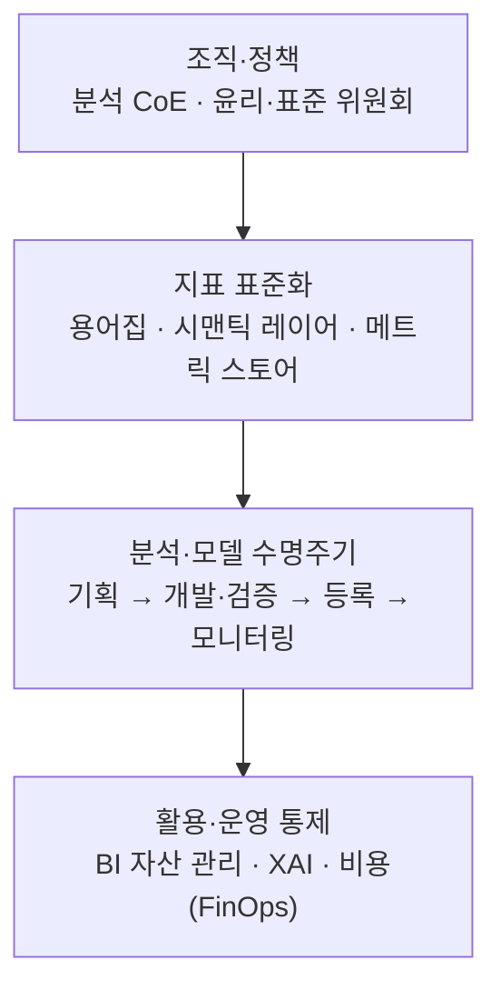

# 데이터 분석 거버넌스 (Data Analytics Governance)

---

## I. 분석 결과를 믿을 수 있게, 데이터 분석 거버넌스의 개요

### 가. 정의

- 분석 과제 기획부터 **지표 정의, 모델 개발·배포, 리포트 활용까지 분석 활동 전반의 조직·프로세스·표준·도구를 정해 관리하는 체계**

### 나. 필요성 및 특징

| 구분 | 내용 |
| --- | --- |
| 지표 일관성 | 부서마다 다른 KPI 계산식을 하나로 통일 |
| 모델 위험 관리 | 편향·드리프트·설명 불가 모델로 인한 잘못된 의사결정 방지 |
| 규제 대응 | EU AI Act 등 AI 규제, [[AI 윤리]] 기준 준수 |
| 범위 | [[데이터 거버넌스]]가 원천 데이터를 다룬다면 분석 거버넌스는 지표·모델·리포트 대상 |

---

## II. 관리 체계 및 구성요소

### 가. 분석 거버넌스 체계

- 조직이 정한 정책 아래 지표를 표준화하고, 모델 수명주기를 [[MLOps]]로 통제하며, 리포트·비용까지 관리

### 나. 구성요소

| 구분 | 요소 | 설명 |
| --- | --- | --- |
| 조직 | 분석 CoE | 과제 우선순위, 방법론 표준, 모델 배포 승인 |
| | 분석 담당 역할 | CAO, 데이터 과학자, BI 관리자, 시민 데이터 과학자 |
| 지표 | 시맨틱 레이어·메트릭 스토어 | KPI 계산 로직을 코드로 한 곳에서 정의, BI 도구 간 결과 일치 |
| 모델 | 모델 레지스트리 | 버전, 파라미터, 학습 데이터, 계보 관리 |
| | 모델 모니터링 | 데이터·개념 드리프트, 성능 저하 감지 |
| 신뢰 | [[XAI]] | SHAP·[[LIME]]로 예측 근거 설명, 편향 점검 |
| 자산 | BI 자산 관리 | 미사용 대시보드 정리, 중복 리포트 방지, 접근 통제 |
| 비용 | 분석 FinOps | 쿼리·GPU 비용 감시, 부서별 비용 배분 |

---

## III. 비교 및 동향

### 가. 데이터 거버넌스 vs 데이터 분석 거버넌스

| 비교 항목 | [[데이터 거버넌스\|데이터 거버넌스]] | 데이터 분석 거버넌스 |
| --- | --- | --- |
| 관리 대상 | 원천 데이터, 스키마, 메타데이터, 마스터 데이터 | 지표, 분석 모델, 대시보드 |
| 초점 | 데이터 품질·보안·가용성 | 인사이트 정확성·의사결정 영향 |
| 표준화 | 명명 규칙, 코드, 카탈로그 | 지표 계산 로직, 시맨틱 계층, 특성 정의 |
| 위험 | 유출, 품질 오류 | 잘못된 판단, 모델 [[편향]]·환각 |
| 도구 | 데이터 카탈로그, 계보, MDM | 모델 레지스트리, 시맨틱 레이어, BI 감사 |
| 책임자 | CDO, 데이터 오너·스튜어드 | CAO, 분석 CoE |

### 나. 동향

- **AI 에이전트 거버넌스**: LLM 에이전트의 자동 질의·분석에 권한 제어, 가드레일, 결과 검증 적용
- **연합형 분석**: 도메인에 분석 권한을 위임하고 정책을 코드로 자동 검증 (Policy-as-Code)
- **AI 관리체계 표준**: ISO/IEC 42001(AI 경영시스템) 인증으로 분석·AI 거버넌스 체계화

---

### 🔗 연관 토픽

- **소속 도메인**: [[00_데이터베이스_MOC|🗄️ 데이터베이스]]
- **세부 분류**: `6. SQL 표준 문법 & 쿼리 성능 튜닝`
- **핵심 연관 토픽**:
  - [[데이터 거버넌스|데이터 거버넌스 (Data Governance)]]
  - [[데이터 거버넌스 데이터 품질]]
  - [[MLOps]]
  - [[XAI]]
  - [[분석 모델 평가 방법]]
