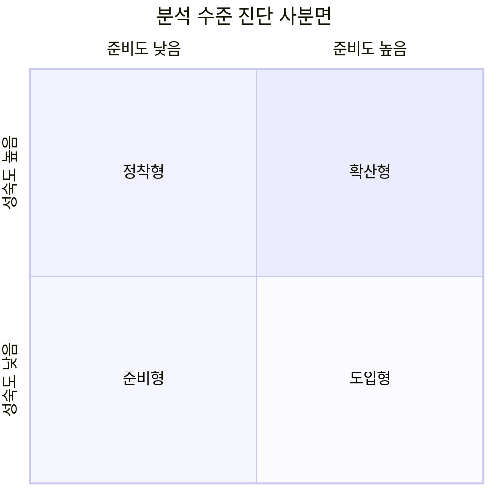

# 데이터 분석 준비도와 성숙도

---

## I. 조직의 분석 수준을 두 축으로 진단, 데이터 분석 준비도와 성숙도의 개요

### 가. 정의

- 조직의 데이터 분석 수준을 **준비도(Readiness, 분석 도입을 위한 환경·역량)** 와 **성숙도(Maturity, 분석 활용의 발전 단계)** 두 축으로 진단해 현재 위치와 개선 방향을 정하는 프레임워크 (한국데이터산업진흥원 데이터 분석 전문가 가이드)

### 나. 필요성 및 특징

| 구분 | 내용 |
| --- | --- |
| 필요성 | 도구 도입 위주 투자를 피하고 조직 수준에 맞는 단계적 분석 로드맵 수립 |
| 2축 진단 | 준비도(6개 영역) × 성숙도(4단계) → 4개 유형으로 포지셔닝 |
| CMMI 기반 | 성숙도는 [[CMMI]] 단계 모델을 분석 역량에 적용 |
| 균형 점검 | 인프라·데이터·인력·문화 중 병목 영역 식별 |

---

## II. 진단 체계 및 구성요소

### 가. 진단 사분면

- 준비도는 낮지만 성숙도가 높으면 정착형(일부 부서 중심 활용), 준비도는 높지만 성숙도가 낮으면 도입형(환경은 갖췄으나 활용 미흡)

### 나. 구성요소

| 구분 | 요소 | 설명 |
| --- | --- | --- |
| 준비도 6개 영역 | 분석 업무 파악 | 발생 사실·예측·시뮬레이션·최적화 분석 업무 현황 |
| | 인력 및 조직 | 분석 전문가·전담 조직, 경영진 분석 이해도 |
| | 분석 기법 | 업무별 적합한 기법 사용, 기법 라이브러리 |
| | 분석 데이터 | 데이터 충분성·신뢰성·적시성, 기준 데이터 관리 |
| | 분석 문화 | 사실 기반 의사결정, 데이터 공유·협업 |
| | IT 인프라 | 운영 시스템 통합, DW·분석 플랫폼 |
| 성숙도 4단계 | 도입 | 분석 시작, 환경·시스템 구축 (DW, 데이터 마트, 리포팅) |
| | 활용 | 분석 결과를 실제 업무에 적용 (예측 모델, 대시보드) |
| | 확산 | 전사 차원에서 분석 관리·공유 (분석 전담 조직, 실시간 분석) |
| | 최적화 | 분석을 진화시켜 혁신·성과 향상 (최적화, 분석 협업 체계) |

---

## III. 유형별 전략 및 동향

### 가. 사분면 유형별 비교

| 구분 | 준비형 | 정착형 | 도입형 | 확산형 |
| --- | --- | --- | --- | --- |
| 상태 | 준비도·성숙도 모두 낮음 | 준비도 낮음, 성숙도 높음 | 준비도 높음, 성숙도 낮음 | 모두 높음 |
| 특징 | 데이터·인력·조직 부재 | 일부 부서·전문가 중심 활용 | 인프라는 갖췄으나 활용 저조 | 전사 분석 문화 정착 |
| 우선 과제 | 사전 준비, 빠른 성과 과제 | 플랫폼·[[데이터 거버넌스]] 정비 | 활용 과제 발굴, 리터러시 교육 | 고도화, 지속 혁신 |

### 나. 동향

- **AI 준비도로 확장**: 비정형 데이터 관리, [[파운데이션 모델]]·RAG 활용 역량을 포함한 AI 준비도 진단으로 확대 ([[AI Ready Data]])
- **셀프서비스 분석**: 시맨틱 레이어·지표 표준화로 현업이 직접 분석하는 비중 증가
- **공공 진단 연계**: 공공기관 데이터 기반 행정 평가 등 데이터 활용 수준 진단과 연계

---

### 🔗 연관 토픽

- **소속 도메인**: [[00_경영전략_MOC|📈 경영전략]]
- **세부 분류**: `3. 비즈니스 프로세스 혁신 & 디지털 전환 (DX)`
- **핵심 연관 토픽**:
  - [[데이터 거버넌스|데이터 거버넌스 (Data Governance)]]
  - [[CMMI]]
  - [[AI Ready Data]]
  - [[데이터 마이닝|Data Mining (데이터 마이닝)]]
  - [[파운데이션 모델|파운데이션 모델(Foundation Model)]]
