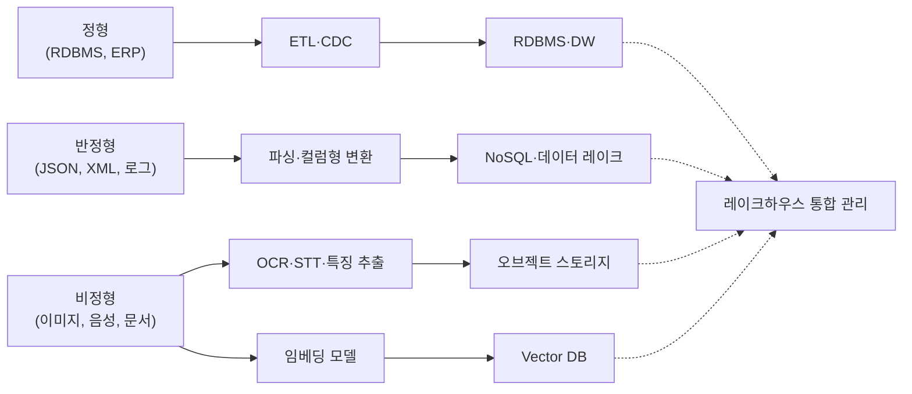

# 데이터 유형 (Data Types)

---

## I. 구조화 수준에 따른 분류, 데이터 유형의 개요

### 가. 정의

- 데이터를 **스키마 적용 방식과 구조화 수준에 따라 정형·반정형·비정형(및 AI용 벡터 데이터)으로 구분**한 분류 체계

### 나. 분류 기준 및 특징

| 구분 | 내용 |
| --- | --- |
| 구조화 수준 | 고정 스키마(Schema-on-Write) → 유연한 스키마(Schema-on-Read) → 스키마 없음 → 임베딩 벡터 |
| 데이터 비중 | 기업 데이터의 대부분(통상 80% 내외로 추정)이 비정형 |
| 저장 인프라 | RDBMS·DW → [[NoSQL (CAP 이론 BASE 속성)\|NoSQL]]·데이터 레이크 → 레이크하우스·[[벡터 데이터베이스]]로 다변화 |
| AI 활용 | 비정형 데이터를 임베딩으로 변환해 검색·학습에 사용하는 비중 증가 |

---

## II. 유형별 처리 체계

### 가. 처리 흐름

- 유형별로 변환 파이프라인과 저장소가 다르며, 최근에는 오픈 테이블 포맷 기반 레이크하우스로 통합 관리

### 나. 유형별 핵심 요소

| 구분 | 요소 | 설명 |
| --- | --- | --- |
| 정형 | Schema-on-Write | 적재 전 테이블 구조·타입·제약조건 정의 |
| | [[SQL(Structured Query Language)\|SQL]]·ACID | 관계형 연산, 인덱스 기반 고속 조회·집계 |
| 반정형 | 자기 기술(Self-Describing) | 태그·키가 데이터 안에 구조 정보를 포함 ([[JSON]], [[XML]], YAML) |
| | Schema-on-Read | 읽는 시점에 구조 해석, 스키마 변경에 유연 |
| 비정형 | 오브젝트 스토리지 | ID·메타데이터로 대용량 파일(영상·이미지·문서) 저장 |
| | 특징 추출 | OCR, STT, 비전-언어 모델로 분석 가능한 정보 추출 |
| AI 데이터 | 벡터 임베딩 | 의미를 $\mathbb{R}^d$ 실수 벡터로 표현, HNSW·IVF 색인으로 유사도 검색 |
| | [[합성 데이터]] | [[GAN (Generative Adversarial Network)\|GAN]]·확산 모델·LLM으로 생성한 데이터, 개인정보 보호·불균형 보완 |

---

## III. 비교 및 동향

### 가. 유형별 비교

| 비교 항목 | 정형 | 반정형 | 비정형 | 벡터 |
| --- | --- | --- | --- | --- |
| 스키마 | 사전 정의 | 읽을 때 해석 | 없음 | 차원 $d$ 고정 |
| 형태 | 행·열 테이블 | Key-Value, JSON, 로그 | 이미지, 음성, 영상, 텍스트 | 실수 배열 |
| 저장소 | RDBMS, DW | NoSQL, 데이터 레이크 | 오브젝트 스토리지, [[HDFS]] | Vector DB |
| 질의 | SQL 일치·범위 검색 | JSONPath, XPath | 키워드·메타데이터 검색 | [[유사도]] 검색 (코사인, L2) |

### 나. 동향

- **비정형 데이터의 벡터화**: 문서·이미지를 임베딩해 [[RAG (Retrieval Augmented Generation) 검색 증강 생성 AI|RAG]]·에이전트의 검색 자산으로 활용
- **멀티모달 레이크하우스**: Apache Iceberg·Delta Lake 같은 오픈 테이블 포맷 위에서 정형 테이블, 비정형 파일 포인터, 벡터 인덱스를 함께 관리
- **합성 데이터 품질 관리**: 개인정보·저작권 제약으로 합성 데이터 활용이 늘면서 충실도(Fidelity)·프라이버시 평가 기준 정립

---

### 🔗 연관 토픽

- **소속 도메인**: [[00_인공지능_MOC|🤖 인공지능]]
- **세부 분류**: `1. 수학 · 통계학 & 데이터 전처리`
- **핵심 연관 토픽**:
  - [[정량적 데이터]]
  - [[벡터 데이터베이스|벡터 데이터베이스(Vector Database)]]
  - [[합성 데이터|합성 데이터(Synthetic Data)]]
  - [[NoSQL (CAP 이론 BASE 속성)]]
  - [[SQL(Structured Query Language)]]
