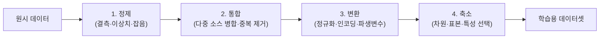

# 데이터 전처리 (Data Preprocessing)

---

## I. 모델 성능의 출발점, 데이터 전처리의 개요

### 가. 정의

- 원시 데이터의 결측·잡음·[[이상치]]·불일치를 처리하고 **정제·통합·변환·축소를 거쳐 분석과 학습에 적합한 형태로 가공하는 과정**

### 나. 필요성 및 특징

| 구분 | 내용 |
| --- | --- |
| GIGO 방지 | 낮은 품질의 입력은 모델 성능 저하로 직결 |
| 공수 비중 | 분석 프로젝트 공수의 상당 부분을 차지 |
| Data-Centric AI | 모델 구조보다 데이터 품질·일관성 개선이 성능을 좌우 |
| 파이프라인화 | 학습·서빙에 동일 로직을 적용해 훈련-서빙 불일치(Skew) 방지 |

---

## II. 전처리 절차 및 기법

### 가. 전처리 4단계

- 정제 → 통합 → 변환 → 축소의 전통적 4단계에 불균형 처리·검증을 더해 파이프라인으로 자동화

### 나. 단계별 기법

| 구분 | 요소 | 설명 |
| --- | --- | --- |
| 정제 | [[결측치]] 처리 | 삭제, 평균·중앙값 대체, KNN·MICE 다중대체 |
| | 이상치 처리 | IQR, Z-Score, Isolation Forest, LOF로 탐지 후 제거·보정 |
| 통합 | 스키마 통합·중복 제거 | 속성명·단위 일치, 엔티티 식별 |
| 변환 | 스케일링 | Min-Max 정규화, Z-Score 표준화, Robust Scaler |
| | 범주형 인코딩 | One-Hot, Label, Target Encoding |
| | 불균형 처리 | 언더샘플링, SMOTE·ADASYN 오버샘플링 |
| 축소 | [[차원 축소]] | [[PCA(Principal Component Analysis)\|PCA]], 특성 선택, [[다중공선성]] 변수(VIF) 제거 |
| 비정형 | 토큰화·증강 | BPE·WordPiece 토큰화, 이미지·음성 데이터 증강 |

---

## III. 비교 및 동향

### 가. 전통 전처리 vs MLOps 기반 전처리

| 비교 항목 | 전통 전처리 | [[MLOps]] 기반 전처리 |
| --- | --- | --- |
| 실행 방식 | 노트북 내 수동 스크립트 | 파이프라인 코드로 자동 실행 |
| 특성 공유 | 팀별 중복 구현 | Feature Store로 학습·서빙 공유 |
| 품질 검증 | 육안·단순 통계 | Great Expectations 등 자동 검증 |
| 드리프트 대응 | 주기적 수작업 | 모니터링 기반 재학습 트리거 |

### 나. 동향

- **[[합성 데이터]]**: 희소·민감 데이터를 생성 모델로 보완
- **데이터 계약(Data Contract)**: 생산자–소비자 간 스키마·품질 조건을 코드로 명시
- **LLM 활용 정제**: 비정형 텍스트의 오탈자·표기 불일치 자동 교정

---

### 🔗 연관 토픽

- **소속 도메인**: [[00_데이터베이스_MOC|🗄️ 데이터베이스]]
- **세부 분류**: `1. 데이터 모델링 & 관계형 DB 설계`
- **핵심 연관 토픽**:
  - [[데이터 클렌징]]
  - [[결측치]]
  - [[이상치]]
  - [[차원 축소|차원 축소(Dimensionality Reduction)]]
  - [[PCA(Principal Component Analysis)]]
