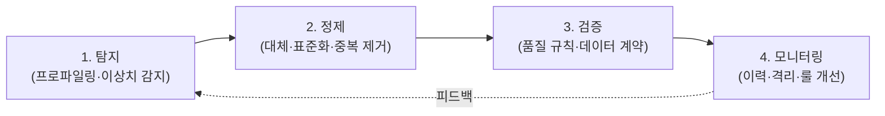

# 데이터 클렌징 (Data Cleansing)

---

## I. 데이터 품질 확보의 첫 단계, 데이터 클렌징의 개요

### 가. 정의

- 데이터 내 [[결측치]], [[이상치]], 중복, 오기입, 비표준 형식을 **탐지해 수정·삭제·대체함으로써 정확성과 일관성을 확보하는 정제 활동**

### 나. 필요성 및 특징

| 구분 | 내용 |
| --- | --- |
| 의사결정 왜곡 방지 | 중복·오류 레코드로 인한 집계·KPI 왜곡 제거 |
| AI 성능 확보 | 라벨 노이즈·이상치로 인한 과적합·[[일반화]] 저하 예방 |
| 규정 준수 | 개인정보 정비, 도메인 표준 준수 ([[데이터 거버넌스]]) |
| 자동화 | 적재 후 사후 정제에서 수집 단계 사전 차단(Shift-Left)으로 이동 |

---

## II. 클렌징 절차 및 기법

### 가. 클렌징 프로세스

- 프로파일링으로 오류를 찾고, 정제 후 품질 규칙으로 검증하며, 실패 레코드는 격리(Quarantine)해 원인을 추적

### 나. 핵심 기법

| 구분 | 요소 | 설명 |
| --- | --- | --- |
| 탐지 | [[데이터 프로파일링]] | 결측률·유일값·패턴·범위 진단으로 오류 후보 식별 |
| | 이상치 탐지 | IQR, Z-Score, Isolation Forest, LOF |
| 정제 | 결측치 대체 | 평균·최빈값, KNN, MICE(다중대체) |
| | 형식 표준화 | 정규표현식·업무 규칙으로 날짜·주소·전화번호 형식 통일 ([[데이터 표준화]]) |
| | 중복 제거 | 레코드 링키지, Levenshtein·Jaro-Winkler [[유사도]] |
| | 라벨 정제 | Confident Learning(cleanlab)으로 잘못된 레이블 추정 |
| 검증 | 품질 규칙 | 스키마·값 범위·참조 무결성 자동 점검 (Great Expectations) |
| 관리 | 계보·격리 | Data Lineage로 변환 이력 추적, 실패 레코드 별도 저장 |

---

## III. 비교 및 동향

### 가. 규칙 기반 vs ML 기반 클렌징

| 비교 항목 | 규칙 기반 | ML 기반 |
| --- | --- | --- |
| 접근 | 사람이 정의한 정적 규칙 | 데이터에서 학습한 패턴 |
| 강점 | 명확·설명 용이 | 알려지지 않은 오류 탐지 |
| 약점 | 규칙 밖 오류 누락 | 오탐, 설명 어려움 |
| 대상 | 정형 데이터 형식 오류 | 이상치, 라벨 노이즈, 비정형 데이터 |

### 나. 동향

- **LLM 기반 의미 정제**: 비정형 텍스트의 모순·표기 오류를 문맥 기반으로 교정
- **정제 편향 관리**: 과도한 이상치 제거로 소수 집단 데이터가 사라져 생기는 [[편향]] 점검
- **품질 인증 연계**: [[데이터 품질관리(ISO 8000)|ISO 8000]], 공공데이터 품질 진단 기준과 연동

---

### 🔗 연관 토픽

- **소속 도메인**: [[00_데이터베이스_MOC|🗄️ 데이터베이스]]
- **세부 분류**: `1. 데이터 모델링 & 관계형 DB 설계`
- **핵심 연관 토픽**:
  - [[데이터 프로파일링|데이터 프로파일링 (Data Profiling)]]
  - [[데이터 전처리]]
  - [[결측치]]
  - [[데이터 품질관리(ISO 8000)]]
  - [[빅데이터 감리|빅데이터 관련 정보화 사업에 대한 감리 수행]]
