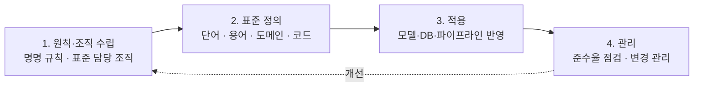

# 데이터 표준화 (Data Standardization)

---

## I. 같은 데이터는 같은 이름과 형식으로, 데이터 표준화의 개요

### 가. 정의

- 데이터의 **명칭·정의·형식·규칙을 단어·용어·도메인·코드 표준으로 정하고 모든 시스템에 일관되게 적용·관리하는 활동** (참조: ISO/IEC 11179 메타데이터 레지스트리)

### 나. 필요성 및 특징

| 구분 | 내용 |
| --- | --- |
| 일관성 | 부서·시스템별 다른 명칭·코드로 인한 불일치 해소 |
| 상호운용성 | 시스템 간 연계·통합 비용 감소 |
| 품질 기반 | 표준 준수가 데이터 품질 진단의 기준 ([[데이터 거버넌스 데이터 품질]]) |
| 구성 | 표준 단어 → 표준 용어, 표준 도메인·코드와 결합 |

---

## II. 표준화 체계 및 구성요소

### 가. 표준화 절차

- 표준 사전을 메타데이터 관리 시스템에 등록하고, 모델링·배포 시 준수 여부를 점검

### 나. 구성요소

| 구분 | 요소 | 설명 |
| --- | --- | --- |
| 표준 요소 | 표준 단어 | 최소 의미 단위, 영문 약어·금칙어·이음동의어 정의 |
| | 표준 도메인 | 데이터 타입·길이·형식·허용 범위 그룹 (예: 일자 CHAR(8)) |
| | 표준 코드 | 코드 도메인의 허용값 집합과 의미 |
| | 표준 용어 | 표준 단어 조합 + 도메인으로 정한 속성명·컬럼명 |
| 참조 표준 | ISO/IEC 11179 | 데이터 요소의 명명·정의·등록 체계 |
| 조직 | 데이터 관리자·스튜어드 | 표준 제정·심의·변경 승인 ([[데이터 거버넌스]]) |
| 관리 도구 | 메타데이터 관리 시스템 | 표준 사전 등록, 준수율 점검 |
| 자동화 | 데이터 계약·자동 매핑 | 배포 시 표준 검증, 의미 유사도로 비표준 컬럼 매핑 추천 |

---

## III. 비교 및 동향

### 가. 전통 표준화 vs 현대 표준화

| 비교 항목 | 전통 표준화 | 현대 표준화 |
| --- | --- | --- |
| 통제 | 중앙 심의 중심 | 연합형 거버넌스, Policy-as-Code |
| 적용 시점 | DB 설계 단계 | 설계 + CI/CD 배포 시점 검증 |
| 범위 | RDBMS 테이블·컬럼 | JSON·이벤트 스키마·지표(Metric) 포함 |
| 메타데이터 | 수기 등록 | 카탈로그 자동 수집 |

### 나. 동향

- **공공 표준**: [[공공 데이터베이스 표준화 관리 매뉴얼 (2023.04)|공공 DB 표준화 관리 매뉴얼]]의 공통 표준 용어·도메인 적용
- **시맨틱 레이어**: 지표 정의를 표준화해 BI 도구 간 KPI 계산 일치 (dbt Semantic Layer 등)
- **온톨로지·지식 그래프**: 용어 간 의미 관계를 표현해 LLM·RAG 검색 정확도 향상

---

### 🔗 연관 토픽

- **소속 도메인**: [[00_데이터베이스_MOC|🗄️ 데이터베이스]]
- **세부 분류**: `3. 장애 회복 기법 & 데이터 무결성`
- **핵심 연관 토픽**:
  - [[공공 데이터베이스 표준화 관리 매뉴얼 (2023.04)]]
  - [[데이터 거버넌스|데이터 거버넌스 (Data Governance)]]
  - [[데이터 거버넌스 데이터 품질]]
  - [[자료 사전]]
  - [[데이터 품질인증 가이드라인 - DQ인증 (2025.02.26)]]
