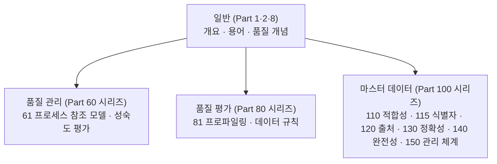

# 데이터 품질관리 (ISO 8000)

---

## I. 교환 가능한 고품질 데이터, ISO 8000의 개요

### 가. 정의

- 데이터의 **구문·의미·사양 적합성, 출처, 정확성·완전성과 데이터 품질 관리 프로세스를 규정한 데이터 품질 국제 표준 시리즈** (ISO/TC 184/SC 4, 마스터 데이터 교환 중심)

### 나. 특징

| 구분 | 내용 |
| --- | --- |
| 배경 | 공급망([[SCM (Supply Chain Management)\|SCM]])·기업 간 데이터 교환 시 불일치·해석 오류 |
| 적합성 3요건 | 구문(Syntax), 의미 인코딩(Semantic Encoding), 데이터 사양 적합성 |
| 출처 보증 | 데이터 생성·변경 이력(Provenance)으로 신뢰성 확보 |
| 프로세스 | 품질 관리 프로세스 참조 모델(Part 61) 제시 |

---

## II. 표준 구성 및 요소

### 가. 표준 체계

- 데이터 품질 관리 프로세스(60번대)로 지속 관리하고, 마스터 데이터 표준(100번대)으로 교환 데이터의 품질을 검증

### 나. 주요 파트

| 구분 | 요소 | 설명 |
| --- | --- | --- |
| 일반 | Part 1·2 | 표준 개요, 용어 정의 |
| | Part 8 | 정보·데이터 품질 개념과 측정 |
| 프로세스 | Part 61 | 품질 계획·통제·보증·개선 프로세스 참조 모델 |
| | Part 62~ | 조직의 데이터 품질 프로세스 성숙도 평가 |
| 평가 | Part 81 | 데이터 프로파일링 기반 품질 평가 ([[데이터 프로파일링]]) |
| 마스터 데이터 | Part 110 | 구문·의미 인코딩·사양 적합성 |
| | Part 115 | 품질 식별자 |
| | Part 120 | 출처(Provenance) |
| | Part 130·140 | 정확성, 완전성 |
| | Part 150 | 마스터 데이터 품질 관리 체계(역할·책임) |

---

## III. 비교 및 동향

### 가. ISO 8000 vs ISO/IEC 25012

| 비교 항목 | ISO 8000 | ISO/IEC 25012 |
| --- | --- | --- |
| 기구 | ISO/TC 184/SC 4 (산업 데이터) | ISO/IEC JTC 1/SC 7 (SW 공학, SQuaRE) |
| 목적 | 교환 데이터·마스터 데이터 품질 보증 | 시스템 내 데이터 품질 모델 정의 |
| 접근 | 프로세스 + 데이터 사양·출처 | 고유·시스템 의존 15개 품질 특성 |
| 활용 | MDM, 공급망 데이터 교환 | 데이터 품질 요구사항 정의·평가 |

### 나. 동향

- **AI 데이터 품질 표준**: ISO/IEC 5259 시리즈(분석·ML용 데이터 품질)와 함께 활용
- **데이터 계약 자동화**: 사양 적합성 원칙을 스키마·품질 규칙 코드로 정의해 파이프라인에서 자동 검증
- **국내 인증 연계**: [[데이터 품질인증 가이드라인 - DQ인증 (2025.02.26)|DQ 인증]], [[공공데이터 품질인증 매뉴얼(2025.07.)|공공데이터 품질인증]]의 품질 기준과 연계

---

### 🔗 연관 토픽

- **소속 도메인**: [[00_데이터베이스_MOC|🗄️ 데이터베이스]]
- **세부 분류**: `3. 장애 회복 기법 & 데이터 무결성`
- **핵심 연관 토픽**:
  - [[데이터 거버넌스 데이터 품질]]
  - [[데이터 품질인증 가이드라인 - DQ인증 (2025.02.26)]]
  - [[공공데이터 품질인증 매뉴얼(2025.07.)]]
  - [[데이터 표준화]]
  - [[데이터 거버넌스|데이터 거버넌스 (Data Governance)]]
