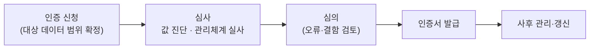

# 데이터 품질인증 가이드라인 (DQ인증)

---

## I. 데이터 품질의 공인 보증, DQ인증의 개요

### 가. 정의

- 기업·기관이 보유한 데이터의 **값(Content)과 관리체계(Process) 품질을 인증기관이 평가해 공식 인증하는 제도**의 운영 기준 (데이터산업법 근거, 한국데이터산업진흥원 운영)

### 나. 필요성 및 특징

| 구분 | 내용 |
| --- | --- |
| 신뢰 확보 | 데이터 거래·활용 시 품질을 객관적으로 입증 |
| AI 대응 | 학습용 비정형 데이터의 라벨 정확도·다양성까지 평가 범위 확대 |
| 이원 인증 | 데이터 값 인증과 데이터 관리체계 인증으로 구분 운영 |
| 국제 표준 연계 | ISO/IEC 25012(데이터 품질 모델), ISO/IEC 5259(AI·분석용 데이터 품질) 참고 |

---

## II. 인증 절차 및 평가 요소

### 가. 인증 절차

- 데이터 값은 진단 도구로 규칙 기반 검증, 관리체계는 산출물 심사와 인터뷰로 평가

### 나. 평가 요소

| 구분 | 요소 | 설명 |
| --- | --- | --- |
| 값 인증 | 정형 데이터 | 업무 규칙·도메인 규칙 기반 정확성·유효성·일관성·완전성 검증, 오류율 산출 |
| | AI 학습 데이터 | 구문·의미 정확성, 라벨링 정확도, 데이터 다양성·편향 검증 |
| 관리체계 인증 | 품질 관리 체계 | 품질 방침·조직, [[데이터 표준화]], 메타데이터·변경 관리 프로세스 |
| 진단 기술 | 규칙 기반 프로파일링 | [[SQL(Structured Query Language)\|SQL]]·스크립트로 전수 또는 표본 오류 추출 ([[데이터 프로파일링]]) |
| | 작업자 일치도 | Cohen's·Fleiss' Kappa, 바운딩 박스 IoU로 라벨 신뢰도 측정 |
| 결과 | 등급·판정 | 오류율 수준에 따라 인증 여부·등급 결정 |

---

## III. 비교 및 동향

### 가. 값 인증 vs 관리체계 인증

| 비교 항목 | 데이터 값 인증 | 데이터 관리체계 인증 |
| --- | --- | --- |
| 대상 | DB 테이블, AI 학습 데이터셋 | 조직의 데이터 관리 프로세스 |
| 관점 | 결과 (데이터 값 자체) | 과정 ([[데이터 거버넌스]] 성숙도) |
| 기준 | 오류율, 결측률, 라벨 오류율 | 계획·통제·측정·개선 체계 |
| 방법 | 도구 진단, 표본·전수 검증 | 문서 심사, 실사, 인터뷰 |
| 효과 | 데이터 상품 신뢰도 | 지속적 품질 유지 |

### 나. 동향

- **공공 인증과 연계**: [[공공데이터 품질인증 매뉴얼(2025.07.)|공공데이터 품질인증]]과 함께 공공·민간 품질 보증 체계 구성
- **합성 데이터 품질**: [[합성 데이터]]의 충실도·다양성·[[차분 프라이버시|프라이버시]] 평가 기준 마련 필요
- **지속적 인증**: 파이프라인의 자동 품질 검증 결과를 인증 유지 근거로 활용하는 방향

---

### 🔗 연관 토픽

- **소속 도메인**: [[00_데이터베이스_MOC|🗄️ 데이터베이스]]
- **세부 분류**: `2. 트랜잭션 & 동시성 제어 (Concurrency)`
- **핵심 연관 토픽**:
  - [[공공데이터 품질인증 매뉴얼(2025.07.)]]
  - [[데이터 품질관리(ISO 8000)]]
  - [[데이터 거버넌스 데이터 품질]]
  - [[데이터 표준화]]
  - [[데이터 프로파일링]]
