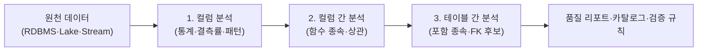

# 데이터 프로파일링 (Data Profiling)

---

## I. 데이터 품질 진단의 출발점, 데이터 프로파일링의 개요

### 가. 정의

- 데이터의 구조·내용·관계를 **통계 요약, 패턴 분석, 종속성 검증으로 조사해 품질 상태와 메타데이터를 파악하는 진단 기법**

### 나. 필요성 및 특징

| 구분 | 내용 |
| --- | --- |
| 사전 진단 | [[결측치]]·[[이상치]]·형식 오류를 분석·이관 전에 식별 |
| 비침해성 | 원천 데이터를 변경하지 않고 특성 정보만 추출 |
| 계층적 분석 | 단일 컬럼 → 컬럼 간 → 테이블 간 관계로 확장 |
| 규칙 도출 | 결과를 품질 규칙·데이터 계약(Data Contract)으로 전환 |

---

## II. 분석 구조 및 구성요소

### 가. 프로파일링 3단계

- 컬럼 단위 기초 통계에서 출발해 [[함수적 종속성]], 테이블 간 참조 관계까지 진단하고 결과를 카탈로그·품질 규칙에 반영

### 나. 분석 요소

| 구분 | 요소 | 설명 |
| --- | --- | --- |
| 컬럼 분석 | 기초 통계 | 최소·최대·평균·표준편차·사분위수, Null 비율 |
| | 카디널리티 | 유일값 개수로 식별자·코드 컬럼 판별 |
| | 패턴·형식 | 정규식으로 날짜·이메일·전화번호 형식 준수율 점검 |
| | 타입 추론 | 문자열로 저장된 실제 데이터 유형(날짜·숫자) 판별 |
| 컬럼 간 분석 | 함수 종속 | X → Y 관계 탐색, 정규화 위반 감지 |
| | 상관 분석 | 피어슨·스피어만 상관계수, [[다중공선성]] 확인 |
| 테이블 간 분석 | 포함 종속 | 외래키 후보 탐색, 고아 레코드(Orphan) 식별 |
| 지능화 | 민감정보 탐지 | 분류기·LLM으로 개인정보 컬럼 자동 태깅 |

---

## III. 비교 및 동향

### 가. 데이터 프로파일링 vs 데이터 마이닝

| 비교 항목 | 데이터 프로파일링 | [[데이터 마이닝 방법론\|데이터 마이닝]] |
| --- | --- | --- |
| 목적 | 데이터 자체의 구조·품질 진단 | 데이터 속 패턴·지식 발견 |
| 기법 | 요약 통계, 정규식, 종속성 검증 | 분류, 군집, 연관규칙, 회귀 |
| 시점 | 이관·적재·품질 진단 초기 | 분석·활용 단계 |
| 산출물 | 프로필 리포트, 품질 규칙 | 예측 모델, 세그먼트, 규칙 |

### 나. 동향

- **데이터 관측성(Data Observability)**: 스트리밍 환경에서 볼륨·신선도·스키마 변화를 지속 프로파일링
- **액티브 메타데이터**: 프로파일 결과를 데이터 카탈로그에 자동 반영 ([[데이터 거버넌스]])
- **AI 학습 데이터 진단**: [[합성 데이터]]·비정형 텍스트의 분포·편향 측정으로 확장

---

### 🔗 연관 토픽

- **소속 도메인**: [[00_데이터베이스_MOC|🗄️ 데이터베이스]]
- **세부 분류**: `1. 데이터 모델링 & 관계형 DB 설계`
- **핵심 연관 토픽**:
  - [[데이터 클렌징|데이터 클렌징 (Data Cleansing)]]
  - [[함수적 종속성]]
  - [[데이터 품질관리(ISO 8000)]]
  - [[데이터 거버넌스|데이터 거버넌스 (Data Governance)]]
  - [[스키마]]
