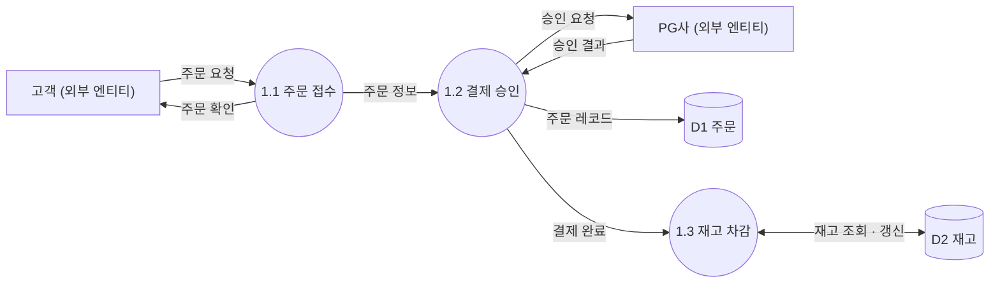

# 데이터 흐름도 (Data Flow Diagram, DFD)

---

## I. 데이터의 흐름과 변환을 그린다, 데이터 흐름도의 개요

### 가. 정의

- 시스템 안에서 **데이터가 외부 엔티티·프로세스·저장소 사이를 어떻게 흐르고 변환되는지를 도형으로 표현**한 구조적 분석의 대표 모델 (버블 차트)

### 나. 특징

| 구분 | 내용 |
| --- | --- |
| 데이터 중심 | 제어 논리·실행 순서를 배제하고 데이터 변환만 표현 |
| 하향식 계층화 | 배경도에서 원시 프로세스까지 단계적 분할 |
| 구현 독립 | 물리 매체·HW를 배제한 논리 모델 |
| 의사소통 | 현업과 분석가가 함께 검토하기 쉬운 표기 |

---

## II. 구성 및 작성 규칙

### 가. Level 1 DFD 예시 (주문·결제)

- 외부 엔티티와 저장소는 반드시 프로세스를 거쳐 연결되며, 상·하위 다이어그램의 입출력 흐름이 일치해야 함

### 나. 구성요소 및 규칙

| 구분 | 요소 | 설명 |
| --- | --- | --- |
| 4대 기호 | 프로세스 | 입력을 출력으로 변환하는 기능 (원: Yourdon·DeMarco, 둥근 사각형: Gane & Sarson) |
| | 데이터 흐름 | 데이터 이동 방향의 화살표, 흐르는 데이터 이름 명기 |
| | 데이터 저장소 | 데이터가 머무는 곳 (평행선: Yourdon, 한쪽 열린 사각형: Gane & Sarson) |
| | 외부 엔티티 | 시스템 밖의 데이터 발생원(Source)·소비처(Sink) (사각형) |
| 계층화 | 배경도 (Context, Level 0) | 시스템 전체를 하나의 프로세스로 보고 외부와의 흐름만 표현 |
| | 하위 분할 | Level 1, 2 … 로 기능 세분화, 최하위는 원시 프로세스 |
| 정합성 규칙 | 균형 (Balancing) | 상위 프로세스와 하위 DFD의 입출력 흐름 일치 |
| | 데이터 보존 | 출력은 입력으로부터만 생성 |
| 오류 유형 | Black Hole · Miracle · Gray Hole | 입력만 있음, 출력만 있음, 입력이 출력 생성에 불충분 |
| 연계 명세 | [[자료 사전]] · 소단위 명세 | 데이터 항목 정의, 원시 프로세스의 처리 논리 |

---

## III. 비교 및 동향

### 가. DFD vs 순서도

| 비교 항목 | DFD | 순서도 (Flowchart) |
| --- | --- | --- |
| 관점 | 데이터 흐름·변환 (무엇을) | 제어 흐름·처리 절차 (어떻게) |
| 시간 순서 | 표현하지 않음 | 순차 실행 표현 |
| 제어 논리 | 분기·반복 표현 안 함 | 판단 기호·반복 표현 |
| 범위 | 시스템 전체의 논리 구조 | 프로그램·모듈 내부 절차 |
| 사용 단계 | 분석 | 상세 설계·구현 |

### 나. 동향

- [[위협 모델링]]에서 DFD에 신뢰 경계(Trust Boundary)를 그려 [[STRIDE]] 위협을 요소별로 도출
- 데이터 파이프라인의 계보(Lineage) 추적, DAG 기반 워크플로 표현으로 개념 확장
- 객체지향 분석에서는 [[유즈케이스 다이어그램]]·[[순차 다이어그램]]이 주로 대체

---

### 🔗 연관 토픽

- **소속 도메인**: [[00_소프트웨어공학_MOC|🏗️ 소프트웨어공학]]
- **세부 분류**: `3. 요구사항 공학 & UML 객체지향 분석/설계`
- **핵심 연관 토픽**:
  - [[요구 사항 분석]]
  - [[자료 사전]]
  - [[나씨-슈나이더만]]
  - [[위협 모델링|위협 모델링(Threat Modeling) - Secure SDLC]]
  - [[STRIDE]]
