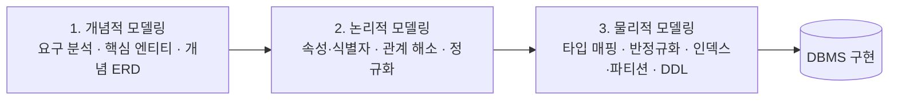

# 데이터베이스 모델링 (Database Modeling)

---

## I. 업무를 데이터 구조로, 데이터베이스 모델링의 개요

### 가. 정의

- 현실 세계의 업무와 정보 요구사항을 **개념적·논리적·물리적 단계로 추상화해 데이터베이스 구조로 변환하는 설계 과정**

### 나. 특징

| 구분 | 내용 |
| --- | --- |
| 3요소 | 개체([[엔티티]]), 속성, 관계 |
| 단계적 추상화 | 개념 → 논리 → 물리로 점차 구체화 |
| 무결성 중심 | 정규화로 [[Anomaly(이상현상)\|이상현상]] 제거, 업무 규칙을 제약조건으로 표현 |
| 독립성 | 논리 모델은 특정 [[DBMS]]에 독립, 물리 모델에서 제품 특성 반영 |

---

## II. 모델링 절차 및 구성요소

### 가. 3단계 모델링

- 개념 ERD를 정규화로 상세화한 뒤, 성능 요건을 반영해 물리 스키마와 [[DDL]]로 구현

### 나. 단계별 요소

| 구분 | 요소 | 설명 |
| --- | --- | --- |
| 개념 | 주제 영역 | 업무를 주문·고객·상품 등 영역으로 구분 |
| | 핵심 엔티티·ERD | 관리 대상과 관계를 고수준 ERD로 표현 |
| 논리 | 식별자 확정 | 주식별자 선정, 식별·비식별 관계 결정 ([[릴레이션 키]]) |
| | M:N 관계 해소 | 교차 엔티티로 두 개의 1:N 관계로 분해 |
| | 정규화 | 1NF~[[BCNF]]로 중복·이상현상 제거 ([[데이터베이스 정규화]]) |
| 물리 | 반정규화 | 조회 성능을 위해 병합·중복 컬럼·집계 테이블 ([[데이터베이스 반정규화]]) |
| | 인덱스 설계 | 접근 경로·선택도 분석으로 B+Tree·Bitmap 등 선택 ([[RDBMS 인덱스(index)\|인덱스]]) |
| | [[파티셔닝]] | Range·List·Hash로 대용량 테이블 분할 |

---

## III. 비교 및 동향

### 가. 논리 모델링 vs 물리 모델링

| 비교 항목 | 논리 모델링 | 물리 모델링 |
| --- | --- | --- |
| 관점 | 업무 요구 중심 | 시스템 성능·자원 중심 |
| DBMS 의존 | 독립적 | 대상 DBMS에 종속 |
| 주요 활동 | 정규화, 식별자, 관계 정의 | 타입 지정, 반정규화, 인덱스·파티션 |
| 산출물 | 논리 ERD, 엔티티 정의서 | 물리 ERD, DDL, 테이블 정의서 |

### 나. 동향

- **Data Vault 2.0**: Hub·Link·Satellite로 분리해 변경에 유연한 DW 모델링
- **[[DDD (Domain Driven Design)|DDD]] 기반 분산 모델링**: [[MSA (Micro Service Architecture)|MSA]] 환경에서 Bounded Context별 데이터 소유
- **Schema-as-Code**: Flyway·Liquibase·dbt로 모델 변경 이력을 버전 관리하고 CI/CD로 배포

---

### 🔗 연관 토픽

- **소속 도메인**: [[00_데이터베이스_MOC|🗄️ 데이터베이스]]
- **세부 분류**: `1. 데이터 모델링 & 관계형 DB 설계`
- **핵심 연관 토픽**:
  - [[엔티티]]
  - [[데이터베이스 정규화]]
  - [[데이터베이스 반정규화]]
  - [[Anomaly(이상현상)]]
  - [[DDL]]
