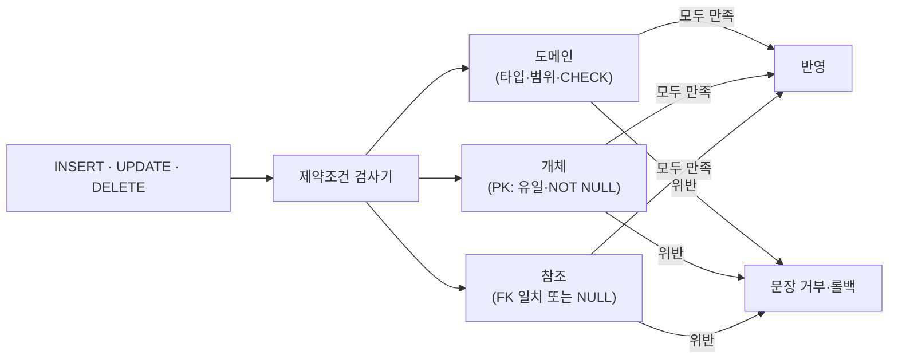

# 데이터베이스 무결성

---

## I. 정확하고 일관된 데이터, 데이터베이스 무결성의 개요

### 가. 정의

- 데이터베이스에 저장된 데이터가 **정확·일관·유효한 상태를 유지하도록 DBMS가 제약조건으로 강제하는 성질**

### 나. 특징

| 구분 | 내용 |
| --- | --- |
| 목적 | 잘못된 값 유입 차단, 응용 오류 예방 |
| 강제 주체 | [[DBMS]]가 [[DML]] 수행 시 자동 검사 |
| 정의 방식 | 선언적 제약조건(DDL), 절차적 통제(트리거) |
| 관련 성질 | ACID의 일관성(Consistency)과 직결 |

---

## II. 검증 구조 및 무결성 유형

### 가. 무결성 검사 흐름

- 하나라도 위반하면 해당 문장을 거부하고, 참조 무결성 위반 시에는 정의된 연쇄 동작(CASCADE 등)을 적용

### 나. 유형 및 보장 수단

| 구분 | 요소 | 설명 |
| --- | --- | --- |
| 유형 | 개체 무결성 | 기본키는 NULL·중복 불가 |
| | 참조 무결성 | 외래키는 참조 테이블의 키 값과 일치하거나 NULL |
| | 도메인 무결성 | 속성 값은 정의된 타입·길이·범위 안에 존재 |
| | 키 무결성 | 릴레이션에 같은 키 값을 가진 튜플 없음 |
| | 사용자 정의 무결성 | 업무 규칙에 따른 제약 (예: 잔액 ≥ 0) |
| 선언적 수단 | 제약조건 | PRIMARY KEY, FOREIGN KEY, UNIQUE, CHECK, NOT NULL ([[DDL]]) |
| | 참조 동작 | ON DELETE/UPDATE CASCADE, SET NULL, RESTRICT |
| 절차적 수단 | 트리거·[[프로시저]] | 복잡한 업무 규칙, 다중 테이블 규칙 검사 |
| 분산 확장 | 2PC·Saga | 여러 DB에 걸친 일관성 보장 ([[트랜잭션]]) |

---

## III. 비교 및 동향

### 가. 무결성 vs 보안

| 비교 항목 | 무결성 | 보안 |
| --- | --- | --- |
| 목적 | 정확성·일관성 | 기밀성·접근 통제 |
| 대상 위협 | 인가된 사용자의 실수·의미 오류 | 비인가 접근·유출 |
| 통제 수단 | 제약조건, 트리거, 동시성 제어 | 접근통제([[DAC]]·[[MAC]]·[[RBAC]]), [[암호화]] |
| 예 | 음수 수량 입력 차단 | [[SQL Injection]] 차단 |

### 나. 동향

- **MSA 무결성**: DB가 서비스별로 분리되어 Saga·Outbox·보상 트랜잭션으로 최종 일관성 확보 ([[MSA (Micro Service Architecture)|MSA]])
- **애플리케이션 위임 경향**: 대규모 서비스에서 FK 제약을 생략하고 애플리케이션·배치로 정합성을 점검하는 사례 증가, 품질 점검 자동화 필요

---

### 🔗 연관 토픽

- **소속 도메인**: [[00_데이터베이스_MOC|🗄️ 데이터베이스]]
- **세부 분류**: `2. 트랜잭션 & 동시성 제어 (Concurrency)`
- **핵심 연관 토픽**:
  - [[무결성]]
  - [[릴레이션 키]]
  - [[DDL]]
  - [[트랜잭션]]
  - [[Anomaly(이상현상)]]
