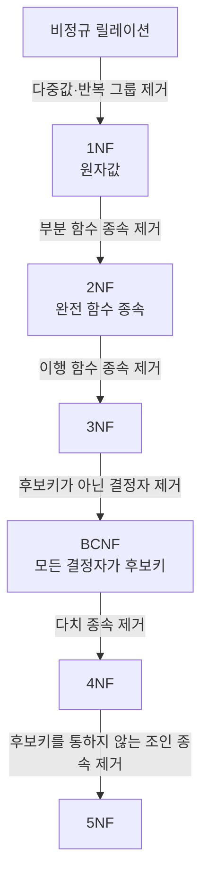

# 데이터베이스 정규화(Normalization)

---

## I. 중복 제거와 이상현상 방지, 정규화의 개요

### 가. 정의

- [[함수적 종속성]]을 기준으로 **릴레이션을 무손실 분해해 데이터 중복과 [[Anomaly(이상현상)|이상현상]]을 제거하는 논리적 설계 기법**

### 나. 특징

| 구분 | 내용 |
| --- | --- |
| 이상현상 방지 | 삽입·삭제·갱신 이상 제거 |
| 무손실 분해 | 분해한 릴레이션을 자연 조인하면 원래 릴레이션 복원 |
| 종속성 보존 | 분해 후에도 원래 함수 종속을 검사 가능하게 유지 |
| 한계 | 과도한 분해는 [[조인]] 증가로 조회 성능 저하 |

---

## II. 정규화 단계

### 가. 정규형 진행

- 단계별 조건 암기: 도·부·이·결·다·조, 실무에서는 3NF 또는 [[BCNF]]까지 적용

### 나. 정규형별 조건

| 구분 | 요소 | 설명 |
| --- | --- | --- |
| 기반 이론 | 함수 종속 (X → Y) | X 값이 Y 값을 유일하게 결정 |
| | 이상현상 | 삽입·삭제·갱신 이상 |
| 기본 정규형 | 1NF | 모든 속성 값이 원자값 |
| | 2NF | 1NF + 기본키가 아닌 속성이 기본키에 완전 함수 종속 (부분 종속 제거) |
| | 3NF | 2NF + 기본키가 아닌 속성 간 이행 종속(X → Y → Z) 제거 |
| | BCNF | 모든 결정자가 후보키 |
| 고급 정규형 | 4NF | BCNF + 비자명한 다치 종속(MVD) 제거 |
| | 5NF (PJ/NF) | 모든 조인 종속이 후보키를 통해서만 성립 |

---

## III. 비교 및 동향

### 가. 정규화 vs 반정규화

| 비교 항목 | 정규화 | [[데이터베이스 반정규화\|반정규화]] |
| --- | --- | --- |
| 목적 | 중복 최소화, 무결성 | 조회 성능 향상 |
| 단계 | 논리 모델링 | 물리 모델링 |
| 방법 | 무손실 분해 | 병합, 중복 컬럼, 중복 관계 |
| 성능 | 갱신 유리, 조회 시 조인 증가 | 조회 유리, 갱신 부하 증가 |
| 적합 환경 | [[OLTP]] | [[OLAP]]·DW |

### 나. 동향

- **CQRS**: 쓰기 DB는 정규화, 읽기 DB는 반정규화로 분리 ([[MSA (Micro Service Architecture)|MSA]])
- **구체화 뷰·캐시**: 원본은 3NF·BCNF 유지, 조인 비용은 Materialized View·Redis로 상쇄
- **DW 모델링**: 스타 스키마는 차원 테이블을 의도적으로 반정규화, 스노우플레이크는 정규화

---

### 🔗 연관 토픽

- **소속 도메인**: [[00_데이터베이스_MOC|🗄️ 데이터베이스]]
- **세부 분류**: `1. 데이터 모델링 & 관계형 DB 설계`
- **핵심 연관 토픽**:
  - [[함수적 종속성]]
  - [[Anomaly(이상현상)]]
  - [[BCNF|BCNF (Boyce-Codd Normal Form 3.5NF)]]
  - [[데이터베이스 반정규화]]
  - [[암스트롱 공리]]
