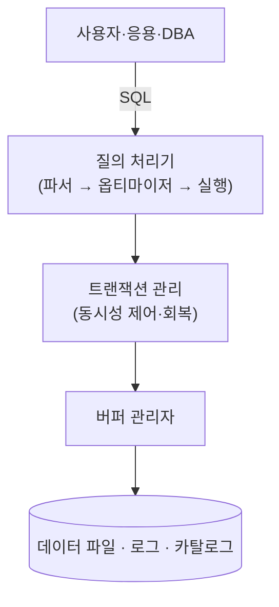

# 데이터베이스 (Database)

---

## I. 공유·통합된 정보 자산, 데이터베이스의 개요

### 가. 정의

- 특정 조직의 업무를 위해 **여러 사용자가 공유(Shared)하도록 통합(Integrated)·저장(Stored)되어 운영(Operational)되는 상호 관련된 데이터의 집합**

### 나. 특징

| 구분 | 내용 |
| --- | --- |
| 등장 배경 | 파일 시스템의 데이터 중복·종속성·불일치 문제 해결 |
| 데이터 요건 | 공유·통합·저장·운영 데이터 |
| 운영 특성 | 실시간 접근성, 계속적 변화, 동시 공유, 내용에 의한 참조 |
| 관리 수단 | [[DBMS]]가 데이터 독립성, 무결성, ACID [[트랜잭션]] 보장 |

---

## II. 구조 및 구성요소

### 가. DB 시스템 구조

- 사용자의 [[SQL(Structured Query Language)|SQL]]이 질의 처리기에서 실행 계획으로 바뀌고, 트랜잭션 관리자의 통제 아래 버퍼를 거쳐 저장소에 반영

### 나. 핵심 구성요소

| 구분 | 요소 | 설명 |
| --- | --- | --- |
| 구조 | [[ANSI SPARC 모델(3-단계 데이터베이스 구조) 데이터 독립성\|3단계 스키마]] | 외부·개념·내부 [[스키마]] 분리로 논리적·물리적 데이터 독립성 확보 |
| 질의 처리 | [[OPTIMIZER\|옵티마이저]] | 통계 기반 비용 계산으로 접근 경로·조인 순서 결정 |
| 트랜잭션 | ACID | 원자성, 일관성, 고립성, 지속성 보장 |
| 동시성 제어 | [[Locking]], [[MVCC(다중 버전 동시성 제어) 2가지 유형\|MVCC]] | 동시 접근 시 직렬 가능성 보장 |
| 회복 | WAL, [[ARIES]] | 로그 선기록 후 REDO·UNDO로 장애 복구 |
| 저장·색인 | B+Tree, LSM-Tree | 범위 검색 최적화, 쓰기 집약 워크로드 최적화 |
| 무결성 | 개체·참조·도메인 무결성 | PK, FK, CHECK 제약으로 오류 유입 차단 |
| 메타데이터 | [[시스템 카탈로그]] | 스키마·제약·권한·통계 정보 저장 |

---

## III. 비교 및 동향

### 가. DB 유형 비교

| 비교 항목 | RDBMS | [[NoSQL (CAP 이론 BASE 속성)\|NoSQL]] | [[New SQL\|NewSQL]] | 벡터 DB |
| --- | --- | --- | --- | --- |
| 데이터 모델 | 테이블 | Key-Value, Document, Column-Family, Graph | 테이블 | 고차원 벡터 + 메타데이터 |
| 일관성 | ACID | BASE (최종 일관성) | 분산 ACID | 제품별 상이 |
| 확장 | 주로 Scale-Up | Scale-Out | Scale-Out | Scale-Out |
| 스키마 | Schema-on-Write | 유연 (Schemaless) | Schema-on-Write | 차원 고정 + 유연 메타데이터 |
| 질의 | SQL | 제품별 API | 분산 SQL | 근사 최근접 탐색 ([[ANN(Approximate Nearest Neighbor)알고리즘\|ANN]]) |
| 예 | Oracle, PostgreSQL, MySQL | MongoDB, Redis, Cassandra | [[CockroachDB]], TiDB, Spanner | Milvus, Pinecone, pgvector |

### 나. 동향

- **스토리지–컴퓨팅 분리**: Aurora, Snowflake 등 [[클라우드 네이티브]] DB의 서버리스·탄력 확장
- **HTAP**: 행 저장([[OLTP]])과 열 저장([[OLAP]]) 엔진을 하나의 DB에서 함께 운영
- **벡터 검색 내장**: RAG 수요로 PostgreSQL(pgvector), Oracle 23ai 등 기존 DB가 벡터 인덱스(HNSW) 지원

---

### 🔗 연관 토픽

- **소속 도메인**: [[00_데이터베이스_MOC|🗄️ 데이터베이스]]
- **세부 분류**: `1. 데이터 모델링 & 관계형 DB 설계`
- **핵심 연관 토픽**:
  - [[DBMS]]
  - [[스키마]]
  - [[트랜잭션]]
  - [[NoSQL (CAP 이론 BASE 속성)]]
  - [[시스템 카탈로그|시스템 카탈로그 (System Catalog)]]
