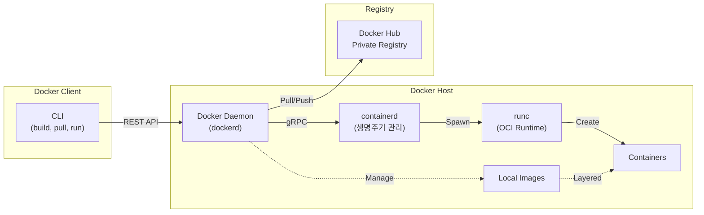

# 도커 (Docker)

---

## I. Build Once, Run Anywhere, 도커의 개요

### 가. 정의

- 리눅스 [[커널]]의 Namespace·cgroups를 이용해 애플리케이션과 실행 환경을 **이미지로 패키징하고 격리된 [[컨테이너]]로 배포·실행**하는 오픈소스 컨테이너 플랫폼

### 나. 특징

| 구분 | 내용 |
| --- | --- |
| 등장 배경 | [[Hypervisor (VMM)\|하이퍼바이저]] 기반 VM의 오버헤드, [[MSA (Micro Service Architecture)\|MSA]]·[[DevOps]] 확산에 따른 빠르고 일관된 배포 요구 |
| 경량성 | 호스트 OS 커널 공유, Guest OS 없이 초 단위 기동, 높은 집적도 |
| 이식성 | 개발·테스트·운영 환경 불일치 해소 |
| 불변 인프라 | 변경 시 이미지를 다시 빌드해 교체 (Immutable Infrastructure) |
| 코드화 | Dockerfile로 실행 환경을 선언적으로 정의 |

---

## II. 아키텍처 및 구성요소

### 가. 아키텍처

- 클라이언트의 REST API 요청을 dockerd가 받아 containerd → runc 순으로 컨테이너를 생성하는 OCI 표준 기반 구조

### 나. 구성요소

| 구분 | 요소 | 설명 |
| --- | --- | --- |
| 커널 기능 | Namespace | PID·NET·IPC·MNT·UTS·USER 등 자원의 가시성 격리 |
| | cgroups | 컨테이너별 [[CPU]]·메모리·I/O 사용량 제한 |
| | UnionFS (OverlayFS) | 읽기 전용 이미지 레이어 위에 쓰기 레이어를 겹쳐 이미지 [[재사용]]·저장공간 절감 |
| 엔진 | Docker Daemon (dockerd) | API 처리, 이미지·컨테이너·네트워크·볼륨 관리 |
| | containerd / runc | 고수준 런타임(생명주기·이미지) / 저수준 OCI 런타임(실제 생성) |
| 빌드 · 배포 | Dockerfile / BuildKit | 이미지 정의 스크립트, 병렬 빌드·캐싱 지원 빌드 엔진 |
| | Registry | 이미지 저장·배포 (Docker Hub, Harbor 등) |
| | Docker Compose | YAML로 다중 컨테이너 서비스·네트워크·볼륨 일괄 정의 |

---

## III. 비교 및 동향

### 가. 도커(컨테이너) vs 하이퍼바이저(VM)

| 비교 항목 | 도커 (컨테이너) | 하이퍼바이저 (VM) |
| --- | --- | --- |
| 가상화 수준 | [[OS(운영체제)\|OS]] 수준 | 하드웨어 수준 |
| Guest OS | 없음 (호스트 커널 공유) | VM마다 독립 OS |
| 격리 수준 | 프로세스 격리, 커널 공유로 상대적 취약 | 하드웨어 수준 격리 |
| 기동 시간 | 초 단위 이하 | 분 단위 (OS 부팅) |
| 자원 효율 | 오버헤드 작고 집적도 높음 | 오버헤드 크고 집적도 낮음 |
| 주요 용도 | MSA, 무상태 앱, CI/CD | 레거시, 이기종 OS, 강한 격리 필요 환경 |

### 나. 동향

- **역할 분리**: 쿠버네티스 v1.24(2022)에서 Dockershim 제거 후 운영 런타임은 containerd·CRI-O, 도커는 개발·빌드 도구(Docker Desktop, BuildKit) 중심. 도커로 빌드한 OCI 이미지는 그대로 사용 가능
- **보안 강화**: Rootless 모드, 이미지 서명(Sigstore cosign)·SBOM·취약점 스캔(Docker Scout) 등 공급망 보안 기능 확대
- **AI 개발 지원**: Docker Model Runner 등 로컬 LLM 실행·AI 에이전트 구성을 Compose로 관리하는 기능 추가

---

### 🔗 연관 토픽

- **소속 도메인**: [[00_디지털서비스_MOC|🚀 디지털서비스]]
- **세부 분류**: `1. 클라우드 컴퓨팅 & 가상화 인프라`
- **핵심 연관 토픽**:
  - [[컨테이너|컨테이너 (Container)]]
  - [[쿠버네티스|쿠버네티스(Kubernates)]]
  - [[가상화]]
  - [[Hypervisor (VMM)]]
  - [[MSA (Micro Service Architecture)|MSA]]
