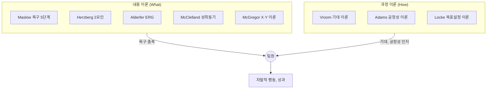

# 동기부여 이론 (Motivation Theory)

---

## I. 팀원이 스스로 움직이게 하는 원리, 동기부여 이론의 개요

### 가. 정의

- 구성원이 목표 달성을 위해 **자발적·지속적으로 노력하게 만드는 심리적 원리**를 설명하는 이론으로, 욕구에 초점을 둔 **내용 이론**과 인지 과정에 초점을 둔 **과정 이론**으로 구분

### 나. 필요성 및 특징

| 구분 | 내용 |
| --- | --- |
| 지식 근로자 | 창의성·문제 해결이 중요한 IT 업무는 외적 보상만으로 동기 유지 곤란 |
| 다양한 가치관 | 세대·직무별로 다른 동인 파악 필요 |
| PM 역할 | PMBOK 자원·팀 관리, 7판 팀 성과 영역에서 동기부여를 리더십 역량으로 강조 |
| 관점 | 무엇이 동기를 일으키는가(내용) vs 어떻게 동기가 형성되는가(과정) |

---

## II. 이론 체계와 주요 이론

### 가. 체계도

- 내용 이론은 충족할 욕구·요인을, 과정 이론은 보상 기대와 공정성 판단이 행동으로 이어지는 과정을 설명

### 나. 주요 이론

| 구분 | 요소 | 설명 |
| --- | --- | --- |
| 내용 이론 | 욕구단계 (Maslow) | 생리 → 안전 → 사회(소속) → 존경 → 자아실현, 하위 욕구 충족 후 상위 욕구 발현 |
| | 2요인 (Herzberg) | 위생 요인(급여·근무 조건)은 불만족 방지, 동기 요인(성취·인정·책임)이 만족 유발 |
| | ERG (Alderfer) | 존재·관계·성장, 여러 욕구 동시 작용, 좌절-퇴행 |
| | 성취동기 (McClelland) | 성취·권력·친교 욕구 중 지배적 욕구에 맞춘 직무 배정 |
| | X·Y 이론 (McGregor) | X: 통제가 필요한 인간관, Y: 자율적·책임감 있는 인간관 (Ouchi Z 이론 확장) |
| 과정 이론 | 기대 이론 (Vroom) | 동기 = 기대감(E) × 수단성(I) × 유의성(V), 하나라도 0이면 동기 없음 |
| | 공정성 (Adams) | 자신과 타인의 투입 대비 산출 비율 비교, 불공정 인식 시 투입 조정 |
| | 목표설정 (Locke) | 구체적이고 도전적인 목표와 피드백이 성과 향상, 실무에선 SMART 기준(Doran) 활용 |
| 현대 이론 | Motivation 3.0 (Pink) | 자율성·숙련·목적의 내재적 동기 강조 (『Drive』 2009) |

---

## III. 비교 및 동향

### 가. 내용 이론 vs 과정 이론

| 비교 항목 | 내용 이론 | 과정 이론 |
| --- | --- | --- |
| 핵심 질문 | 무엇이 사람을 움직이는가 | 어떻게 행동이 유도되는가 |
| 주요 변수 | 욕구, 요인 | 기대, 보상, 공정성 인지 |
| 인간관 | 욕구를 지닌 존재 | 계산·판단하는 합리적 존재 |
| IT 조직 적용 | 성장 기회, 인정 문화, 업무 환경 | 명확한 목표([[OKR]]), 공정한 평가·보상 |
| 한계 | 개인차·상황 변화 설명 부족 | 합리성 가정 과도 |

### 나. 동향

- **내재적 동기 중시**: 자율 팀, 기술 성장 지원, 목적 공유를 애자일 조직 운영 원리로 채택
- **심리적 안전감**: 구글 아리스토텔레스 프로젝트에서 고성과 팀의 핵심 요인으로 확인, 회고·실패 공유 문화 확산
- **OKR 기반 목표 관리**: 도전적 목표 설정과 투명한 공유로 목표설정 이론 실천

---

### 🔗 연관 토픽

- **소속 도메인**: [[00_프로젝트관리_MOC|📋 프로젝트관리]]
- **세부 분류**: `5. 애자일 프로젝트 관리 & 개발 운영 (Agile PM)`
- **핵심 연관 토픽**:
  - [[터크만 팀 개발 5단계]]
  - [[갈등관리]]
  - [[OKR]]
  - [[PMBOK 7판 (Project Management Body of Knowledge 7th Ed.)]]
  - [[애자일 선언문]]
