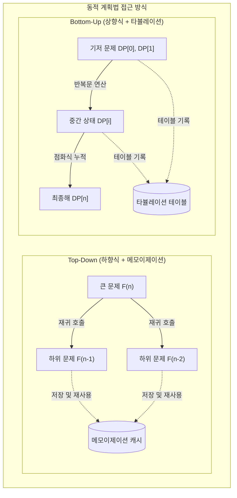

# 동적 계획법 (Dynamic Programming)

---

## I. 중복 연산 최소화를 위한 최적화 기법, 동적 계획법의 개요

### 가. 정의

- 복잡한 문제를 여러 개의 작은 하위 문제(Subproblems)로 나누어 해결한 후, **하위 문제의 해를 저장하고 재사용(Memoization/Tabulation)하여 전체 문제의 최적해를 구하는 알고리즘 설계 기법**

### 나. 특징 및 필요성

| 구분 | 내용 |
| --- | --- |
| 지수 시간 단축 | 단순 재귀 호출 시 발생하는 지수 시간($O(2^N)$)의 중복 계산을 다항 시간($O(N)$ 또는 $O(N^2)$)으로 단축 |
| 기억하며 풀기 | 계산된 부분 문제의 결과를 캐시나 테이블에 저장하여 중복 호출 시 $O(1)$에 반환 |
| 필수 충족 조건 | 최적 부분 구조(Optimal Substructure)와 부분 문제의 중복(Overlapping Subproblems) 성립 필요 |
| 핵심 적용 분야 | 최단 경로 탐색(플로이드-워셜, 벨만-포드), 자원 배분(배낭 문제), 유전자 서열 정렬, 강화학습 |

---

## II. 개념도 및 핵심 구성요소

### 가. 개념도 (하향식 vs 상향식)

- 하향식(Top-Down)은 큰 문제에서 재귀 호출로 내려가며 메모이제이션을 활용하고, 상향식(Bottom-Up)은 기저 문제부터 반복문으로 테이블을 채워나감

### 나. 핵심 구성요소 및 설계 원리

| 구분 | 요소 | 설명 |
| --- | --- | --- |
| 성립 조건 | 최적 부분 구조 | 전체 문제의 최적해가 작은 하위 문제들의 최적해로부터 구성되는 성질 |
| | 부분 문제 중복 | 문제를 분할할 때 동일한 하위 문제가 재귀 과정에서 반복적으로 등장하는 성질 |
| 핵심 기법 | 메모이제이션 (Memoization) | Top-Down 방식에서 계산된 하위 문제의 결괏값을 메모리에 캐싱하여 중복 계산 방지 |
| | 타뷸레이션 (Tabulation) | Bottom-Up 방식에서 가장 작은 문제부터 차례대로 풀며 결과를 1차원/2차원 배열에 기록 |
| 설계 요소 | 점화식 (Recurrence Relation) | 상태와 상태 간의 전이 관계를 수학적으로 정의한 상태 전이 방정식 ($DP[i] = f(DP[i-1], \dots)$) |
| | 기저 상태 (Base Case) | 재귀 탈출 또는 반복문 시작점이 되는 가장 작은 문제의 기저값 정의 |
| 구현 방식 | 재귀 호출 (Recursion) | 하향식 구현 시 직관적이나 함수 호출 스택 오버헤드 발생 가능 |
| | 반복문 (Iteration) | 상향식 구현 시 스택 오버플로우 위험이 없고 캐시 지역성(Locality)이 우수 |

---

## III. 알고리즘 비교 및 동향

### 가. 동적 계획법 vs 분할 정복

| 비교 항목 | 동적 계획법 (Dynamic Programming) | 분할 정복 (Divide & Conquer) |
| --- | --- | --- |
| 하위 문제 관계 | **상호 의존적** (하위 문제 간 중복 연산 발생) | **상호 독립적** (하위 문제 간 중복 없음) |
| 해의 재사용 | 계산 결과를 메모리에 저장 후 지속 **재사용** | 문제를 독립적으로 해결한 뒤 결합(Merge) |
| 메모리 오버헤드 | 추가 메모리 공간(캐시 또는 테이블) 필수 | 호출 스택 외 별도 결과 저장 테이블 불필요 |
| 구현 방식 | Top-Down(재귀+캐시), Bottom-Up(반복문) | 주로 Top-Down 재귀 호출 기반 분할 및 병합 |
| 대표 알고리즘 | 피보나치, 0-1 배낭 문제, 최장 공통 부분 수열(LCS) | [[병합 정렬]], [[퀵 정렬]], 이진 탐색 |

### 나. 동향

- **초거대 언어 모델([[초거대 언어 모델|LLM]]) 인퍼런스 최적화(KV Cache)**: 이전 생성 토큰의 Key-Value Attention 텐서를 재계산하지 않고 메모리에 저장해 재사용하는 KV 캐싱은 DP의 메모이제이션 철학을 딥러닝 추론에 적용한 핵심 기술
- **강화학습([[강화학습]]) 가치 반복**: 마르코프 결정 과정(MDP)에서 벨만 최적 방정식을 풀어 최적 정책을 도출하는 Policy Iteration 및 Value Iteration의 수학적 기반으로 동작
- **근사 동적 계획법(ADP)**: 상태 공간이 기하급수적으로 폭증하는 '차원의 저주(Curse of Dimensionality)'를 극복하기 위해 신경망을 가치 함수 추정기로 결합한 심층 강화학습(DQN 등)으로 발전

---

### 🔗 연관 토픽

- **소속 도메인**: [[00_컴퓨터구조_MOC|💻 컴퓨터구조]]
- **세부 분류**: `5. 핵심 알고리즘 & 계산 복잡도 (Algorithms)`
- **핵심 연관 토픽**:
  - [[알고리즘]]
  - [[강화학습]]
  - [[병합 정렬|병합 정렬 (Merge Sort)]]
  - [[퀵 정렬|퀵 정렬 (Quick Sort)]]
  - [[초거대 언어 모델]]
