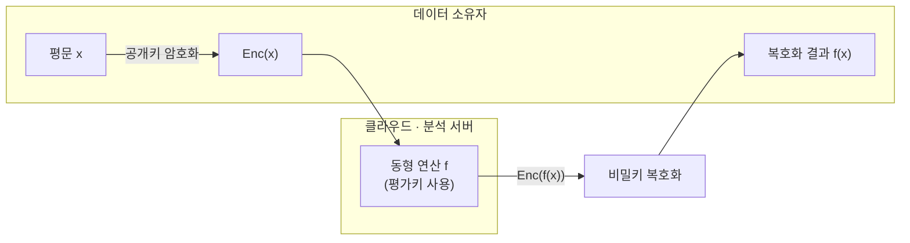

# 동형 암호 (Homomorphic Encryption)

---

## I. 복호화 없이 계산하는, 동형 암호의 개요

### 가. 정의

- **암호문 상태에서 연산한 결과를 복호화하면 평문에 같은 연산을 한 결과와 일치**하도록 설계된 암호 방식 ($Dec(f(Enc(x))) = f(x)$)

### 나. 특징

| 구분 | 내용 |
| --- | --- |
| 사용 중 데이터 보호 | 클라우드·외부 분석 시에도 평문 노출 없이 처리 |
| 보호·활용 양립 | 민감 데이터(의료·금융) 결합·분석·AI 추론 |
| 격자 기반 | LWE·RLWE 난제 기반으로 양자 내성 기대 |
| 성능 부담 | 평문 연산 대비 수천~수만 배 느리고 암호문 크기 증가 |
| 노이즈 | 연산할수록 오차가 커져 관리 필요 |

---

## II. 동작 구조 및 구성요소

### 가. 위탁 연산 구조

- 데이터 소유자는 암호문만 맡기고, 서버는 평가키로 암호문 연산을 수행해 암호화된 결과만 돌려줌

### 나. 구성요소

| 구분 | 요소 | 설명 |
| --- | --- | --- |
| 수학적 기반 | LWE / RLWE | 오류를 더한 격자 문제, 노이즈가 안전성의 근원 |
| 키 | 비밀키·공개키 | 복호화와 암호화 |
| | 평가키 | 곱셈 후 재선형화, 회전, 부트스트래핑에 사용 |
| 핵심 기법 | 부트스트래핑 | 암호문을 동형적으로 복호화해 누적 노이즈를 줄임 (Gentry, 2009) |
| | 모듈러스 스위칭·재조정 | 곱셈 후 노이즈·스케일 관리 |
| | SIMD 패킹 | 한 암호문에 여러 슬롯을 담아 병렬 연산 |
| 스킴 | BGV / BFV | 정수 정확 연산 |
| | CKKS | 실수 근사 연산, 머신러닝에 적합 |
| | TFHE / FHEW | 비트 단위 논리 연산과 빠른 부트스트래핑 |

---

## III. 비교 및 동향

### 가. 동형성 수준별 비교

| 비교 항목 | 부분 동형 (PHE) | 제한 동형 (SHE) | 완전 동형 (FHE) |
| --- | --- | --- | --- |
| 지원 연산 | 덧셈 또는 곱셈 하나 | 덧셈·곱셈 | 덧셈·곱셈 |
| 연산 횟수 | 해당 연산 무제한 | 깊이 제한 (노이즈 한계) | 부트스트래핑으로 무제한 |
| 대표 | RSA(곱셈), Paillier·ElGamal 변형 | BGN (곱셈 1회) | BGV, BFV, CKKS, TFHE |
| 활용 | 전자투표, 집계 | 제한된 질의 | 암호문 AI 추론, 통계 분석 |

### 나. 동향

- **하드웨어 가속**: GPU·FPGA·전용 ASIC(DARPA DPRIVE 등)으로 부트스트래핑 비용 절감
- **표준화**: ISO/IEC 18033-6(부분 동형) 제정, 완전 동형 표준(ISO/IEC 28033) 개발과 HomomorphicEncryption.org 커뮤니티 표준
- **PET 결합**: MPC·[[영지식증명]]·[[연합 학습]]과 결합한 프라이버시 보존 머신러닝(PPML), [[PEC(Privacy-Enhancing Computation)|PEC]]

---

### 🔗 연관 토픽

- **소속 도메인**: [[00_보안_MOC|🛡️ 보안]]
- **세부 분류**: `2. 현대 암호학 & 키 관리 · 전자서명`
- **핵심 연관 토픽**:
  - [[PEC(Privacy-Enhancing Computation)]]
  - [[기밀컴퓨팅|기밀컴퓨팅(Confidential Computing)]]
  - [[차분 프라이버시]]
  - [[양자내성암호]]
  - [[연합 학습]]
