# 드론 취약점 및 대응

---

## I. 안전한 3차원 공간 모빌리티 확보를 위한, 드론 취약점 및 대응의 개요

드론 취약점 및 대응은 원격 조종 또는 자율 비행하는 무인 항공기(UAV)의 기체, 무선 통신 링크, 지상통제국(GCS) 영역에서 발생하는 사이버 위협을 식별하고 이를 기술적·물리적으로 방어하는 일련의 보안 대응 체계이다.

| 구분 | 내용 |
| :--- | :--- |
| **정의** | 무인기(UAV) 기체, 통신 링크, 지상통제국(GCS) 전 구간의 위협을 방어하는 보안 체계 |
| **특수 환경** | GPS·RF·센서 등 다계층 공격 표면 노출, SWaP(Size, Weight, Power) 자원 제약 환경 극복 필요 |
| **보안 목표** | 기체 제어권 보호(가용성), 항법 신호 및 펌웨어 보호(무결성), 통신 패킷 보호(기밀성) |

---

## II. 드론 취약점 개념도 및 영역별 핵심 대응 기술 요소

### 가. 드론 사이버 위협 및 취약점 발생 개념도

```mermaid
flowchart TB
    subgraph Attacker["사이버 공격자 (Attacker)"]
        A1("신호 재밍 (Jamming)<br/>가용성 침해")
        A2("GPS 스푸핑 (Spoofing)<br/>무결성 침해")
        A3("하이재킹 / 스니핑 (MitM)<br/>기밀성 침해")
        A4("악성코드 / 펌웨어 변조<br/>제어권 탈취")
    end

    subgraph GCS["GCS (지상 통제국)"]
        G_Ctrl["조종기 / 관제 S/W"]
    end

    subgraph Comm["무선 통신 링크 (Data Link)"]
        RF["5G / LTE / RF / Wi-Fi"]
    end

    subgraph UAV["무인기 (Drone)"]
        FC["FC (비행 제어 컴퓨터) / 센서"]
        Storage["데이터 저장소 / 펌웨어"]
    end

    GCS <== "Telemetry / 원격 제어" ==> Comm
    Comm <== "명령 수신 / 영상 송신" ==> UAV

    A1 -. "통신 방해 / 연결 두절" .-> Comm
    A2 -. "거짓 위치 좌표 주입" .-> FC
    A3 -. "패킷 감청 / 세션 탈취" .-> Comm
    A4 -. "백도어 / 데이터 탈취" .-> Storage
    A4 -. "비인가 권한 접근" .-> G_Ctrl
```

### 나. 드론 영역별 취약점 및 핵심 보안 대응 기술

| 구분 | 핵심 대응 기술 | 세부 설명 및 적용 방안 |
| :--- | :--- | :--- |
| **기체 (UAV)** | Anti-Spoofing / 복합 측위 | 암호화 군용 GPS, 비전 센서 및 IMU 관성항법 융합 교차 검증으로 GPS 기만 방어 |
| **기체 (UAV)** | Secure Boot / TEE | 부팅 및 펌웨어 업데이트 시 전자서명 기반 무결성 검증 체계 및 하드웨어 보안 영역 적용 |
| **통신망 (Link)** | 주파수 도약 (FHSS/DSSS) | 항재밍 안테나 및 확산 대역 기술을 활용하여 주파수 간섭 및 DoS 공격 방어 |
| **통신망 (Link)** | 경량 [[암호화]] / E2EE | SWaP 제약을 고려한 경량 암호(LEA) 및 기체-GCS 간 종단간 암호화(VPN) 적용 |
| **GCS (통제국)** | MFA / [[RBAC]] 접근제어 | 관제 앱 및 조종기 접근 시 다중인증(MFA) 및 역할 기반 최소 권한 통제 |
| **GCS (통제국)** | [[EDR(Endpoint Detection and Response)\|EDR]] / 망분리 | 지상통제국 PC의 EDR 탑재 및 관제망-인터넷망 간 물리적·논리적 망분리 구축 |
| **인프라/제도** | Remote ID (원격 식별) | 비행 중인 드론의 식별 번호, 소유자, 위치 정보를 실시간 브로드캐스팅하는 표준 의무화 |
| **물리 방어** | Anti-Drone (안티 드론) | 레이더·RF 탐지 결합 무력화 수단(Soft Kill: 전파방해, Hard Kill: 그물/타격) 운용 |

---

## III. 공격 영역별 위협 비교 및 향후 기술 동향

### 가. 드론 공격 영역별(기체 vs 통신망 vs GCS) 위협 비교

| 비교 항목 | 기체 (UAV Drone) | 통신망 (Data Link) | 지상통제국 (GCS) |
| :--- | :--- | :--- | :--- |
| **주요 위협** | GPS 스푸핑, 센서 기만, 펌웨어 변조 | RF 신호 재밍, 데이터 스니핑, 하이재킹 | 악성코드 감염, 조종 권한 비인가 탈취 |
| **침해 영향** | 항로 이탈, 추락, 물리적 충돌 테러 | 제어 두절, 명령 변조, 비행 영상 유출 | 다수 드론 관제망 마비, 백도어 침투 |
| **핵심 대책** | 복합 측위, Secure Boot, TEE | 주파수 도약(FHSS), 경량 암호화(LEA) | MFA, EDR, 망분리, RBAC 인가 |
| **자원 제약** | SWaP 제약 극심 (배터리·중량 한계) | 대역폭 및 실시간 지연시간(Latency) 제약 | 상대적으로 고성능 컴퓨팅 자원 활용 가능 |

### 나. 향후 기술 동향 및 발전 전망
- **UTM 기반 도심항공교통([[UAM]]) 통합 보안 관제**: 다수의 무인기가 공존하는 도심 환경에서 실시간 비행 승인, 항로 이탈 감지, 상호 충돌 방지를 위한 통제 체계 필수화.
- **AI 및 [[블록체인]] 연계 보안 고도화**: 머신러닝(ML) 기반의 비정상 비행 패턴 실시간 탐지와 함께, 드론 비행 로그 및 센서 데이터 무결성 보장을 위한 블록체인 분산 원장 도입.
- **Security by Design 전주기 인증 제도화**: 기체 설계 단계부터 펌웨어 공급망 보안 검증을 의무화하고, 국방·공공 분야를 중심으로 KCMVP 및 하드웨어 보안 평가 표준 도입.

---

### 🔗 연관 토픽

- **소속 도메인**: [[00_보안_MOC|🛡️ 보안]]
- **세부 분류**: `4. 웹 & 애플리케이션 보안 · 취약점 점검`
- **핵심 연관 토픽**:
  - [[암호화|암호화 (Encryption)]]
  - [[기밀성]]
  - [[랜섬웨어]]
  - [[암호 알고리즘]]
  - [[무결성]]
