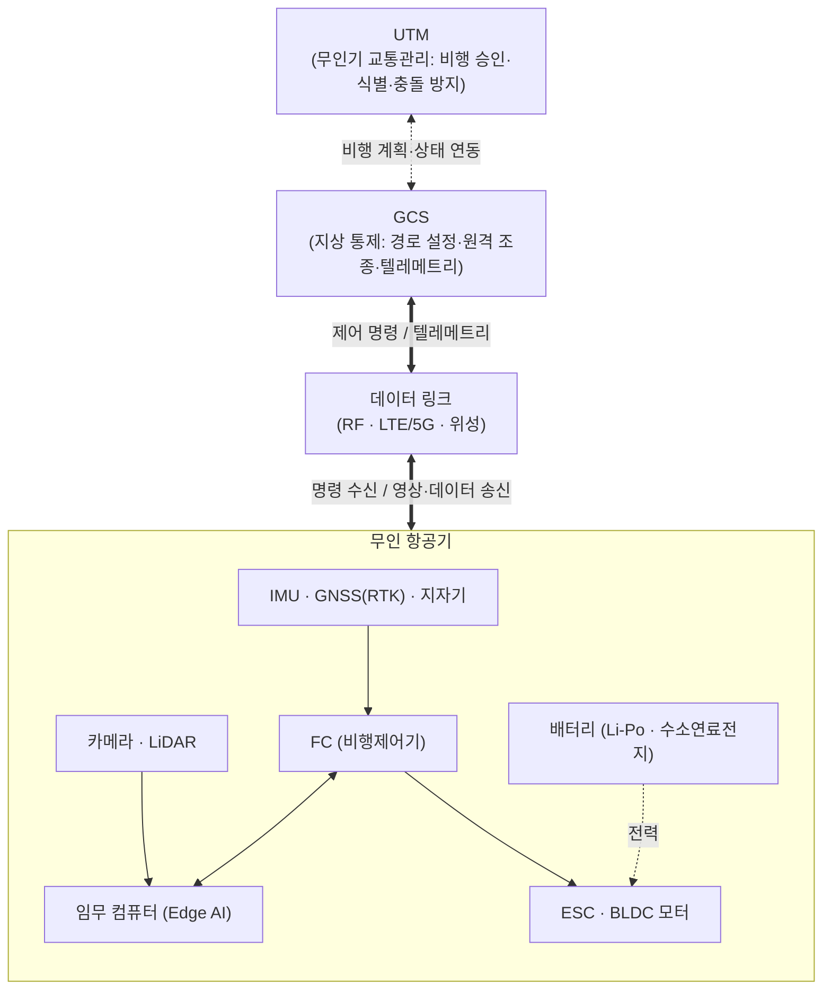

# 드론 (Drone)

---

## I. 3차원 공간 모빌리티, 드론의 개요

### 가. 정의

- 조종사가 탑승하지 않고 **원격 조종 또는 비행제어기(FC)에 의한 자율 비행**으로 임무를 수행하는 무인 항공기(UAV), 지상 통제·통신을 포함한 체계는 UAS

### 나. 특징

| 구분 | 내용 |
| --- | --- |
| 등장 배경 | 군사 정찰에서 출발, 센서(IMU·GNSS)·배터리·통신 발전으로 물류·농업·촬영·점검 등 민간 확산 |
| 3차원 이동 | 지형 제약 없이 접근 곤란 지역 임무 수행 |
| 비가시권 비행 | BVLOS(Beyond Visual Line of Sight) 비행으로 장거리 임무 |
| 지능화 | 온보드 [[EDGE\|Edge]] AI, 군집 비행 |
| 한계 | 배터리 비행시간, 기상 영향, 사생활·안전·보안 위협 |

---

## II. 시스템 구조 및 기술요소

### 가. 시스템 구조

- FC가 센서 데이터를 융합해 자세·위치를 제어하고, 통신 링크로 GCS·UTM과 연동하여 임무 수행

### 나. 기술요소

| 구분 | 요소 | 설명 |
| --- | --- | --- |
| 비행 제어 | FC (Flight Controller) | 센서 융합으로 자세·고도 유지, ESC로 모터 회전수 제어 (PX4, ArduPilot) |
| 항법 | IMU / RTK-GNSS | 가속도·자이로 관성 측정, RTK 보정으로 cm급 [[측위기술\|측위]] |
| 상황 인식 | Vision · LiDAR · SLAM | 주변 3D 지도 작성과 자기 위치 추정, 장애물 회피 |
| 통신 | C2 링크 · LTE/5G · [[저궤도 위성]] | 원격 제어·영상 전송, BVLOS 통신 확보 |
| 관제 | UTM | 다수 드론의 비행 승인·항로 배분·충돌 방지 |
| 임무 | Edge AI | 탑재 컴퓨터로 객체 인식·추적·화재 감지 |
| | 군집 비행 (Swarm) | 다수 드론의 분산 협업 비행 |
| 식별 | Remote ID | 비행 중 기체 식별번호·위치·고도를 방송하는 원격 식별 규제 (미국 FAA Part 89) |
| 대응 | 안티드론 | 탐지(레이더·RF) 후 재밍·포획으로 불법 드론 무력화 |

---

## III. 비교 및 동향

### 가. 드론 vs UAM

| 비교 항목 | 드론 (소형 무인기) | [[UAM]] |
| --- | --- | --- |
| 목적 | 촬영·점검·소형 화물 | 승객·대형 화물 도심 수송 |
| 탑승 | 무인 | 유인(조종사) → 자율 비행 목표 |
| 기체 | 멀티콥터 중심 | eVTOL |
| 관제 | UTM | UATM, 회랑(Corridor)·버티포트 |
| 규제 수준 | 기체 무게·비행 구역별 관리 | 항공기 수준 감항 인증 |

### 나. 동향

- **제도**: 국내 「드론 활용의 촉진 및 기반조성에 관한 법률」(2020 시행), 드론 특별자유화구역·규제 샌드박스로 BVLOS·도심 배송 실증
- **AAM 확장**: 드론 기술이 UAM·지역 간 항공(RAM)을 포함한 미래항공교통(AAM)으로 확장, K-UAM 그랜드챌린지 실증
- **군사·보안**: 저가 드론의 전장 활용 확대로 안티드론·자율 비행 기술 수요 증가

---

### 🔗 연관 토픽

- **소속 도메인**: [[00_디지털서비스_MOC|🚀 디지털서비스]]
- **세부 분류**: `3. 사물인터넷 (IoT) & 스마트 플랫폼 · 메타버스`
- **핵심 연관 토픽**:
  - [[UAM|UAM (Urban Air Mobility)]]
  - [[측위기술|측위기술 (LDT Location Determination Technology)]]
  - [[Physical AI|물리적 AI]]
  - [[저궤도 위성]]
  - [[C-ITS|C-ITS (Cooperative-Intelligent Transport Systems)]]
