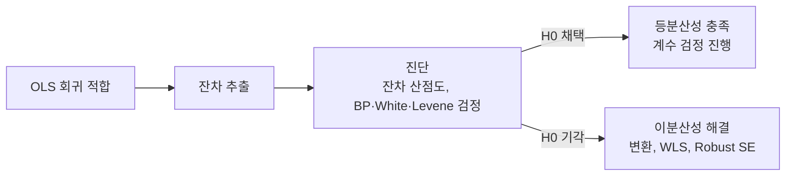

# 등분산성 (Homoscedasticity)

---

## I. 오차 분산이 일정하다는 가정, 등분산성의 개요

### 가. 정의

- [[회귀분석]]·[[ANOVA(Analysis of variance)|ANOVA]]에서 **독립변수 값이나 집단과 무관하게 오차항의 분산이 일정**한 성질, $Var(\epsilon_i) = \sigma^2$ (위배 시 이분산성)

### 나. 필요성

| 구분 | 내용 |
| --- | --- |
| 가우스-마르코프 정리 | OLS 추정량이 BLUE(최량 선형 불편 추정량)가 되기 위한 가정 중 하나 |
| 검정 신뢰성 | 위배 시 표준오차가 왜곡되어 t-검정·F-검정의 [[유의확률\|p-value]]를 믿을 수 없음 |
| 예측 구간 | 예측 오차 범위가 X 구간에 따라 달라지지 않음을 전제 |

---

## II. 진단 및 해결

### 가. 진단·해결 절차

- 잔차를 시각·통계적으로 진단하고, 이분산성이면 변수 변환이나 추정 방식 보정으로 해결

### 나. 진단·해결 기법

| 구분 | 요소 | 설명 |
| --- | --- | --- |
| 전제 | 가우스-마르코프 가정 | 선형성, 외생성(오차 평균 0), 등분산성, 오차 간 무상관 (정규성은 BLUE에 불필요, 소표본 검정에 필요) |
| 시각 진단 | 잔차 산점도 | 예측값 대비 잔차가 일정한 띠인지, 깔때기 모양인지 확인 |
| 통계 검정 | Breusch-Pagan | 잔차 제곱을 독립변수에 회귀해 선형 형태의 이분산성 검정 |
| | White | 제곱항·교차항까지 포함해 일반적 형태의 이분산성 검정 |
| | Levene·Bartlett | 집단 간 분산 동일성 검정 (Bartlett는 정규성 가정, Levene는 정규성에 강건) |
| 해결 | 변수 변환 | 종속변수에 로그·Box-Cox 변환으로 분산 안정화 |
| | 가중최소제곱법 (WLS) | 분산이 큰 관측치에 작은 가중치 부여 |
| | 강건 표준오차 | White(HC) 추정량으로 계수는 유지하고 표준오차만 보정 |

---

## III. 비교 및 동향

### 가. 등분산성 vs 이분산성

| 비교 항목 | 등분산성 | 이분산성 |
| --- | --- | --- |
| 잔차 분포 | 0을 중심으로 일정한 두께의 띠 | 깔때기·나팔 모양 등 패턴 존재 |
| 계수 불편성 | 유지 | 유지 |
| 효율성 | 최소 분산 (BLUE) | 최소 분산 아님 |
| 가설검정 | 유효 | 표준오차 왜곡으로 오류율 증가 |

### 나. 동향

- **트리 기반 모델 활용**: 분포 가정이 필요 없는 [[랜덤 포레스트]]·XGBoost·LightGBM이 예측 목적에서 많이 쓰이나, 계수 해석이 필요한 분석에서는 여전히 등분산성 점검 필요
- **불확실성 모델링**: 딥러닝에서 입력별로 다른 분산을 예측해 데이터 고유 잡음(Aleatoric Uncertainty)을 표현하는 이분산 회귀 활용 ([[베이지안 딥러닝]])

---

### 🔗 연관 토픽

- **소속 도메인**: [[00_인공지능_MOC|🤖 인공지능]]
- **세부 분류**: `1. 수학 · 통계학 & 데이터 전처리`
- **핵심 연관 토픽**:
  - [[회귀분석|회귀분석(Regression Analysis)]]
  - [[ANOVA(Analysis of variance)]]
  - [[t-검정 (t-test)]]
  - [[가설 검정]]
  - [[다중공선성|다중공선성 (Multicolinearity)]]
