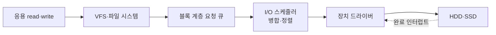

# 디스크 스케줄링 (Disk Scheduling)

---

## I. 헤드 이동을 줄이는, 디스크 스케줄링의 개요

### 가. 정의

- 대기 중인 여러 디스크 입출력 요청의 **처리 순서를 정해 탐색 시간(Seek Time)을 줄이고 [[처리량]]을 높이는** OS 기법

### 나. 특징

| 구분 | 내용 |
| --- | --- |
| 접근 시간 | 탐색 시간 + 회전 지연 + 전송 시간, 이 중 탐색 시간이 가장 큼 → 스케줄링 대상 |
| 평가 기준 | 처리량, 평균 응답시간, 응답시간 편차(공정성) |
| 기아 위험 | 헤드 근처 요청만 계속 처리하면 먼 요청이 무기한 대기 |
| 매체 변화 | SSD·NVMe는 기계적 탐색이 없어 정렬보다 병합·병렬 큐가 중요 |

---

## II. 동작 구조 및 알고리즘

### 가. 블록 계층 구조

- 파일 시스템이 만든 블록 요청을 스케줄러가 인접 요청 병합·순서 정렬 후 장치에 전달

### 나. 알고리즘

| 구분 | 요소 | 설명 |
| --- | --- | --- |
| 기본 | FCFS | 도착 순서대로 처리, 공정하나 헤드 이동이 많음 |
| 거리 우선 | SSTF (Shortest Seek Time First) | 현재 헤드에서 가장 가까운 요청 우선, 처리량 높음 / 먼 위치 요청 기아 발생 |
| 방향 유지 | SCAN (엘리베이터) | 한쪽 끝까지 이동하며 처리 후 방향 반전, 양 끝 트랙은 대기 편차 큼 |
| | C-SCAN | 한 방향으로만 처리하고 끝에 도달하면 처음으로 복귀, 대기시간 균일 |
| | LOOK·C-LOOK | SCAN·C-SCAN과 같되 디스크 끝이 아닌 마지막 요청 위치까지만 이동 |
| | N-step SCAN | 큐를 N개씩 묶어 처리 중에는 새 요청을 다음 묶음으로, 헤드 고착 방지 |
| Linux 스케줄러 | none (구 NOOP) | 정렬 없이 병합만 수행, NVMe 기본 |
| | mq-deadline | 읽기·쓰기별 만료 시간을 두어 기아 방지 |
| | BFQ | 프로세스별 예산(섹터 수)으로 공평 분배, 데스크톱 응답성 |
| | Kyber | 목표 지연 시간 기반 큐 깊이 조절, 고속 장치용 |
| 구조 | blk-mq | CPU별 소프트웨어 큐 + 장치 하드웨어 큐, 락 경합 감소 |

---

## III. 비교 및 동향

### 가. HDD vs SSD·NVMe 환경

| 비교 항목 | HDD | SSD·NVMe |
| --- | --- | --- |
| 목표 | 탐색 시간 최소화 | 병렬성 극대화, 지연 최소화 |
| 알고리즘 | SCAN, C-LOOK, mq-deadline, BFQ | none, mq-deadline, Kyber |
| 큐 구조 | 장치 큐 하나 | NVMe 최대 약 64K개 큐, 큐당 최대 약 64K 명령 |
| 병목 | 헤드 이동, 회전 | 컨트롤러·PCIe 대역폭, 소프트웨어 오버헤드 |
| 매체 관리 | OS 무관 | 마모 평준화·가비지 컬렉션은 SSD 내부 FTL이 담당 |

### 나. 동향

- **단일 큐 계층 제거**: Linux 5.0에서 기존 단일 큐 블록 계층과 CFQ·deadline·noop을 제거하고 blk-mq로 일원화
- **io_uring·폴링 I/O**: 비동기 제출과 완료 폴링으로 인터럽트·시스템 콜 비용 축소
- **Zoned Storage**: SMR HDD·ZNS SSD는 영역 내 순차 쓰기를 요구해 호스트가 쓰기 순서를 직접 관리

---

### 🔗 연관 토픽

- **소속 도메인**: [[00_운영체제_MOC|⚙️ 운영체제]]
- **세부 분류**: `2. CPU 스케줄링 알고리즘`
- **핵심 연관 토픽**:
  - [[스케줄링]]
  - [[입출력발생]]
  - [[기아|기아(Starvation)]]
  - [[처리량]]
  - [[유닉스 파일 시스템|파일 시스템(유닉스 파일시스템)]]
