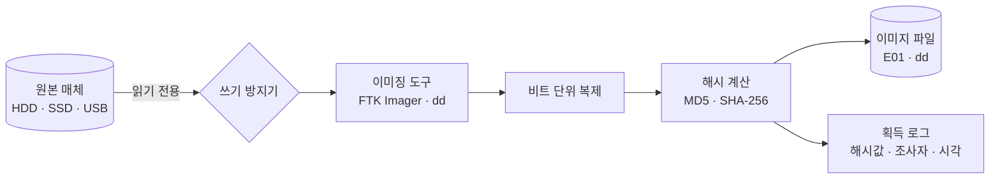

# 디스크 이미징 (Disk Imaging)

---

## I. 원본을 건드리지 않는 증거 확보, 디스크 이미징의 개요

### 가. 정의

- [[디지털 포렌식]] 조사를 위해 **원본 저장매체의 전체 섹터를 비트 단위(Bit-by-Bit)로 복제하여 이미지 파일로 만들고, 해시값으로 원본과의 동일성을 입증**하는 증거 수집 기법

### 나. 필요성 및 특징

| 구분 | 내용 |
| --- | --- |
| 증거 능력 | 원본 대신 사본을 분석해 원본 훼손 방지 (Forensic Soundness) |
| 은닉 데이터 확보 | 파일 복사로는 얻을 수 없는 비할당 영역·슬랙 공간까지 수집 |
| [[무결성]] 입증 | 획득 전후 해시값 비교로 동일성 증명 |
| 반복 분석 | 사본을 복제해 여러 분석자가 병렬 분석 가능 |

---

## II. 수집 절차 및 구성요소

### 가. 이미징 절차

- 쓰기 방지기로 원본 변경을 막은 상태에서 비트 단위로 복제하고, 해시값과 획득 정보를 로그로 남겨 연계보관성 확보

### 나. 구성요소

| 구분 | 요소 | 설명 |
| --- | --- | --- |
| 원본 보호 | 쓰기 방지기 (Write Blocker) | 원본 매체에 대한 쓰기·시간정보 변경을 하드웨어·소프트웨어로 차단 |
| 복제 | 비트 스트림 복제 | 파일시스템과 무관하게 매체 전체 섹터를 1:1 복제 |
| 검증 | 해시값 | MD5·SHA-1·SHA-256으로 원본과 사본의 동일성 증명 |
| 수집 범위 | 비할당 영역 | 삭제 표시만 되고 실제 데이터가 남은 영역, 삭제 파일 복구 대상 |
| | 슬랙 공간 | 클러스터 크기와 파일 크기 차이로 남는 공간 (RAM 슬랙, 파일 슬랙) |
| 포맷 | Raw (.dd) | 메타데이터 없이 비트 배열 그대로 저장 |
| | E01 (EnCase) | 압축·해시·조사자 정보 포함, 포렌식 분야에서 널리 쓰는 포맷 |
| 도구 | FTK Imager, dd, Guymager | GUI 도구(Windows)와 CLI 도구(Linux) |

---

## III. 비교 및 동향

### 가. 이미징 vs 클로닝 vs 파일 복사

| 비교 항목 | 디스크 이미징 | 디스크 클로닝 | 파일 복사 |
| --- | --- | --- | --- |
| 목적 | 증거 획득·보존 | 시스템 이전·백업 | 일반 백업·이동 |
| 산출물 | 이미지 파일 | 복제된 물리 매체 | 개별 파일 |
| 범위 | 전체 섹터 (비할당·슬랙 포함) | 전체 섹터 | 할당된 논리 파일만 |
| 무결성 검증 | 해시 검증 필수 | 보통 생략 | 메타데이터(시간 등) 변경 가능 |
| 포렌식 적합성 | 높음 | 보통 | 부적합 |

### 나. 동향

- **SSD의 TRIM·GC**: 삭제 후 컨트롤러가 블록을 지워 사후 복구가 어려워, 라이브 포렌식과 메모리 덤프 비중 증가
- **[[클라우드 포렌식]]**: 물리 매체 압수가 어려운 IaaS에서는 [[CSP]]의 볼륨 스냅샷·API로 원격 이미징
- **선별 압수**: 대용량 매체 전체 이미징 대신 현장 트리아지 후 필요한 데이터만 수집하는 방식 확대

---

### 🔗 연관 토픽

- **소속 도메인**: [[00_보안_MOC|🛡️ 보안]]
- **세부 분류**: `1. 정보보안 원칙 & 거버넌스 · 인증`
- **핵심 연관 토픽**:
  - [[디지털 포렌식|디지털 포렌식(Digital Forensic)]]
  - [[안티 포렌식|안티 포렌식(Anti-forensic)]]
  - [[클라우드 포렌식|클라우드 포렌식(Cloud Forensic)]]
  - [[무결성]]
  - [[해시함수|해시함수(알고리즘 측면)]]
