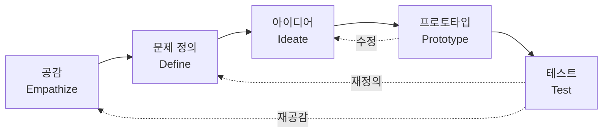

# 디자인 씽킹 (Design Thinking)

---

## I. 사용자 공감에서 출발하는 문제 해결, 디자인 씽킹의 개요

### 가. 정의

- 사용자에 대한 **공감으로 숨은 문제를 정의하고, 발산·수렴과 빠른 시제품 실험을 반복**해 해결책을 찾는 인간 중심 문제 해결 방법론 (IDEO, Stanford d.school 대중화)

### 나. 특징

| 구분 | 내용 |
| --- | --- |
| 인간 중심 | 기술·공급자가 아닌 사용자 관찰·공감에서 출발 |
| 발산과 수렴 | 아이디어를 넓게 펼친 뒤 좁히는 과정 반복 (더블 다이아몬드) |
| 빠른 실험 | 저비용 프로토타입으로 일찍 실패하고 학습 |
| 협업 | 다학제 팀이 함께 문제 정의·아이디어 도출 |

---

## II. 프로세스 및 구성요소

### 가. d.school 5단계

- 공감·정의가 문제 공간, 아이디어·프로토타입·테스트가 해결 공간이며, 테스트 결과에 따라 앞 단계로 돌아가 반복

### 나. 단계별 기법

| 구분 | 요소 | 설명 |
| --- | --- | --- |
| 공감 | 관찰·인터뷰·섀도잉 | 사용자의 실제 행동과 불편(Pain Point) 파악 |
| | 공감지도·[[고객여정지도]] | 사용자 생각·감정, 접점별 경험 시각화 |
| 문제 정의 | [[페르소나\|페르소나 (Persona)]] | 대표 사용자를 가상 인물로 구체화 |
| | POV·HMW | "우리가 어떻게 하면 ~할 수 있을까?" 형식의 문제 진술 |
| 아이디어 | 브레인스토밍 | 비판 금지, 양 우선, 자유 발상 |
| | SCAMPER | 대체·결합·응용·수정·용도 변경·제거·재배열 질문 |
| 프로토타입 | 페이퍼 프로토타입·목업 | 핵심만 담은 빠르고 저렴한 시제품 |
| 테스트 | 사용성 테스트 | 실제 사용자 반응으로 가설 검증 |

---

## III. 유사 방법론 비교 및 동향

### 가. 디자인 씽킹 vs 린 스타트업 vs 애자일

| 구분 | 디자인 씽킹 | [[린 방법론\|린 스타트업]] | [[Agile]] |
| --- | --- | --- | --- |
| 초점 | 올바른 문제 발견 | 사업 가설 검증 | 제품의 반복적 구현 |
| 핵심 질문 | 사용자에게 진짜 문제는? | 시장이 원하는가? | 제대로 만들고 있는가? |
| 주요 활동 | 공감, 아이디어, 프로토타입 | Build–Measure–Learn, [[MVP]] | 스프린트, [[SCRUM\|Scrum]] |
| 산출물 | 문제 정의, 제품 콘셉트 | 검증된 비즈니스 모델 | 작동하는 소프트웨어 |

- 결합 흐름: 디자인 씽킹으로 문제를 찾고, 린으로 검증하며, 애자일로 구현 (Gartner 제시 조합)

### 나. 동향

- **생성형 AI 활용**: 인터뷰 요약·인사이트 분류, 아이디어 확장, 화면 시안 자동 생성으로 단계 소요 시간 단축
- **DesignOps**: 디자인 조직의 도구·프로세스·협업을 운영 체계로 관리해 대규모 조직에 정착
- **공공 서비스 디자인**: 국민 참여 서비스 디자인, [[리빙랩, S.O.S랩|리빙랩]] 등 공공 정책 설계에 적용

---

### 🔗 연관 토픽

- **소속 도메인**: [[00_경영전략_MOC|📈 경영전략]]
- **세부 분류**: `3. 비즈니스 프로세스 혁신 & 디지털 전환 (DX)`
- **핵심 연관 토픽**:
  - [[고객여정지도|고객여정지도 (Customer Journey Map)]]
  - [[페르소나]]
  - [[린 방법론|린 (Lean) 방법론]]
  - [[리빙랩, S.O.S랩|리빙랩(Living Lab), S.O.S랩]]
  - [[Agile]]
