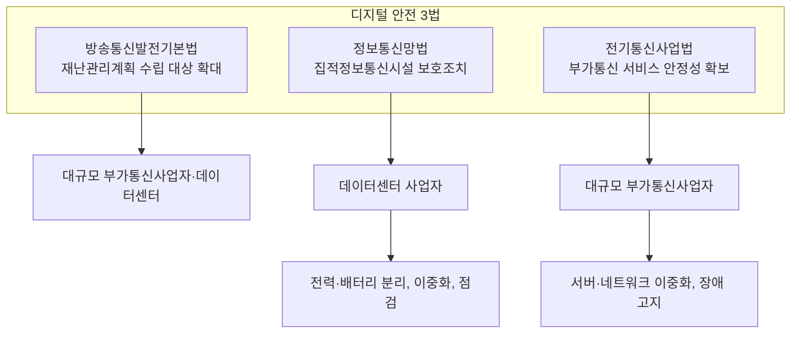

# 디지털 안전 3법

---

## I. 부가통신·데이터센터를 재난관리에 편입한, 디지털 안전 3법의 개요

### 가. 정의

- 2022년 10월 판교 데이터센터 화재로 인한 카카오 서비스 장애를 계기로, **대규모 부가통신사업자와 데이터센터를 방송통신 재난관리 체계에 포함**하도록 개정된 방송통신발전기본법·정보통신망법·전기통신사업법

### 나. 배경 및 특징

| 구분 | 내용 |
| --- | --- |
| 배경 | 단일 데이터센터 화재가 국민 생활 서비스(메신저·결제·지도) 장시간 중단으로 확산 |
| 규제 공백 해소 | 기간통신사업자 중심 재난관리를 부가통신사업자·데이터센터로 확대 |
| 3개 축 | 재난관리계획(기본법), 데이터센터 보호조치(망법), 서비스 안정성 확보(사업법) |
| BCP 법제화 | 이중화·분산·장애 고지 등 연속성 조치를 법적 의무로 규정 |

---

## II. 3법의 구조 및 구성요소

### 가. 개념도

- 과학기술정보통신부가 대상 사업자의 재난관리계획을 받고 점검하며, 사업자는 시설 보호·이중화·장애 보고 의무를 이행

### 나. 구성요소

| 구분 | 요소 | 설명 |
| --- | --- | --- |
| 법률 | 방송통신발전기본법 | 대규모 부가통신사업자·데이터센터를 재난관리계획 수립·점검 대상에 포함 |
| | 정보통신망법 | 집적정보통신시설(데이터센터)의 재난 대비 보호조치 의무화 |
| | 전기통신사업법 | 부가통신사업자의 서비스 안정성 확보 조치와 장애 시 이용자 고지 |
| 대상 (시행령 기준 예) | 부가통신사업자 | 일평균 이용자 1천만 명 이상 또는 국내 트래픽 비중 2% 이상 |
| | 데이터센터 | 전산실 바닥면적 22,500㎡ 이상 또는 수전 용량 40MW 이상 |
| 시설 조치 | 전력·배터리 안전 | 리튬이온 배터리실 분리, UPS [[다중화]], 화재 감지·소화 |
| 서비스 조치 | 이중화·분산 | 핵심 기능의 다중 데이터센터 분산 운영 ([[다중지역 A-A DRS]]) |
| | 장애 보고·고지 | 장애 발생 시 정부 보고와 이용자 고지 |

---

## III. 한계 및 동향

### 가. 쟁점과 보완 방향

| 구분 | 쟁점 | 보완 방향 |
| --- | --- | --- |
| 비용 | 이중화·시설 투자 부담 | [[DRaaS]]·멀티 리전 클라우드 활용 |
| 기준 | '서비스 안정성' 범위 해석 차이 | 정량 지표([[SLA]], RTO) 중심 가이드라인 |
| 규제 범위 | 중소 사업자 진입 장벽 우려 | 이용자 수·트래픽 기준으로 대상 한정 |

### 나. 동향

- **공공 시스템 이중화**: 2025년 국가정보자원관리원 대전센터 화재로 정부 시스템이 대규모 중단되며 공공 정보시스템의 이중화·재해복구 체계 강화 논의 확대
- **회복 탄력성 운영**: [[카오스 엔지니어링]]·AIOps·[[디지털 면역 시스템]]으로 장애를 사전 검증하고 자동 복구
- **지역 분산**: 수도권 집중 데이터센터를 지역 거점으로 분산하고 멀티 클라우드로 단일 장애점 제거

---

### 🔗 연관 토픽

- **소속 도메인**: [[00_경영전략_MOC|📈 경영전략]]
- **세부 분류**: `5. IT 투자 성과 평가 & 비즈니스 연속성 계획 (BCP)`
- **핵심 연관 토픽**:
  - [[BCP|BCP (Business Continuity Planning)]]
  - [[다중지역 A-A DRS]]
  - [[DRaaS]]
  - [[카오스 엔지니어링]]
  - [[디지털 면역 시스템|디지털 면역 시스템(DIS, Digital Immune System)]]
