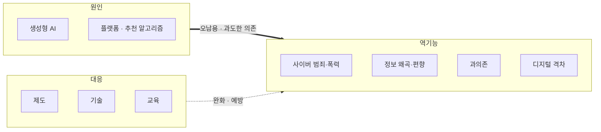

# 디지털 역기능 (Digital Dysfunction)

---

## I. 디지털 편익의 이면, 디지털 역기능의 개요

### 가. 정의

- AI·플랫폼·스마트 기기 등 디지털 기술의 확산 과정에서 발생하는 **사회적·경제적·윤리적 부작용**(범죄, 정보 왜곡, 과의존, 격차, 프라이버시 침해 등)의 총칭

### 나. 등장 배경 및 특징

| 구분 | 내용 |
| --- | --- |
| 생성형 AI 확산 | 딥페이크·가짜뉴스 제작 비용 하락으로 피해 규모 확대 |
| 알고리즘 추천 | 필터버블·확증 편향 강화, 과몰입 유도 |
| 디지털 의존 심화 | 키오스크·모바일 전용 서비스로 취약계층 소외 |
| 특징 | 국경 없는 빠른 확산, 피해 회복 곤란, 기술·제도·교육의 복합 대응 필요 |

---

## II. 발생 구조 및 유형·대응

### 가. 발생 구조

- 기술의 오남용과 과의존이 역기능을 낳으며, 제도·기술·교육을 함께 적용해 완화

### 나. 유형 및 대응

| 구분 | 요소 | 설명 |
| --- | --- | --- |
| 역기능 유형 | 사이버 범죄·폭력 | [[딥페이크]] 성범죄·사기, 사이버 불링, IP카메라 영상 유출 |
| | 정보 왜곡·[[편향]] | AI [[할루시네이션]], 에코체임버·필터버블 |
| | 과의존 | 스마트폰·숏폼·게임 과몰입으로 일상 기능 저하 |
| | 디지털 격차 | 고령층·장애인의 접근성 부족에 따른 기회 불평등 |
| | 프라이버시 침해 | 과도한 개인정보 수집·프로파일링 |
| 기술 대응 | 생성물 표시·탐지 | 워터마크·콘텐츠 출처 표준(C2PA), [[딥러닝]] 기반 딥페이크 탐지 |
| | 신뢰할 수 있는 AI | [[XAI]]로 판단 근거 설명, 편향 검증 |
| 제도 대응 | 디지털 권리장전 · AI 기본법 | 디지털 질서 원칙 제시(2023), [[인공지능]] 기본법 시행(2026.1) |
| 사회 대응 | 리터러시 · 포용 설계 | 디지털 시민성 교육, 웹·앱 접근성 준수 |

---

## III. 비교 및 동향

### 가. 대응 수단 비교

| 비교 항목 | 제도적 대응 | 기술적 대응 | 교육적 대응 |
| --- | --- | --- | --- |
| 주체 | 정부·국회 | 기업·연구기관 | 학교·지자체·시민단체 |
| 수단 | 법률, 가이드라인, 처벌 | 탐지·차단·워터마크 | 리터러시·윤리 교육 |
| 장점 | 구속력·강제성 | 실시간·대규모 대응 | 근본적 예방 |
| 한계 | 기술 변화 대비 입법 지연 | 우회·탐지 회피 기술과의 경쟁 | 효과 발현에 장기간 소요 |

### 나. 동향

- **디지털 권리장전(2023.9)**: 자유와 권리 보장, 공정한 접근과 기회 균등, 안전과 신뢰, 혁신 활성화, 인류 후생 증진 원칙 제시
- **AI 규제 법제화**: 국내 AI 기본법(고영향 AI·생성형 AI 표시 의무), EU AI Act 단계적 적용, 딥페이크 성범죄물 소지·시청 처벌 강화(2024)
- **플랫폼 책임 강화**: EU 디지털서비스법(DSA)으로 대형 플랫폼의 유해 콘텐츠 위험 평가·투명성 보고 의무화

---

### 🔗 연관 토픽

- **소속 도메인**: [[00_디지털서비스_MOC|🚀 디지털서비스]]
- **세부 분류**: `3. 사물인터넷 (IoT) & 스마트 플랫폼 · 메타버스`
- **핵심 연관 토픽**:
  - [[딥페이크]]
  - [[할루시네이션]]
  - [[편향]]
  - [[XAI]]
  - [[인공지능]]
