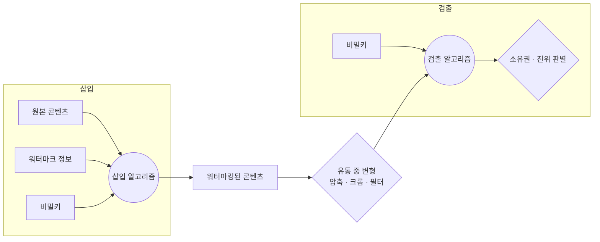

# 디지털 워터마킹 (Digital Watermarking)

---

## I. 저작권 증명에서 AI 생성물 식별까지, 디지털 워터마킹의 개요

### 가. 정의

- 이미지·오디오·영상·텍스트 등 디지털 콘텐츠에 **저작권자 정보나 식별 표식을 사람이 인지하기 어렵게 삽입하고, 필요 시 추출하여 소유권·진위를 확인**하는 기술

### 나. 특징

| 구분 | 내용 |
| --- | --- |
| 비가시성 | 삽입 후에도 사람이 품질 저하를 인지하지 못함 |
| 강인성 | 압축·크롭·필터링 등 변형 후에도 워터마크 유지 (저작권 보호용) |
| 연성 | 미세 변조에도 깨지도록 설계해 위·변조 탐지 (무결성 검증용) |
| 사후 추적 | 접근 차단이 아닌 유출 후 소유권 증명·유포자 추적 |
| AI 생성물 표시 | 생성형 AI 산출물 식별 수단으로 수요 증가 |

---

## II. 동작 구조 및 구성요소

### 가. 삽입·검출 구조

- 비밀키로 워터마크를 삽입한 뒤, 유통 과정의 변형을 거친 콘텐츠에서도 검출기로 워터마크를 추출해 판별

### 나. 구성요소

| 구분 | 요소 | 설명 |
| --- | --- | --- |
| 삽입 영역 | 공간 영역 | LSB 등 픽셀 값을 직접 변경 (구현 단순, 변형에 취약) |
| | 주파수 영역 | DCT·DWT 변환 계수에 삽입 (압축에 강함) |
| 유형 | 강인 워터마크 | 변형에도 유지, 저작권 보호 |
| | 연성 워터마크 | 변형 시 파괴, [[무결성]] 검증 |
| AI 기반 | [[딥러닝]] 워터마킹 | 인코더-디코더로 삽입·복원 (예: Google SynthID) |
| | 텍스트 워터마킹 | LLM 생성 시 토큰 확률(로짓)을 미세 조정해 통계적 표식 삽입 |
| 추적 | 포렌식 마킹 | 구매자·세션별 고유 정보를 삽입해 유출자 추적 ([[핑거프린팅]]) |

---

## III. 비교 및 동향

### 가. 콘텐츠 보호 기술 비교

| 비교 항목 | [[DRM(Digital Right Management)\|DRM]] | 워터마킹 | 스테가노그래피 |
| --- | --- | --- | --- |
| 목적 | 사전 접근 통제 | 사후 소유권 증명·추적 | 통신 사실 은닉 |
| 기법 | [[암호화]], 라이선스·권한 제어 | 공간·주파수 영역 삽입 | 매체 내 비밀 메시지 은닉 |
| 보호 대상 | 콘텐츠 이용 | 저작권자·구매자 식별 정보 | 메시지의 존재 자체 |
| 변형 내성 | 복호화 키 없으면 이용 불가 | 강인성 요구 | 낮음 |
| 활용 | 유료 VOD, 전자책, 사내 문서 | 불법 복제 추적, AI 생성물 식별 | 은밀한 데이터 교환 |

### 나. 동향

- **AI 생성물 표시 의무**: EU AI Act 제50조, 국내 AI 기본법에서 생성형 AI 산출물의 기계 판독 가능한 표시 요구
- **[[C2PA]] 연계**: 콘텐츠 출처 메타데이터(Content Credentials)와 비가시 워터마크를 함께 적용해 메타데이터 삭제에 대비
- **제거 공격 대응**: 재생성·확산 모델 기반 워터마크 제거 공격에 강인한 기법 연구

---

### 🔗 연관 토픽

- **소속 도메인**: [[00_보안_MOC|🛡️ 보안]]
- **세부 분류**: `1. 정보보안 원칙 & 거버넌스 · 인증`
- **핵심 연관 토픽**:
  - [[핑거프린팅|핑거프린팅(Fingerprinting)]]
  - [[DRM(Digital Right Management)]]
  - [[C2PA]]
  - [[무결성]]
  - [[암호화|암호화 (Encryption)]]
