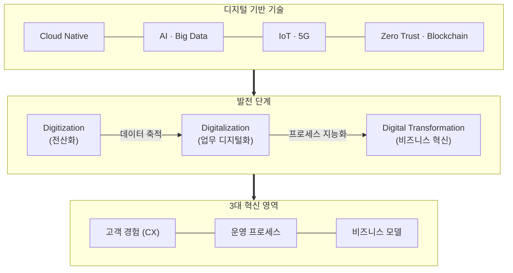

# 디지털 전환 (Digital Transformation, DX)

---

## I. 기술 도입을 넘어 사업 방식의 재설계, 디지털 전환의 개요

### 가. 디지털 전환의 정의

- 클라우드·AI·빅데이터 등 디지털 기술을 경영 전반에 적용하여 **비즈니스 모델, 프로세스, 고객 경험, 조직 문화를 근본적으로 바꾸는** 전사적 혁신 전략

### 나. 등장 배경 및 특징

| 구분 | 내용 |
| --- | --- |
| 환경 변화 | 불확실성(VUCA) 증대, 산업 경계 붕괴(Big Blur), 플랫폼 경제 가속 |
| 경쟁 변화 | 디지털 네이티브 기업의 파괴적 혁신 |
| 고객 변화 | 초개인화와 끊김 없는 옴니채널 경험 요구 |
| 특징 | 데이터 기반 의사결정, [[Agile]] 기반 민첩성, SW 중심 가치사슬 재편 |

---

## II. 디지털 전환의 단계 및 핵심 요소

### 가. 개념도

- 디지털 기반 기술 위에서 전산화 → 디지털화 → 전환 단계를 거쳐 고객 경험·운영·비즈니스 모델을 혁신

### 나. 핵심 구성요소

| 영역 | 요소 | 설명 |
| --- | --- | --- |
| 비즈니스 모델 | [[XaaS]], 구독 경제 | 소유에서 서비스·구독 모델로 전환 ([[서비타이제이션]]) |
| 고객 경험 | 옴니채널, XR | 온·오프라인 경계 없는 일관된 경험, 실감형 고객 접점 |
| 프로세스 | 하이퍼오토메이션 | RPA + AI + 프로세스 마이닝으로 [[End-to-End]] 자동화 |
| 조직·문화 | Agile & [[DevOps]] | 수평적 조직, CI/CD 기반 빠른 배포 |
| 인프라 | [[클라우드 네이티브]] | [[MSA (Micro Service Architecture)\|MSA]]·[[컨테이너]]로 확장성·유연성 확보 |
| 데이터·지능 | 빅데이터, [[인공지능]] | 데이터 레이크 기반 분석, AI 기반 의사결정 |
| 연결 | IoT, 5G | 물리 자산의 실시간 연결·제어, [[디지털 트윈]] |
| 보안 | [[제로 트러스트 보안모델\|Zero Trust]] | "항상 검증" 원칙의 보안 체계 |

---

## III. 단계별 비교 및 동향

### 가. Digitization vs Digitalization vs DX

| 비교 항목 | 전산화 (Digitization) | 디지털화 (Digitalization) | 디지털 전환 (DX) |
| --- | --- | --- | --- |
| 핵심 | 아날로그 정보를 디지털로 변환 | 업무 프로세스 최적화 | 비즈니스 모델·문화 혁신 |
| 목적 | 보관·검색 효율 | 비용 절감, 운영 효율 | 새로운 가치·수익 창출 |
| 주체 | IT 부서 | 현업 부서 | 전사 (CEO·CDO 주도) |
| 사례 | 문서 스캔, 바코드 | ERP, [[CRM]], RPA | 넷플릭스 구독 모델, 제조사의 플랫폼화 |
| 파급력 | 낮음 | 중간 | 매우 높음 |

### 나. 동향

- **AX로 진화**: DX 기반 위에 생성형 AI·에이전트를 업무 설계의 중심에 두는 [[AX (AI Transformation)\|AI 전환]]
- **Twin Transition**: 디지털 전환과 녹색 전환(GX)을 함께 추진해 [[ESG 경영]] 실현
- **성공 요건**: 기술 도입보다 경영진 리더십, 변화 관리, 구성원의 디지털 리터러시가 성패를 좌우

---

### 🔗 연관 토픽

- **소속 도메인**: [[00_경영전략_MOC|📈 경영전략]]
- **세부 분류**: `1. 경영 환경 분석 & 전략 수립 프레임워크`
- **핵심 연관 토픽**:
  - [[AX (AI Transformation)]]
  - [[클라우드 네이티브]]
  - [[XaaS|XaaS(Everything as a Service)]]
  - [[환경분석]]
  - [[Backcasting|Backcasting (백캐스팅)]]
