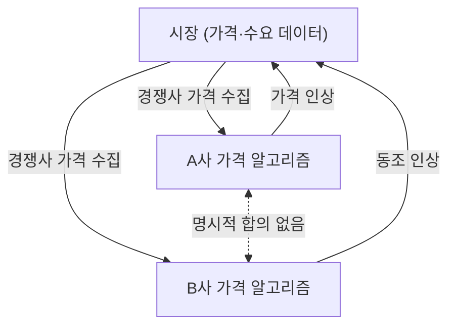

# 디지털 카르텔

---

## I. 알고리즘이 매개하는 담합, 디지털 카르텔의 개요

### 가. 정의

- 경쟁 사업자들이 명시적 합의 없이 **가격 결정 [[알고리즘]]을 매개로 가격을 동조화**하여 경쟁을 제한하는 담합 행위 (알고리즘 담합)

### 나. 배경 및 특징

| 구분 | 내용 |
| --- | --- |
| 동적 가격 확산 | 이커머스·플랫폼에서 수요·경쟁사 가격에 따른 자동 가격 결정 보편화 |
| 암묵적 담합 | 알고리즘 간 상호 반응만으로 높은 가격 수준에 수렴 가능 |
| 입증 곤란 | 경쟁법상 '합의(의사의 연락)' 요건 입증이 어렵고 블랙박스로 책임 소재 불명확 |

---

## II. 디지털 카르텔의 동작 구조 및 유형

### 가. 동작 개념도 (자율적 기계형)

- 각 사의 알고리즘이 시장 데이터를 보고 상대 반응을 학습([[강화학습]] 등)한 결과, 직접 소통 없이 초과 이윤 가격대에 수렴

### 나. 유형 (Ezrachi & Stucke, 『Virtual Competition』 2016)

| 구분 | 요소 | 설명 |
| --- | --- | --- |
| 유형 | 메신저 (Messenger) | 사람이 합의한 담합을 알고리즘이 실행·감시 |
| | 허브 앤 스포크 (Hub & Spoke) | 경쟁사들이 같은 제3자 가격 알고리즘(허브)을 사용해 가격 동조화 |
| | 예측 가능한 대리인 (Predictable Agent) | 각자 설계한 알고리즘이 시장 변화에 같은 방식으로 반응해 담합 효과 발생 |
| | 자율적 기계 (Digital Eye) | AI가 이윤 극대화 과정에서 스스로 담합적 균형을 학습 |
| 기반 기술 | 동적 가격 책정 | 수요·재고·경쟁사 가격으로 실시간 가격 산정 |
| | 가격 모니터링 | 웹 스크래핑·API로 경쟁사 가격을 지속 수집 |

---

## III. 규제 한계와 대응 및 동향

### 가. 규제 한계와 대응 방안

| 구분 | 한계 | 대응 방안 |
| --- | --- | --- |
| 합의 입증 | 명시적 합의 증거 없음 | 정황 증거·알고리즘 설계 의도 기반 판단, 합의 추정 요건 논의 |
| 블랙박스 | [[딥러닝]] 기반 결정 과정 설명 곤란 | 알고리즘 감사, [[XAI]] 기반 설명 의무 |
| 탐지 역량 | 대량 실시간 가격 변동을 수작업으로 감시 불가 | 경쟁당국의 데이터 분석 기반 감시 (Computational Antitrust) |

### 나. 동향

- **허브 앤 스포크 소송**: 미국 법무부의 RealPage 임대료 산정 알고리즘 소송(2024) 등 공통 가격 SW를 통한 담합 제재 사례 등장
- **플랫폼 규제 강화**: EU 디지털시장법(Digital Markets Act)이 게이트키퍼 플랫폼의 자기우대·데이터 결합 제한
- **국내**: 공정거래위원회가 알고리즘 조작에 의한 자사 우대 사건 제재, 알고리즘 담합 연구·감시 체계 검토

---

### 🔗 연관 토픽

- **소속 도메인**: [[00_경영전략_MOC|📈 경영전략]]
- **세부 분류**: `1. 경영 환경 분석 & 전략 수립 프레임워크`
- **핵심 연관 토픽**:
  - [[알고리즘]]
  - [[인공지능]]
  - [[XAI]]
  - [[강화학습]]
  - [[딥러닝]]
