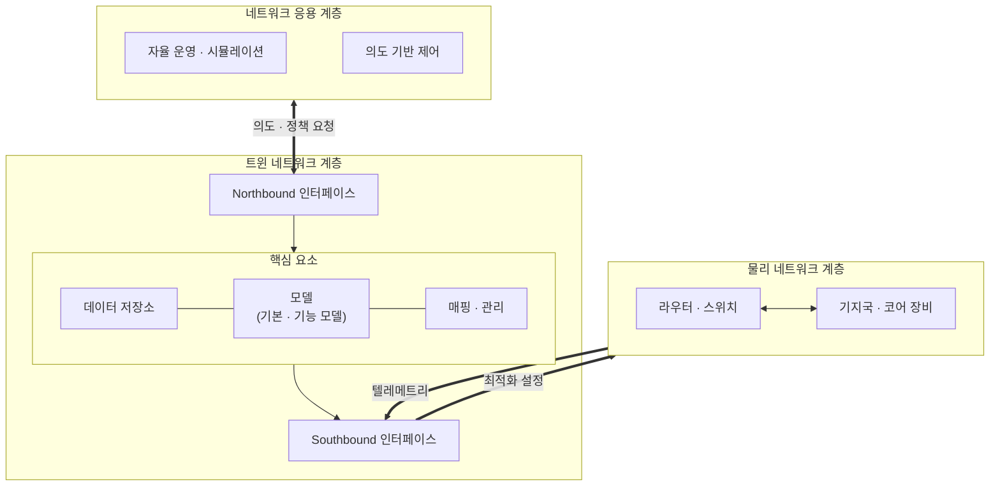

# 디지털 트윈 네트워크 (Digital Twin Network)

---

## I. 망을 바꾸기 전에 가상으로 먼저, 디지털 트윈 네트워크의 개요

### 가. 정의

- 물리 네트워크의 구성·상태·트래픽을 **가상 공간에 실시간으로 복제하고, 시뮬레이션·분석 결과를 다시 물리망에 반영**해 운영을 자동화하는 네트워크 모델 (ITU-T Y.3090)

### 나. 필요성 및 특징

| 구분 | 내용 |
| --- | --- |
| 복잡도 증가 | 5G·클라우드 환경의 망을 사람이 직접 설정·검증하기 어려움 |
| 사전 검증 | 설정 변경·장애·트래픽 폭증을 트윈에서 What-if 시뮬레이션 |
| 위험 감소 | 운영망에 영향 없이 신규 정책·구성 시험 |
| 폐루프 제어 | 분석 결과를 물리망에 반영하고 재측정하는 Closed-loop |
| 자율 운영 기반 | Zero-touch, 자율 네트워크(Autonomous Network)의 핵심 요소 |

---

## II. 구조 및 구성요소

### 가. 3계층 참조 구조 (ITU-T Y.3090)

- 물리망에서 수집한 데이터로 트윈을 만들고, 응용 계층의 시뮬레이션 결과를 Southbound로 물리망에 반영

### 나. 핵심 요소

| 구분 | 요소 | 설명 |
| --- | --- | --- |
| 4대 요소 | 데이터 (Data) | 토폴로지·설정·성능 지표를 통합 저장하는 저장소 |
| | 모델 (Models) | 망 요소를 표현하는 기본 모델과 트래픽 분석·예측용 기능 모델 |
| | 매핑 (Mapping) | 물리 [[엔티티]]와 트윈 엔티티를 대응시켜 상태 동기화 |
| | 인터페이스 (Interface) | 물리망(Southbound)·응용(Northbound) 연동 표준 인터페이스 |
| 데이터 수집 | 스트리밍 텔레메트리 | SNMP 폴링 대신 gNMI·INT로 고해상도 상태 실시간 수집 |
| 분석 | AI/ML 모델 | 장애 예측, 트래픽 예측, 최적 경로 계산 |
| 운영 | 폐루프 자동화 | 검증된 설정을 운영망에 자동 배포 후 결과 재측정 |
| 보안 | 접근 통제 · [[암호화]] | 트윈 데이터 변조 방지, [[무결성]] 확보 |

---

## III. 비교 및 동향

### 가. 기존 네트워크 시뮬레이터 vs 디지털 트윈 네트워크

| 비교 항목 | 기존 시뮬레이터 (NS-3 등) | 디지털 트윈 네트워크 |
| --- | --- | --- |
| 데이터 | 가정한 모델·과거 데이터 | 운영망 실시간 데이터 |
| 동기화 | 없음 (오프라인) | 물리망과 지속 동기화 |
| 결과 반영 | 사람이 수동 적용 | 폐루프로 자동 반영 |
| 용도 | 설계·연구 | 운영 최적화, 장애 예측, 변경 검증 |

### 나. 동향

- **표준화**: ITU-T Y.3090(요구사항·구조), IRTF NMRG의 네트워크 디지털 트윈 개념·구조 문서
- **실시간성 과제**: 대규모 망에서 데이터 동기화 지연과 모델 정확도 확보가 핵심 과제
- **의도 기반 연계**: [[IBN(Intent-Based Networking)|IBN]]의 의도를 트윈에서 먼저 검증한 뒤 [[네트워크 슬라이싱]]·자원 배분에 적용

---

### 🔗 연관 토픽

- **소속 도메인**: [[00_네트워크_MOC|🌐 네트워크]]
- **세부 분류**: `1. OSI 7계층 & 데이터링크 계층 (L1/L2)`
- **핵심 연관 토픽**:
  - [[IBN(Intent-Based Networking)]]
  - [[네트워크 슬라이싱]]
  - [[SDN(Software Defined Network)]]
  - [[네트워크 지능]]
  - [[NWDAF(Network Data Analytics Function)]]
