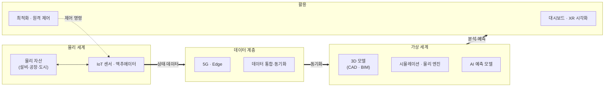

# 디지털 트윈 (Digital Twin)

---

## I. 현실을 실시간으로 복제하는 가상 모델, 디지털 트윈의 개요

### 가. 정의

- 물리 자산·시스템·프로세스를 가상 공간에 모델로 구현하고 **실시간 데이터로 동기화하여 모니터링·시뮬레이션·예측·제어**에 활용하는 기술 (Michael Grieves 2002년 개념 제시)

### 나. 특징

| 구분 | 내용 |
| --- | --- |
| 등장 배경 | [[인더스트리 4.0 5.0\|인더스트리 4.0]]·스마트 팩토리 확산, 사전 위험 예측과 [[유지보수]] 비용 절감 요구 |
| 실시간 동기화 | 센서 데이터로 물리·가상 상태를 지속 일치 |
| 양방향성 | 가상에서 도출한 결과를 물리 객체 제어로 피드백 |
| 사전 검증 | 현실에 적용하기 전 What-if 시뮬레이션 |
| 전 생애주기 | 설계·제조·운영·폐기 단계 데이터 연결 |

---

## II. 구조 및 기술요소

### 가. 구조

- 수집 → 동기화 → 분석·시뮬레이션 → 제어 피드백의 순환 구조

### 나. 기술요소

| 구분 | 요소 | 설명 |
| --- | --- | --- |
| 수집 | IoT 센서 | 온도·진동·위치 등 상태 측정 |
| 연결 | 5G · Edge | 대용량 데이터 저지연 전송, 현장 근처([[EDGE\|Edge]]) 처리 |
| 모델링 | 3D CAD / BIM / GIS | 형상·속성·공간 정보 구현 |
| 시뮬레이션 | 물리 엔진 · 해석 모델 | 물리 법칙 모사, 이상 상황 사전 검증 |
| 분석 | AI / ML | 고장 예지(Predictive Maintenance), [[최적화 알고리즘\|최적화]] |
| 시각화 | AR / VR / XR | 결과를 직관적으로 확인·조작 |
| 연계 | 디지털 스레드 | 설계~폐기 전 생애주기 데이터를 단일 흐름으로 연결 |
| 표준 | ISO 23247 · Asset Administration Shell | 제조 디지털 트윈 프레임워크, 자산 정보 표준 모델 |
| 보안 | 접근통제 · [[암호화]] | 제어 명령 위변조 방지, [[무결성]] 확보 |

---

## III. 비교 및 동향

### 가. 시뮬레이션 vs 디지털 트윈

| 비교 항목 | 전통적 시뮬레이션 | 디지털 트윈 |
| --- | --- | --- |
| 데이터 | 정적 입력, 일회성 | 실시간·지속 동기화 |
| 적용 시점 | 설계·개발 단계 | 전 생애주기 |
| 데이터 흐름 | 단방향 (입력 → 결과) | 양방향 (수집 ↔ 분석 ↔ 제어) |
| 범위 | 단위 장비·공정 | 공장·도시 등 시스템 통합 |

### 나. 동향

- **산업용 [[메타버스]]**: NVIDIA Omniverse(OpenUSD) 기반 가상 공장 설계·로봇 학습 확산
- **도시·국가 트윈**: 국토 디지털 트윈, 교통·전력·수자원 트윈 연계 (Virtual Singapore 등)
- **AI 결합**: 디지털 트윈에서 로봇·자율주행을 학습시키는 Sim-to-Real, 의료 분야 환자 트윈 연구

---

### 🔗 연관 토픽

- **소속 도메인**: [[00_디지털서비스_MOC|🚀 디지털서비스]]
- **세부 분류**: `3. 사물인터넷 (IoT) & 스마트 플랫폼 · 메타버스`
- **핵심 연관 토픽**:
  - [[CPS]]
  - [[메타버스|메타버스 (Metaverse)]]
  - [[Smart Factory|Smart Factory/스마트 팩토리(공장)]]
  - [[인더스트리 4.0 5.0|인더스트리 4.0 5.0 (Industry 4.0 5.0)]]
  - [[디지털 트윈 네트워크]]
