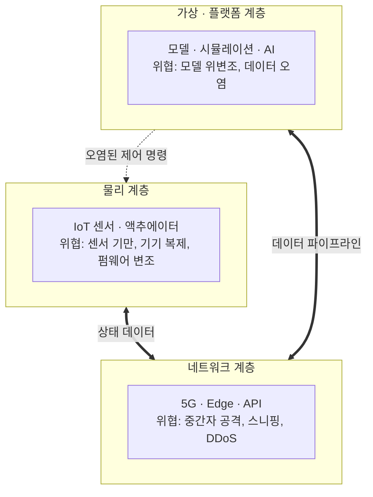

# 디지털 트윈(Digital Twin)의 보안 취약점 및 대응방안

---

## I. 가상의 해킹이 현실의 사고로, 디지털 트윈 보안의 개요

### 가. 정의

- 물리 객체와 가상 모델이 **실시간 양방향으로 동기화되는 [[디지털 트윈]] 환경에서 계층별 [[기밀성]]·[[무결성]]·[[가용성]] 위협을 식별하고 대응**하는 보안 체계

### 나. 필요성

| 구분 | 내용 |
| --- | --- |
| 공격 표면 확대 | IoT·5G·클라우드·API가 결합된 다계층 구조 |
| 물리적 피해 전이 | 가상 모델의 제어권 탈취가 설비 파괴·인명 피해로 연결 ([[CPS]]) |
| 의사결정 오염 | 조작된 데이터가 시뮬레이션·AI 예측을 왜곡해 연쇄 오작동 유발 |
| 데이터 민감성 | 설비 설계·공정 정보 등 핵심 자산 유출 위험 |

---

## II. 계층별 취약점 및 대응 기술

### 가. 계층별 위협 구조

- 물리·네트워크·가상 계층마다 고유 위협이 있어 계층별 대응을 겹겹이 적용하는 심층 방어 필요

### 나. 취약점 및 대응 기술

| 구분 | 요소 | 설명 |
| --- | --- | --- |
| 물리 | 센서 기만·기기 복제 | PUF 기반 기기 고유키로 디바이스 인증 |
| | 펌웨어 변조 | Secure Boot로 부팅 시 서명 검증 |
| 네트워크 | 비인가 접근 | [[제로 트러스트 보안모델\|제로 트러스트]] 기반 지속 인증·최소 권한 |
| | 스니핑·중간자 공격 | TLS·종단간 [[암호화]], 경량 암호(LEA) 적용 |
| 플랫폼 | 모델·이력 위변조 | 해시 체인·[[01_IT Tech/블록체인\|블록체인]]으로 데이터 생성·수정 이력 보존 |
| | API 취약점 | API 게이트웨이, 호출량 제한, [[OAuth(Open Authorize) 2.0\|OAuth 2.0]] 인가 |
| AI | 데이터 오염 | 학습 데이터 [[이상치]] 탐지, [[적대적 공격]] 내성 검증 |
| 데이터 | 민감정보 노출 | 접근 통제, [[동형 암호]]·[[연합 학습]] 등 PET 적용 |

---

## III. 비교 및 동향

### 가. IT 보안 vs 디지털 트윈(OT 연계) 보안

| 비교 항목 | 일반 IT 보안 | 디지털 트윈 보안 |
| --- | --- | --- |
| 우선 가치 | 기밀성 중심 | 가용성·무결성(안전) 중심 |
| 피해 범위 | 정보 유출 | 정보 유출 + 물리적 사고 |
| 대상 | 서버·단말·데이터 | 센서·제어기·모델·데이터 파이프라인 |
| 적용 표준 | ISO/IEC 27001 | [[IEC 62443]], ISO/IEC 27001 병행 |

### 나. 동향

- **표준화**: NIST IR 8356(디지털 트윈 보안·신뢰 고려사항), ITU-T Y.3090([[디지털 트윈 네트워크]] 요구사항·구조)
- **연합 디지털 트윈**: 여러 기관 트윈 연동 시 연합 학습·데이터 클린룸으로 원본 공유 없이 협업
- **보안 트윈 활용**: IT 인프라를 트윈으로 복제해 침해 시뮬레이션(BAS)으로 취약점 사전 검증

---

### 🔗 연관 토픽

- **소속 도메인**: [[00_보안_MOC|🛡️ 보안]]
- **세부 분류**: `1. 정보보안 원칙 & 거버넌스 · 인증`
- **핵심 연관 토픽**:
  - [[디지털 트윈]]
  - [[CPS]]
  - [[IEC 62443]]
  - [[스마트팩토리 보안취약점 및 대응방안]]
  - [[제로 트러스트 보안모델|제로 트러스트 (Zero Trust) 보안모델]]
