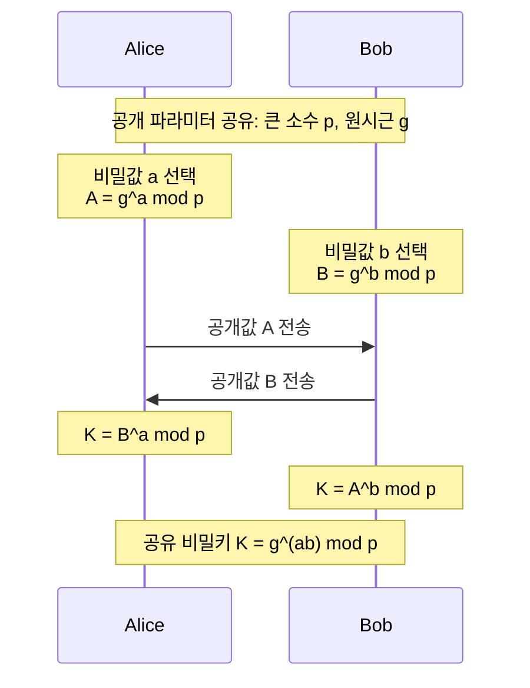

# 디피-헬만 알고리즘(Diffie-Hellman Algorithm)

---

## I. 공개 채널에서의 대칭키 합의, 디피-헬만의 개요

디피-헬만 알고리즘(Diffie-Hellman Key Exchange)은 사전 공유된 비밀키가 없는 두 통신 주체가 도청 가능한 불안전한 공개 채널을 통해 수학적 이산대수 난제를 기반으로 동일한 대칭 세션키를 안전하게 합의·도출하는 최초의 비대칭 암호학적 키 교환 프로토콜이다.

| 구분 | 내용 |
| :--- | :--- |
| **정의** | 송신자와 수신자가 사전 공유 비밀 없이 **공개 채널에서 동일한 대칭키를 합의(Key Agreement)** 하는 이산대수 기반 키 교환 [[프로토콜]] (최초의 공개키 개념) |
| **특징** | - **키 분배 문제 해결**: 비밀키를 미리 안전한 채널로 전달할 필요가 없음 - **이산대수 문제 기반**: 거듭제곱은 쉽지만 역산(로그)은 매우 어려운 난제 활용 - **인증 부재**: 상대방 신원 확인 기능이 없어 중간자 공격(MITM)에 취약 - **활용**: [[SSL-TLS\|TLS]], [[IP Sec\|IPsec]]의 세션키 교환 |

---

## II. 디피-헬만의 동작 원리 및 핵심 기술요소

### 가. 키 교환 메커니즘

<svg xmlns="http://www.w3.org/2000/svg" viewBox="0 0 640 370" width="100%" height="auto" style="max-width: 640px; width: 100%; height: auto; display: block; margin: 1.5rem auto;">
  <defs>
    <marker id="arrow-blue" markerWidth="8" markerHeight="6" refX="7" refY="3" orient="auto">
      <polygon points="0 0, 8 3, 0 6" fill="#2563EB" />
    </marker>
    <marker id="arrow-emerald" markerWidth="8" markerHeight="6" refX="7" refY="3" orient="auto">
      <polygon points="0 0, 8 3, 0 6" fill="#059669" />
    </marker>
  </defs>
  <!-- 배경 카드 -->
  <rect width="640" height="370" fill="#F9FAFB" rx="8" stroke="#E5E7EB" stroke-width="1"/>
  <!-- 열 구분 안내선 -->
  <line x1="205" y1="20" x2="205" y2="350" stroke="#E2E8F0" stroke-width="1.5" stroke-dasharray="4 4" />
  <line x1="435" y1="20" x2="435" y2="350" stroke="#E2E8F0" stroke-width="1.5" stroke-dasharray="4 4" />
  <!-- 열 헤더: 송신자 -->
  <rect x="25" y="20" width="165" height="34" rx="6" fill="#EFF6FF" stroke="#3B82F6" stroke-width="1.5"/>
  <text x="107" y="42" font-family="system-ui, sans-serif" font-size="14" font-weight="bold" fill="#1E40AF" text-anchor="middle">[ 송신자 ]</text>
  <!-- 열 헤더: 공개망 -->
  <rect x="220" y="20" width="200" height="34" rx="6" fill="#F8FAFC" stroke="#64748B" stroke-width="1.5"/>
  <text x="320" y="42" font-family="system-ui, sans-serif" font-size="14" font-weight="bold" fill="#334155" text-anchor="middle">[ 공개망 ]</text>
  <!-- 열 헤더: 수신자 -->
  <rect x="450" y="20" width="165" height="34" rx="6" fill="#ECFDF5" stroke="#10B981" stroke-width="1.5"/>
  <text x="532" y="42" font-family="system-ui, sans-serif" font-size="14" font-weight="bold" fill="#065F46" text-anchor="middle">[ 수신자 ]</text>
  <!-- 공개값 공유 박스 -->
  <rect x="230" y="66" width="180" height="30" rx="4" fill="#F1F5F9" stroke="#94A3B8" stroke-width="1.2"/>
  <text x="320" y="86" font-family="system-ui, sans-serif" font-size="12" font-weight="600" fill="#1E293B" text-anchor="middle">공개값 p와 g를 공유</text>
  <!-- 송신자 1, 2단계 -->
  <rect x="25" y="66" width="165" height="28" rx="4" fill="#DBEAFE" stroke="#2563EB" stroke-width="1.2"/>
  <text x="107" y="85" font-family="system-ui, sans-serif" font-size="12" font-weight="600" fill="#1E3A8A" text-anchor="middle">① 비밀키 'a' 생성</text>
  <rect x="25" y="100" width="165" height="28" rx="4" fill="#DBEAFE" stroke="#2563EB" stroke-width="1.2"/>
  <text x="107" y="119" font-family="system-ui, sans-serif" font-size="12" font-weight="600" fill="#1E3A8A" text-anchor="middle">② 공개키 A = gᵃ mod p</text>
  <!-- 수신자 1, 2단계 -->
  <rect x="450" y="66" width="165" height="28" rx="4" fill="#D1FAE5" stroke="#059669" stroke-width="1.2"/>
  <text x="532" y="85" font-family="system-ui, sans-serif" font-size="12" font-weight="600" fill="#064E3B" text-anchor="middle">① 비밀키 'b' 생성</text>
  <rect x="450" y="100" width="165" height="28" rx="4" fill="#D1FAE5" stroke="#059669" stroke-width="1.2"/>
  <text x="532" y="119" font-family="system-ui, sans-serif" font-size="12" font-weight="600" fill="#064E3B" text-anchor="middle">② 공개키 B = gᵇ mod p</text>
  <!-- 화살표: 공개키 A 전송 -->
  <line x1="195" y1="140" x2="442" y2="140" stroke="#2563EB" stroke-width="1.5" marker-end="url(#arrow-blue)"/>
  <text x="320" y="134" font-family="system-ui, sans-serif" font-size="12" font-weight="bold" fill="#1D4ED8" text-anchor="middle">공개키 A 전송 →</text>
  <!-- 화살표: 공개키 B 전송 -->
  <line x1="445" y1="172" x2="198" y2="172" stroke="#059669" stroke-width="1.5" marker-end="url(#arrow-emerald)"/>
  <text x="320" y="166" font-family="system-ui, sans-serif" font-size="12" font-weight="bold" fill="#047857" text-anchor="middle">← 공개키 B 전송</text>
  <!-- 송신자 3, 4단계 -->
  <rect x="25" y="188" width="165" height="28" rx="4" fill="#FFFFFF" stroke="#93C5FD" stroke-width="1.2"/>
  <text x="107" y="207" font-family="system-ui, sans-serif" font-size="12" font-weight="600" fill="#1F2937" text-anchor="middle">③ B 수신</text>
  <rect x="25" y="222" width="165" height="46" rx="4" fill="#DBEAFE" stroke="#2563EB" stroke-width="1.2"/>
  <text x="107" y="240" font-family="system-ui, sans-serif" font-size="11" font-weight="600" fill="#1E3A8A" text-anchor="middle">④ K = Bᵃ mod p</text>
  <text x="107" y="258" font-family="system-ui, sans-serif" font-size="11" font-weight="600" fill="#1E3A8A" text-anchor="middle">= (gᵇ)ᵃ mod p</text>
  <!-- 수신자 3, 4단계 -->
  <rect x="450" y="188" width="165" height="28" rx="4" fill="#FFFFFF" stroke="#6EE7B7" stroke-width="1.2"/>
  <text x="532" y="207" font-family="system-ui, sans-serif" font-size="12" font-weight="600" fill="#1F2937" text-anchor="middle">③ A 수신</text>
  <rect x="450" y="222" width="165" height="46" rx="4" fill="#D1FAE5" stroke="#059669" stroke-width="1.2"/>
  <text x="532" y="240" font-family="system-ui, sans-serif" font-size="11" font-weight="600" fill="#064E3B" text-anchor="middle">④ K = Aᵇ mod p 계산</text>
  <text x="532" y="258" font-family="system-ui, sans-serif" font-size="11" font-weight="600" fill="#064E3B" text-anchor="middle">= (gᵃ)ᵇ mod p</text>
  <!-- 송/수신자 최종 비밀키 도출 배지 -->
  <rect x="25" y="280" width="165" height="34" rx="17" fill="#EFF6FF" stroke="#3B82F6" stroke-width="1.5"/>
  <text x="107" y="302" font-family="system-ui, sans-serif" font-size="13" font-weight="bold" fill="#1E40AF" text-anchor="middle">비밀키 K 도출</text>
  <rect x="450" y="280" width="165" height="34" rx="17" fill="#ECFDF5" stroke="#10B981" stroke-width="1.5"/>
  <text x="532" y="302" font-family="system-ui, sans-serif" font-size="13" font-weight="bold" fill="#065F46" text-anchor="middle">비밀키 K 도출</text>
  <!-- 하단 동일성 확인 점선 및 텍스트 -->
  <line x1="195" y1="297" x2="445" y2="297" stroke="#64748B" stroke-width="1.5" stroke-dasharray="4 4"/>
  <rect x="255" y="283" width="130" height="28" rx="14" fill="#FEF3C7" stroke="#F59E0B" stroke-width="1.2"/>
  <text x="320" y="302" font-family="system-ui, sans-serif" font-size="12" font-weight="bold" fill="#92400E" text-anchor="middle">두 값은 동일함</text>
  <text x="320" y="335" font-family="system-ui, sans-serif" font-size="12" font-weight="bold" fill="#4B5563" text-anchor="middle">( K = gᵃᵇ mod p )</text>
</svg>

- 비밀값 $a, b$는 노출하지 않고 공개값 $A, B$만 교환하며, 도청자는 $g, p, A, B$를 알아도 $K$를 계산할 수 없음

### 나. 핵심 구성요소

|구분|요소|설명|
|---|---|---|
|**수학적 기반**|**이산대수 문제**|$y = g^x \bmod p$에서 $y$로부터 $x$를 구하기 매우 어려움|
|**공개 파라미터**|**큰 소수 $p$, 원시근 $g$**|$p$는 2048bit 이상 권장, $g$는 $1 \sim p-1$을 모두 생성하는 생성자|
|**키 생성·교환**|**비공개 값**|각자 독립적으로 생성하는 난수 $a, b$ (외부 유출 금지)|
||**공개 값**|교환하는 $A = g^a \bmod p$, $B = g^b \bmod p$|
||**공유 비밀키**|$K = g^{ab} \bmod p$, [[대칭키 암호화]]의 세션키로 사용|
|**확장**|**ECDH / [[ECDHE]]**|타원곡선 이산대수(ECDLP) 기반으로 짧은 키로 동등 보안, Ephemeral 키로 PFS 보장|
|**보안 보완**|**STS 프로토콜**|DH 교환에 전자서명·인증서를 결합해 상호 인증 제공|

---

## III. 취약점 대응 및 차세대 암호 전환

### 가. 디피-헬만 vs RSA

|비교 항목|디피-헬만|[[RSA (Rivest Shamir Adleman)\|RSA]]|
|---|---|---|
|수학적 기반|이산대수 문제|소인수분해 문제|
|목적|키 합의 (양쪽이 함께 생성)|키 전달, 암호화, [[전자 서명]]|
|인증|자체 인증 없음|개인키 서명으로 인증 가능|
|통신 방식|실시간 양방향 교환|공개키만 알면 단방향 전달|

### 나. 중간자 공격(MITM) 대응

|구분|내용|
|---|---|
|**원리**|공격자가 중간에서 양쪽에 자신의 공개값을 보내 각각 별도의 키를 합의한 뒤 세션을 탈취|
|**대응**|- **TLS 핸드셰이크**: PKI 인증서·서명으로 상대를 검증한 후 키 교환 - **IKE (IPsec)**: 인증서·서명 교환으로 피어 검증 후 DH 교환 - **PFS**: 세션마다 임시 키(DHE/ECDHE)를 사용해 장기 키 유출 시에도 과거 세션 보호 (TLS 1.3은 RSA 키 교환 폐지, ECDHE 기본)|

### 다. 양자 컴퓨팅 위협과 하이브리드 키 교환
- **쇼어 알고리즘 기반 해독 위협**: [[쇼어 & 그루버 알고리즘|쇼어 알고리즘]]이 양자 컴퓨터 상에서 다항 시간 내에 이산대수 및 타원곡선 이산대수(ECDLP)를 해결할 수 있어 고전 DH/ECDH 암호체계 전면 무력화 위협 존재.
- **하이브리드 키 교환(X25519 + ML-KEM) 도입**: 고전 타원곡선 키 교환(X25519)과 격자 기반 [[양자내성암호]](PQC, ML-KEM)를 결합하여 두 공유키를 HKDF로 추출하는 하이브리드 KEM 표준화 가속.
- **TLS 1.3 및 전방향 비밀성(PFS)의 전환**: 미래의 양자 해독에 대비해 현재 전송되는 암호문을 도청·수집 후 사후 해독하는 'Harvest Now, Decrypt Later(HNDL)' 공격을 방어하기 위해 PQC 키 교환 조기 도입 확산.

---

### 🔗 연관 토픽

- **소속 도메인**: [[00_보안_MOC|🛡️ 보안]]
- **세부 분류**: `2. 현대 암호학 & 키 관리 · 전자서명`
- **핵심 연관 토픽**:
  - [[ECDHE]]
  - [[RSA (Rivest Shamir Adleman)]]
  - [[IP Sec]]
  - [[쇼어 & 그루버 알고리즘]]
  - [[양자내성암호]]
