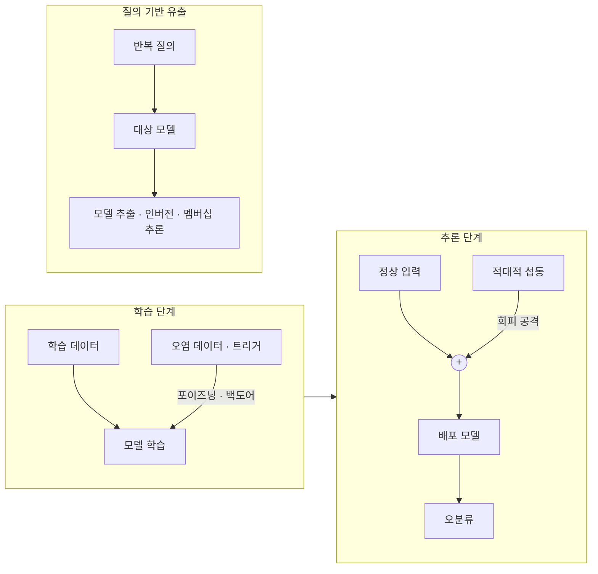

# 딥러닝 취약점

---

## I. 학습·추론 전 단계의 공격 표면, 딥러닝 취약점의 개요

### 가. 정의

- [[딥러닝]] 모델의 데이터 의존성과 고차원 결정 경계 특성을 악용하여 **학습 데이터를 오염시키거나 추론 입력을 조작해 오작동을 일으키고, 모델·학습 데이터를 유출**하는 보안 위협

### 나. 발생 원인

| 구분 | 내용 |
| --- | --- |
| 고차원 입력 공간 | 사람이 인지하지 못하는 작은 섭동으로 결정 경계를 넘김 |
| 데이터 의존성 | 대규모 외부 수집 데이터는 출처·품질 검증이 어려움 |
| 블랙박스 구조 | 판단 근거가 불투명해 이상 동작 발견이 늦음 |
| 과적합·기억 | 학습 데이터 일부를 기억해 질의로 유출 가능 |

---

## II. 공격 구조 및 유형

### 가. 단계별 공격 구조

- 학습 단계의 오염, 추론 단계의 입력 조작, 배포 모델에 대한 반복 질의로 공격이 나뉨

### 나. 공격 유형

| 구분 | 요소 | 설명 |
| --- | --- | --- |
| 무결성 (학습) | 데이터 포이즈닝 | 조작 데이터 주입으로 성능 저하·편향 유도 |
| | 백도어 | 특정 트리거 입력 시에만 오작동하도록 심음 |
| 무결성 (추론) | 회피 공격 | 적대적 예제로 오분류 유도 (FGSM, PGD, C&W) |
| 기밀성 | 모델 인버전 | 출력·신뢰도로 학습 데이터 특징 복원 |
| | 멤버십 추론 | 특정 데이터의 학습 포함 여부 추론 |
| | 모델 추출 | 대량 질의로 기능이 비슷한 복제 모델 생성 |
| 가용성 | 스펀지 공격 | 연산량을 극대화하는 입력으로 지연·비용 증가 |
| [[초거대 언어 모델\|LLM]] 특화 | [[프롬프트 인젝션]] | 입력·외부 문서에 지시를 숨겨 시스템 지시 무력화 |
| | 탈옥 | 안전장치를 우회하는 프롬프트 설계 |

---

## III. 비교 및 동향

### 가. 공격별 대응 기법

| 비교 항목 | 대응 기법 | 설명 |
| --- | --- | --- |
| 포이즈닝·백도어 | 데이터 정제·출처 관리 | [[이상치]] 탐지, 데이터 계보 관리, 백도어 탐지 |
| 회피 공격 | 적대적 학습 | 적대적 예제를 포함해 재학습, 입력 변환·인증된 강건성 |
| 멤버십 추론·인버전 | [[차분 프라이버시]] | DP-SGD로 개별 데이터 영향 제한 |
| 모델 추출 | 질의 제한·워터마킹 | API 호출량 제한, 출력 신뢰도 축소, 모델 워터마크 |
| 프롬프트 인젝션 | 입력·출력 필터, 권한 분리 | 외부 데이터와 지시 분리, 도구 호출 최소 권한 |

### 나. 동향

- **위협 지식 베이스**: MITRE ATLAS, [[OWASP Top 10 for LLM Application 2025]]로 AI 공격 기법 체계화
- **AI 거버넌스**: [[AI TRiSM]], NIST AI RMF, EU AI Act의 고위험 AI 강건성·사이버보안 요구
- **레드티밍**: 출시 전 [[AI 레드팀(Red team) 테스트|AI 레드팀 테스트]]로 탈옥·유해 출력 점검

---

### 🔗 연관 토픽

- **소속 도메인**: [[00_보안_MOC|🛡️ 보안]]
- **세부 분류**: `2. 현대 암호학 & 키 관리 · 전자서명`
- **핵심 연관 토픽**:
  - [[적대적 공격]]
  - [[OWASP Top 10 for LLM Application 2025]]
  - [[AI TRiSM]]
  - [[차분 프라이버시]]
  - [[XAI]]
