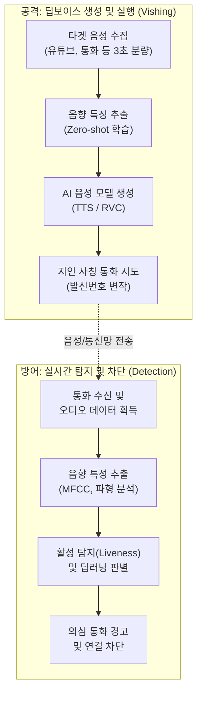

# 딥보이스 피싱 (Deep Voice Phishing)

---

## I. AI 악용 신종 금융 사기, 딥보이스 피싱의 개요

딥보이스 피싱(Deep Voice Phishing)은 생성형 인공지능 기반의 음성 합성 및 복제(Voice Cloning) 기술을 악용하여, 가족·지인이나 신뢰받는 기관 인물의 목소리와 어투를 정교하게 위조해 금전을 편취하거나 기밀 정보를 탈취하는 신종 소셜 엔지니어링 공격이다.

| 구분 | 내용 |
| :--- | :--- |
| **정의** | 생성형 AI 기반 음성 복제 기술을 악용해 지인·기관의 목소리를 위조하여 수행하는 신종 보이스피싱 |
| **등장 배경** | 2~3초 분량의 음성만으로 억양·감정을 복제하는 Zero-shot TTS 및 실시간 음성 변환(RVC) 기술의 대중화 |
| **위협 특성** | 인간의 본능적 음성 신뢰 악용, 발신번호 변작 결합으로 기존 텍스트/시그니처 기반 탐지 무력화 |

---

## II. 딥보이스 피싱의 메커니즘 개념도 및 핵심 기술 요소

### 가. 딥보이스 피싱의 개념도 및 동작 원리

### 나. 딥보이스 피싱의 핵심 기술 및 방어/탐지 요소

| 구분 | 요소기술(키워드) | 세부 설명 |
| :--- | :--- | :--- |
| **공격/생성** | **Zero-shot Voice Cloning** | 2~3초의 짧은 샘플 음성만으로도 타겟 화자의 억양, 발음 등 고유한 음향적 특성을 완벽하게 복제 |
| **공격/생성** | **생성형 AI 모델 ([[GAN (Generative Adversarial Network)\|GAN]], TTS)** | 수집된 음성 데이터를 기반으로 고품질의 합성 음성을 생성하는 [[딥러닝]](Transformer 등) 아키텍처 |
| **공격/실행** | **실시간 음성 변환 (RVC)** | 공격자의 실제 목소리를 타겟의 목소리로 실시간 매핑(Masking)하여 이질감 없는 양방향 대화 수행 |
| **공격/실행** | **발신번호 변작 (Spoofing)** | 피해자의 신뢰를 빠르게 확보하기 위해 VoIP 망 등을 악용하여 가족, 수사기관 등의 발신자 정보 조작 |
| **방어/탐지** | **활성 탐지 (Liveness Detection)** | 인간 고유의 호흡 패턴, 미세한 피치 변화 및 배경 잡음 일관성을 기계학습으로 분석하여 인간 발화 여부 판별 |
| **방어/탐지** | **MFCC 기반 스펙트럼 분석** | 인간 청각 인지 특성을 반영하여(Mel-Frequency Cepstral Coefficients) 음향 주파수에서 기계적 합성 패턴 탐지 |
| **방어/탐지** | **오디오 워터마킹 (Watermark)** | AI 음성 생성 단계에서 비가청 주파수 대역에 추적 가능한 식별 코드 삽입을 의무화하여 출처 및 변조 검증 |
| **방어/인증** | **다중 모달 인증 (MFA 연계)** | 단순 음성 생체인식 외에 기기 정보, 지식 기반(OTP), 행동 바이오메트릭스를 결합한 교차(Zero-Trust) 인증 |

---

## III. 전통적 보이스피싱과의 비교 및 향후 기술 동향

### 가. 전통적 보이스피싱 vs 딥보이스 피싱 비교

| 비교 항목 | 전통적 보이스피싱 (Vishing) | 딥보이스 피싱 (Deep Voice) |
| :--- | :--- | :--- |
| **사칭 방식** | 연기자(상담원)가 각본에 따라 수사기관/금융기관 사칭 | 타겟 실제 지인·가족의 목소리 클로닝 및 실시간 음성 변환 |
| **핵심 기술** | 사회공학적 기법, 대포통장, 중계기 발신번호 변작 | 생성형 AI(TTS, GAN, VAE), Zero-shot Cloning, RVC |
| **피해자 심리** | 공포감 조성(구속 협박, 대출 사기) | 친밀감 및 신뢰감 악용(가족 납치, 급전 요구) |
| **탐지 기법** | 블랙리스트 번호 차단, 통화 키워드(대출, 검찰) 탐지 | 음향 스펙트로그램, Liveness 활성 탐지, 온디바이스 AI |

### 나. 향후 기술 동향 및 발전 전망
- **온디바이스 AI 기반 실시간 통화 음향 탐지**: 스마트폰 AP의 NPU를 활용하여 통화 음성의 스펙트럼 이상을 로컬에서 실시간 분석함으로써 프라이버시 침해 없이 피싱 통화 즉시 경고.
- **AI 생성 오디오 워터마킹 및 규제 의무화**: [[C2PA]] 표준 및 글로벌 AI 안전 협약에 따라 상용 음성 합성 플랫폼에서의 비가청 암호화 워터마크 삽입과 모델 출처 검증 제도화.
- **연합학습(Federated Learning) 기반 범금융·통신 공조망 구축**: 민감 통화 데이터를 유출하지 않고 신종 피싱 음성 특징 모델 가중치만을 상호 공유하여 국가적 조기 대응 체계 확립.

---

### 🔗 연관 토픽

- **소속 도메인**: [[00_보안_MOC|🛡️ 보안]]
- **세부 분류**: `5. 사이버 공격 기법 & 침해사고 대응`
- **핵심 연관 토픽**:
  - [[딥페이크|딥페이크(Deepfake)]]
  - [[인공지능]]
  - [[GAN (Generative Adversarial Network)]]
  - [[DSA]]
  - [[딥러닝]]
