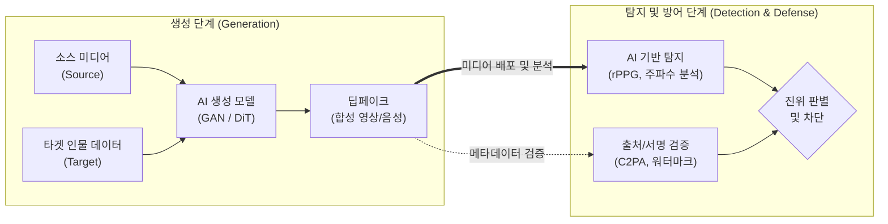

# 딥페이크(Deepfake)

---

## I. 인공지능의 역기능과 신뢰성 위협, 딥페이크의 개요

### 가. 딥페이크의 정의
- 딥러닝 생성 모델(GAN, Diffusion)을 활용하여 특정 인물의 얼굴, 신체, 음성 데이터를 정교하게 합성 및 변조함으로써 실제와 구별하기 어려운 가짜 미디어를 생성하는 인공지능 합성 기술이다.

### 나. 딥페이크의 등장 배경 및 주요 특징

| 구분 | 주요 내용 |
| --- | --- |
| 생성 모델 고도화 | 적대적 신경망(StyleGAN) 및 확산 모델(DiT)의 발전으로 초현실적(Hyper-realistic) 시청각 미디어 생성 가능 |
| 제작 진입장벽 하락 | 오픈소스 모델과 클라우드 도구의 보급으로 비전문가도 소셜미디어 사진·음성 기반 미디어 조작 가능 |
| 사회적 위협 심화 | 가짜뉴스 유포, 금융 보이스피싱(딥보이스), 불법 합성물 유포 등 심각한 디지털 신뢰성 및 안보 위협 유발 |
| 탐지 기술과의 경쟁 | 생체신호(rPPG) 및 출처 증명(C2PA) 등 방어 기술과 생성 기술 간의 적대적 공방전(Cat-and-Mouse) 지속 |

---

## II. 딥페이크의 개념도 및 핵심 기술 요소

### 가. 딥페이크의 메커니즘 및 탐지/방어 개념도

* 생성 모델(GAN/Diffusion)을 통한 합성 미디어가 유포되면, 생체신호(rPPG) 및 주파수 분석, [[C2PA]] 기반 디지털 서명 검증을 복합적으로 적용하여 진위를 판별함

### 나. 딥페이크의 핵심 기술 요소

| 구분 | 요소기술(키워드) | 세부 설명 |
| --- | --- | --- |
| **생성 기술** | **GAN / StyleGAN** | 생성자(Generator)와 판별자(Discriminator)의 적대적 학습을 통한 고해상도 얼굴 합성 및 표정/특징 제어 |
| **생성 기술** | **Diffusion / DiT** | 노이즈 주입 및 복원 과정을 거치며, 최근 [[트랜스포머]](DiT) 구조가 결합되어 초현실적 영상 생성 기능 고도화 |
| **탐지 기술** | **생체 신호(rPPG) 분석** | 딥페이크 모델이 모방하기 어려운 심박동에 따른 미세한 피부색 및 혈류 변화 신호의 부재를 포착하여 가짜 판별 |
| **탐지 기술** | **주파수 아티팩트 탐지** | 영상 변환 시 발생하는 픽셀 경계의 블렌딩 흔적이나 공간적/시간적 주파수 도메인(DCT, FFT)의 기계적 왜곡 식별 |
| **방어 기술** | **C2PA 표준 적용** | 콘텐츠의 생성-편집-배포 전 과정의 메타데이터를 [[01_IT Tech/블록체인]] 및 [[암호화]] 서명으로 기록하는 출처 증명 개방형 표준 |
| **방어/보안** | **비가시 워터마킹** | AI로 생성된 미디어의 비가청/비가시 주파수 대역에 기계만 인식 가능한 식별 코드(예: SynthID)를 강제 삽입 |
| **사전 방어** | **데이터 포이즈닝** | 사용자가 자신의 사진을 업로드할 때 사람 눈에 띄지 않는 적대적 섭동(Noise)을 추가하여 딥페이크 모델의 학습을 무력화 |
| **사전 방어** | **다중 모달 교차 검증** | 영상의 입 모양(Lip-sync)과 출력되는 음성(Audio) 간의 시공간적 불일치를 딥러닝(ViT)으로 교차 검증하여 식별 |

---

## III. 딥페이크 탐지/방어 기술 비교 및 최신 동향

### 가. 딥페이크 능동형 탐지 vs 수동형 방어 기술 비교

| 비교 항목 | AI 기반 사후 탐지 (Detection) | 콘텐츠 출처 증명 및 방어 (Provenance/Defense) |
| --- | --- | --- |
| **작동 원리** | 딥러닝으로 생체신호(rPPG), 주파수 아티팩트, 입모양 불일치 판별 | [[C2PA]] 표준 메타데이터 암호화 서명 및 비가시 워터마크(SynthID) 검증 |
| **적용 시점** | 미디어 배포 후 유포/모니터링 단계 (사후 감지) | 미디어 생성 및 편집·배포 초기 단계 (사전 예방) |
| **핵심 장점** | 메타데이터가 제거되거나 재인코딩된 영상도 내용 기반 분석 가능 | 조작 여부 및 생성 출처를 암호학적으로 확실하게 증명 가능 |
| **주요 한계** | 생성 모델 고도화에 따른 위양성/위음성(오탐/미탐) 발생 가능성 | 출처 서명이 누락되거나 위변조 방지 규격이 없는 미디어에는 적용 불가 |

### 나. 한계 극복 및 최신 발전 동향
- **글로벌 제도적 규제 의무화**: EU AI Act의 생성형 AI 투명성 의무 및 미국 AI 행정명령, 국내 법제 개정을 통해 AI 생성물에 대한 C2PA 출처 표시 및 디지털 워터마킹 삽입 의무화 확산
- **단말기 온디바이스 실시간 탐지**: 딥보이스 금융 피싱 방지를 위해 통신사 및 스마트폰 내부 NPU에서 통화 음성을 실시간 분석하여 보이스피싱을 즉각 경고하는 온디바이스 탐지 체계 도입
- **데이터 포이즈닝(Poisoning) 사전 방어**: 개인이 온라인에 사진 업로드 시 사람 눈에는 보이지 않는 적대적 섭동(Adversarial Perturbation) 노이즈를 주입하여 AI 모델의 무단 합성을 원천 차단하는 기술 상용화

---

### 🔗 연관 토픽

- **소속 도메인**: [[00_인공지능_MOC|🤖 인공지능]]
- **세부 분류**: `3. 딥러닝 핵심 아키텍처 & 신경망`
- **핵심 연관 토픽**:
  - [[GAN (Generative Adversarial Network)]]
  - [[C2PA]]
  - [[인공지능]]
  - [[트랜스포머|트랜스포머(Transformer)]]
  - [[딥러닝]]
