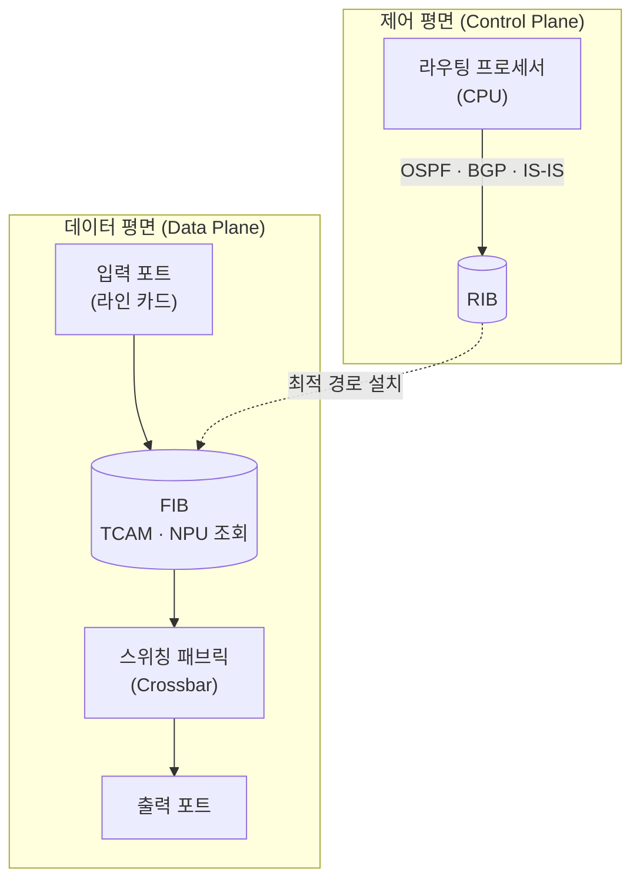

# 라우터 (Router)

---

## I. 네트워크와 네트워크를 잇는 길잡이, 라우터의 개요

### 가. 정의

- 서로 다른 네트워크를 연결하고, **OSI 3계층([[네트워크 계층]]) IP 주소를 기준으로 경로를 결정(Routing)하고 패킷을 다음 홉으로 전달(Forwarding)** 하는 장비

### 나. 특징

| 구분 | 내용 |
| --- | --- |
| 경로 결정 | 라우팅 프로토콜로 토폴로지를 학습해 최적 경로 선택 |
| 브로드캐스트 도메인 분리 | 인터페이스마다 별도 서브넷, 브로드캐스트를 넘기지 않음 |
| 이기종망 연결 | LAN·WAN 등 서로 다른 L2 매체 간 연결 |
| 평면 분리 | 제어 평면(경로 계산)과 데이터 평면(고속 전달) 분리 |
| 부가 기능 | NAT, ACL, [[QoS]], VPN 터널 |

---

## II. 구조 및 구성요소

### 가. 내부 구조

- 제어 평면이 라우팅 프로토콜로 RIB를 만들고 최적 경로만 FIB에 설치하면, 데이터 평면은 FIB를 하드웨어(TCAM·[[NPU]])로 조회해 스위칭 패브릭으로 출력 포트에 전달

### 나. 구성요소

| 구분 | 요소 | 설명 |
| --- | --- | --- |
| 제어 평면 | 라우팅 [[프로토콜]] | OSPF·IS-IS(내부), [[BGP]](외부)로 경로 학습 |
| | RIB | 학습한 모든 경로·메트릭을 담은 라우팅 테이블 |
| 데이터 평면 | FIB | RIB에서 선택된 최적 경로를 Longest Prefix Match에 맞게 변환한 포워딩 테이블 |
| | NPU · ASIC · TCAM | 패킷 헤더 파싱, 고속 주소 조회 |
| 하드웨어 | 라인 카드 | 물리 인터페이스, 입출력 버퍼 |
| | 스위칭 패브릭 | 입력 포트와 출력 포트를 연결하는 내부 교환 구조 |
| 차세대 | Segment Routing (SR-MPLS, SRv6) | 출발지가 경로(SID 목록)를 지정, LDP·RSVP-TE 없이 트래픽 엔지니어링 |
| | 분리형 라우터 (Whitebox) | 범용 하드웨어 + 개방형 NOS(SONiC 등) |
| | P4 | 데이터 평면의 패킷 처리 규칙을 프로그래밍 |

---

## III. 비교 및 동향

### 가. 전통 라우터 vs SDN·SR 기반 라우터

| 비교 항목 | 전통 IP/MPLS 라우터 | SDN·SR 기반 라우터 |
| --- | --- | --- |
| 제어 | 장비별 분산 계산 | 분산 IGP + 중앙 컨트롤러(PCE) 경로 지정 |
| 트래픽 엔지니어링 | LDP, RSVP-TE로 복잡 | SID 기반 소스 라우팅으로 단순 |
| 하드웨어 | 벤더 일체형 | Whitebox + 개방형 NOS 가능 |
| 서비스 도입 | 펌웨어 의존, 느림 | 프로그래밍으로 SFC 등 유연 |
| 적용 | 기업망, 기존 ISP망 | 통신사 코어·백홀, 데이터센터 |

### 나. 동향

- **SRv6 도입 확산**: 통신사 백본·5G 전송망에서 MPLS를 SRv6로 단순화
- **분리형 장비**: 하이퍼스케일러·통신사가 Whitebox와 SONiC 등 오픈 NOS로 비용 절감
- **운영 자동화**: 텔레메트리·[[IBN(Intent-Based Networking)|IBN]]으로 경로 최적화와 장애 대응 자동화

---

### 🔗 연관 토픽

- **소속 도메인**: [[00_네트워크_MOC|🌐 네트워크]]
- **세부 분류**: `1. OSI 7계층 & 데이터링크 계층 (L1/L2)`
- **핵심 연관 토픽**:
  - [[네트워크 계층|네트워크 계층 (Network Layer)]]
  - [[Routing Protocol]]
  - [[BGP|BGP(Border Gateway Protocol)]]
  - [[스위치 (Layer 3 Switch)]]
  - [[SDN(Software Defined Network)]]
