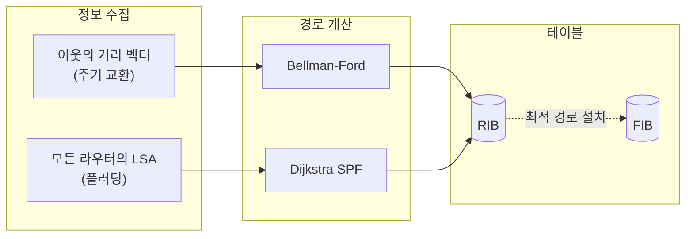

# 라우팅 알고리즘 (Routing Algorithm)

---

## I. 최적 경로를 계산하는 규칙, 라우팅 알고리즘의 개요

### 가. 정의

- [[라우터]]가 수집한 경로 정보로 **목적지별 최적 경로(최소 비용)를 계산해 라우팅 테이블을 구성하는 계산 절차** (거리 벡터, 링크 상태, 경로 벡터)

### 나. 특징 및 분류

| 구분 | 내용 |
| --- | --- |
| 정적 vs 동적 | 관리자 수동 설정 / 망 변화에 따라 자동 계산 |
| 전역 vs 분산 | 전체 토폴로지로 계산(링크 상태) / 이웃 정보로 반복 계산(거리 벡터) |
| 메트릭 기반 | 홉 수, 대역폭, 지연, 부하 등을 비용으로 사용 |
| 요구 성질 | 정확성, 빠른 수렴, 루프 방지, 확장성, 낮은 오버헤드 |
| 상세 노트 | [[거리 벡터 알고리즘]], [[링크 상태 알고리즘]], [[Routing Protocol]] |

---

## II. 구조 및 구성요소

### 가. 정보 수집에서 포워딩까지

- 거리 벡터는 이웃 정보로 Bellman-Ford를, 링크 상태는 전체 토폴로지로 [[다익스트라 알고리즘|Dijkstra]]를 수행해 RIB를 만들고 FIB에 설치

### 나. 구성요소

| 구분 | 요소 | 설명 |
| --- | --- | --- |
| [[알고리즘]] | 거리 벡터 | 이웃과 라우팅 테이블 교환, Bellman-Ford 반복 계산 |
| | 링크 상태 | 링크 상태 플러딩 후 각자 SPF 트리 계산 |
| | 경로 벡터 | AS 경로 목록으로 루프 방지, 정책 기반 선택 ([[BGP]]) |
| 비용 | 메트릭 | Hop Count, Bandwidth, Delay, Load |
| 안정성 | 수렴 (Convergence) | 변화 후 모든 라우터가 일관된 경로를 갖는 과정 |
| 루프 방지 | Split Horizon | 정보를 받은 인터페이스로 같은 정보를 다시 보내지 않음 |
| | Route Poisoning | 끊어진 경로를 무한대 메트릭(RIP 16)으로 즉시 광고 |
| | Poison Reverse | 이웃에게 배운 경로를 그 이웃에게 무한대로 되돌려 광고 |
| | Hold-down Timer | 장애 경로에 대한 불확실한 갱신을 일정 시간 무시 |
| 적용 범위 | IGP · EGP | AS 내부(RIP, EIGRP, OSPF, IS-IS) / AS 간(BGP) |

---

## III. 비교 및 동향

### 가. 거리 벡터 vs 링크 상태 vs 경로 벡터

| 비교 항목 | 거리 벡터 | 링크 상태 | 경로 벡터 |
| --- | --- | --- | --- |
| 교환 범위 | 인접 라우터 | 모든 라우터 (플러딩) | BGP 피어 |
| 교환 정보 | 라우팅 테이블 | 자신의 링크 상태 (LSA) | 경로 + AS_PATH 등 속성 |
| 갱신 | 주기적 (RIP 30초) | 변화 시 | 변화 시 (증분) |
| 계산 | Bellman-Ford | Dijkstra | 정책 기반 선택 |
| 자원 소모 | 낮음 | 높음 | 높음 (대규모 테이블) |
| 수렴·루프 | 느림, Count-to-Infinity | 빠름 | 느림, AS_PATH로 루프 방지 |
| 프로토콜 | RIP, (EIGRP: 고급 거리 벡터) | OSPF, IS-IS | BGP |

### 나. 동향

- **Segment Routing**: IGP가 SID를 배포하고 출발지가 경로를 지정, LDP·RSVP-TE 제거 (SR-MPLS, SRv6)
- **중앙 계산**: [[SDN(Software Defined Network)|SDN]] 컨트롤러·PCE가 전체 망 정보로 경로를 계산하고 [[SLA]]에 맞춰 조정
- **의도 기반 운영**: [[IBN(Intent-Based Networking)|IBN]]이 정책을 경로 설정으로 변환하고 결과를 검증

---

### 🔗 연관 토픽

- **소속 도메인**: [[00_네트워크_MOC|🌐 네트워크]]
- **세부 분류**: `2. 네트워크 계층 & 라우팅 프로토콜 (L3)`
- **핵심 연관 토픽**:
  - [[거리 벡터 알고리즘|거리 벡터 알고리즘 (Distance Vector Algorithm)]]
  - [[링크 상태 알고리즘|링크 상태 알고리즘 (Link State Algorithm)]]
  - [[Routing Protocol]]
  - [[다익스트라 알고리즘]]
  - [[라우터]]
