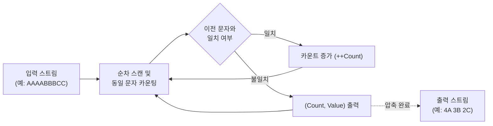

# 런랭스 코딩 (Run-Length Encoding, RLE)

---

## I. 반복 패턴 축소를 위한 무손실 압축 기법, 런랭스 코딩의 개요

### 가. 정의

- 연속적으로 반복되는 데이터(문자, 비트, 픽셀 등)를 **데이터의 원래 값(Value)과 반복 횟수(Run Count)의 쌍으로 치환하여 저장 공간을 줄이는 무손실 데이터 압축 알고리즘**

### 나. 특징 및 필요성

| 구분 | 내용 |
| --- | --- |
| 연산 단순성 | 입력 데이터를 순차적으로 1회 스캔($O(N)$)하는 단순 로직으로 인코딩/디코딩 지연 최소화 |
| 무손실 복원 | 원본 데이터의 손실 없이 $100\%$ 완벽한 복원이 가능하여 정밀 데이터에 적합 |
| 패턴 의존성 | 연속 동일 데이터(희소 행렬, 단색 이미지)에서는 압축률이 우수하나, 무작위 데이터에서는 역압축(크기 증가) 발생 |
| 복합 압축 기반 | 단독 압축보다는 지그재그 스캔(JPEG), 딕셔너리 인코딩(Parquet)과 결합한 전처리 파이프라인으로 주로 활용 |

---

## II. 개념도 및 핵심 구성요소

### 가. 개념도

- 원본 문자열을 순차 스캔하면서 동일 문자가 이어지는 동안 카운트를 누적하고, 다른 문자가 나타날 때 (반복 횟수, 값) 쌍으로 출력하여 데이터 크기 감축

### 나. 핵심 기술 요소 및 최적화 기법

| 구분 | 요소 | 설명 |
| --- | --- | --- |
| 기본 구조 | (Run, Value) 쌍 | 반복된 길이(Run Count)와 실제 데이터 값(Value)의 쌍 구조로 변환 및 복원 |
| 역압축 방지 | Escape 제어 | 반복되지 않는 데이터 구간에 특수 제어 문자를 삽입하여 원본 크기 초과 방지 |
| 전처리 변환 | Zig-zag 스캔 | JPEG 영상 압축에서 2차원 DCT 블록을 1차원으로 변환 시 연속된 0을 극대화하기 위해 지그재그 순서로 스캔 |
| 복합 최적화 | Dictionary 결합 | 가변 길이 문자열을 정수 ID로 매핑한 후, 해당 정수 배열에 RLE를 적용하여 압축 효율 극대화 (Parquet/ORC) |
| | Bit-packing | 고정 바이트(4바이트 등) 대신 최대 카운트에 필요한 최소 비트 단위로 조밀하게 패킹 |
| 응용 구조 | Zero-RLE | 희소 행렬(Sparse Matrix)이나 딥러닝 가지치기 모델에서 0이 반복되는 구간만 인코딩 |
| | Roaring Bitmap / WAH | 데이터베이스 비트맵 인덱스 압축 시 CPU 워드 단위로 RLE를 적용하여 고속 비트 연산 지원 |

---

## III. 압축 알고리즘 비교 및 동향

### 가. 무손실 압축 알고리즘 비교

| 비교 항목 | RLE (Run-Length Encoding) | 허프만 코딩 (Huffman) | LZ77 / Snappy |
| --- | --- | --- | --- |
| 압축 원리 | 연속된 동일 값의 반복 횟수 축약 | 문자의 출현 빈도 기반 가변 길이 코드 할당 | 슬라이딩 윈도우 내 이전 출현 문자열 참조 |
| 연산 복잡도 | $O(N)$ (초저연산, 단순 카운트) | $O(N \log K)$ (빈도 트리 구축 필요) | $O(N)$ (해시 기반 사전 탐색) |
| 압축 효율 | 연속 반복 패턴에만 매우 높음 | 문자 빈도 편차가 클수록 우수 | 일반 텍스트 및 로그 데이터에 고르게 우수 |
| 역압축 위험 | 무작위 데이터에서 크기 증가 위험 큼 | 트리의 오버헤드 외에는 역압축 위험 낮음 | 참조 거리 제한 등으로 역압축 억제 |
| 주 활용 분야 | 팩스(G3/G4), 비트맵 인덱스, 컬럼형 DB | JPEG 후반부 엔트로피 코딩, DEFLATE | Gzip, Snappy, Kafka/Hadoop 블록 압축 |

### 나. 동향

- **빅데이터 컬럼형 저장 포맷 표준(Apache Parquet, ORC)**: 분산 쿼리 엔진에서 정렬된 대규모 데이터 컬럼에 Dictionary 인코딩과 RLE를 결합 적용하여 디스크 I/O를 대폭 절감
- **AI 희소 텐서(Sparse Tensor) 가속**: 거대 신경망 가지치기(Pruning)로 생성된 다수의 0 가중치를 Zero-RLE로 압축하여 가속기 간 고대역폭 메모리 전송 트래픽을 최적화
- **인메모리 시계열 데이터베이스(TSDB) 인덱싱**: IoT 센서 등 동일한 수치가 장시간 유지되는 시계열 메트릭을 Roaring Bitmap 및 Gorilla 계열 RLE로 압축하여 인메모리 보관 효율 극대화

---

### 🔗 연관 토픽

- **소속 도메인**: [[00_컴퓨터구조_MOC|💻 컴퓨터구조]]
- **세부 분류**: `5. 핵심 알고리즘 & 계산 복잡도 (Algorithms)`
- **핵심 연관 토픽**:
  - [[알고리즘]]
  - [[하둡]]
  - [[허프만 코딩]]
  - [[CPU]]
  - [[GPU]]
