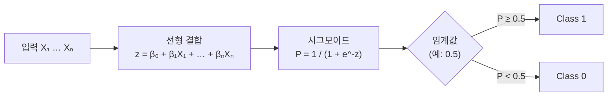

# 로지스틱 회귀분석 (Logistic Regression)

---

## I. 확률로 분류하는 선형 모델, 로지스틱 회귀분석의 개요

### 가. 정의

- 독립변수의 선형 결합을 **시그모이드 함수로 0~1 확률로 변환해 범주형 종속변수(주로 이진)를 예측**하는 분류 모델

### 나. 필요성 및 특징

| 구분 | 내용 |
| --- | --- |
| 선형 회귀의 한계 보완 | 이진 종속변수에 선형 회귀를 쓰면 예측값이 0~1 범위를 벗어나는 문제 해결 |
| 해석력 | 계수 $\beta$를 오즈비 $e^{\beta}$로 해석, 변수 영향 설명 가능 |
| 확률 출력 | 사건 확률을 반환하므로 업무 목적에 맞게 임계값 조정 가능 |
| 확장 | 다중 클래스는 소프트맥스 회귀(다항 로지스틱)로 확장 |

---

## II. 구조 및 구성요소

### 가. 동작 원리

- 선형 결합값 $z$를 시그모이드로 확률 $P$로 바꾸고 임계값으로 범주 결정

### 나. 구성요소

| 구분 | 요소 | 설명 |
| --- | --- | --- |
| 모델 | 시그모이드 | $\sigma(z) = 1/(1+e^{-z})$, 실수를 0~1로 사상 |
| | 로짓 (Logit) | $\ln\frac{P}{1-P} = z$, 로그 오즈가 독립변수와 선형 관계인 링크 함수 |
| 해석 | 오즈·오즈비 | 오즈 $= P/(1-P)$, $X_j$가 1 증가하면 오즈가 $e^{\beta_j}$배 (오즈비) |
| 학습 | 최대우도추정 (MLE) | 종속변수가 베르누이 분포를 따른다는 가정에서 우도 최대화, 닫힌 해가 없어 경사하강법·뉴턴법 사용 |
| | 로그 손실 | 음의 로그 우도 = 이진 크로스 엔트로피, 볼록 함수 |
| | 정규화 | L1·L2 패널티로 과적합·[[다중공선성]] 완화 |
| 전처리 | WoE | 범주별 사건 비율의 로그 비로 범주형 변수를 수치화 (신용평가에서 활용) |
| 평가 | [[혼동행렬]]·[[ROC 곡선\|ROC-AUC]] | 임계값별 민감도·특이도 트레이드오프 평가 |

---

## III. 비교 및 동향

### 가. 선형 회귀 vs 로지스틱 회귀

| 비교 항목 | 선형 [[회귀분석\|회귀]] | 로지스틱 회귀 |
| --- | --- | --- |
| 종속변수 | 연속형 | 범주형 (주로 0/1) |
| 목적 | 값 예측 (예: 매출) | 분류 (예: 이탈 여부) |
| 출력 범위 | $-\infty \sim \infty$ | 0~1 확률 |
| 링크 함수 | 항등 | 로짓 |
| 추정 | 최소제곱법 (OLS) | 최대우도추정 (MLE) |
| 평가 | MSE, RMSE, $R^2$ | Accuracy, F1, ROC-AUC, Log Loss |

### 나. 동향

- **해석 가능 기준 모델**: 금융 신용평가(CSS)·의료 진단처럼 설명 의무가 큰 분야에서 기준(Baseline)·운영 모델로 계속 사용 ([[XAI]])
- **복합 모델 비교·보완**: [[랜덤 포레스트]]·그래디언트 부스팅으로 성능 상한을 확인하고, 해석이 필요한 최종 모델은 로지스틱 회귀로 구성하는 방식 병행

---

### 🔗 연관 토픽

- **소속 도메인**: [[00_인공지능_MOC|🤖 인공지능]]
- **세부 분류**: `1. 수학 · 통계학 & 데이터 전처리`
- **핵심 연관 토픽**:
  - [[회귀분석|회귀분석(Regression Analysis)]]
  - [[활성화함수|활성화함수(Activation Function)]]
  - [[소프트맥스 정규화]]
  - [[혼동행렬|혼동행렬 (Confusion Matrix)]]
  - [[다중공선성|다중공선성 (Multicolinearity)]]
