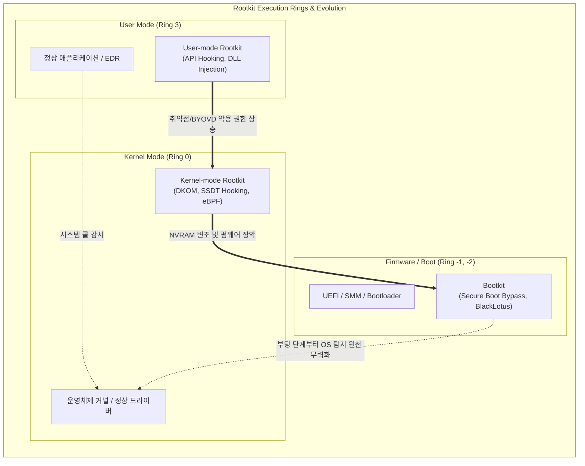

# 루트킷 (Rootkit)

---

## I. 시스템 장악 및 은폐의 핵심 위협, 루트킷의 개요

루트킷(Rootkit)은 공격자가 대상 시스템의 최고 관리자(Root/Administrator) 권한을 탈취한 후, 악성 프로세스, 네트워크 연결, 파일, 시스템 로그 등을 운영체제 커널 및 감시 도구로부터 은폐하여 지속적인 백도어 접근 권한을 유지하는 고도화된 악성 소프트웨어이다.

| 구분 | 내용 |
| :--- | :--- |
| **정의** | 최고 권한을 탈취한 후 악성코드와 침해 흔적을 OS 및 보안 솔루션으로부터 은폐하는 악성 SW |
| **진화 양상** | 유저 레벨 API 후킹 $\rightarrow$ 커널 메모리 직접 조작(DKOM) $\rightarrow$ 펌웨어/부트킷(Bootkit) 및 eBPF 은폐 |
| **핵심 위협** | 전통적 백신/EDR 가시성 원천 무력화, 합법 드라이버 악용(BYOVD), Secure Boot 우회 지속성 확보 |

---

## II. 루트킷의 계층별 개념도 및 핵심 기술 요소

### 가. 운영체제 계층별 루트킷의 구성도 및 동작 원리

### 나. 루트킷의 핵심 공격 기술 및 방어 요소

| 구분 | 요소기술(키워드) | 세부 설명 |
| :--- | :--- | :--- |
| **운영체제 은폐** | **DKOM (Direct Kernel Object Manipulation)** | 커널 메모리 내 [[프로세스]] 연결 리스트(EPROCESS 구조체 등)를 직접 조작하여 악성 프로세스 및 [[쓰레드]] 은폐 |
| **시스템 제어권 탈취** | **SSDT Hooking** | 시스템 콜 [[디스패치]] 테이블(SSDT)의 함수 포인터를 변조하여, 정상 API 호출을 악의적 함수로 우회 실행 |
| **합법 도구 악용** | **BYOVD (Bring Your Own Vulnerable Driver)** | 인증서가 유효한 취약 커널 드라이버를 로드하여 보안 솔루션(EDR/AV) 프로세스를 커널 레벨에서 강제 종료 |
| **펌웨어 장악** | **UEFI Bootkit (블랙로터스)** | OS 부팅 이전 펌웨어 단계에서 실행되어 Secure Boot를 우회하고 OS 커널에 악성 모듈을 주입 ([[CVE]]-2022-21894 악용 등) |
| **클라우드 위협** | **eBPF Rootkit** | 리눅스 커널의 고성능 모니터링 기술인 eBPF를 악용하여 [[컨테이너]] 환경의 네트워크 및 파일 접근 흔적을 스텔스하게 은폐 |
| **방어: 서명 검증** | **DSE (Driver Signature Enforcement)** | 운영체제 구동 시 디지털 서명이 없거나 유효하지 않은 커널 드라이버의 메모리 로드를 원천 차단 |
| **방어: [[무결성]] 감시** | **PatchGuard (KPP)** | 커널의 핵심 데이터 구조체(SSDT, IDT 등) 변조를 실시간으로 감시하고, 탐지 시 시스템 패닉(BSOD) 유도 |
| **방어: 하드웨어 신뢰** | **HVCI / [[TPM]] 기반 증명** | 하이퍼바이저 기반 코드 무결성(HVCI) 및 TPM을 활용하여 부트로더부터 커널까지 암호학적 신뢰 체인(Chain of Trust) 구성 |

---

## III. 동작 계층별 루트킷 비교 및 향후 기술 동향

### 가. 유저 모드 vs 커널 모드 vs 부트킷(Bootkit) 비교

| 비교 항목 | 유저 모드 루트킷 (Ring 3) | 커널 모드 루트킷 (Ring 0) | 부트킷 (Ring -1, -2) |
| :--- | :--- | :--- | :--- |
| **동작 영역** | 애플리케이션 메모리 공간 | 운영체제 커널 및 드라이버 공간 | MBR/VBR, UEFI 펌웨어, SMM |
| **주요 은폐 기법** | API 후킹, DLL 인젝션 | DKOM, SSDT 후킹, eBPF 악용 | Secure Boot 무력화, 부트로더 변조 |
| **탐지 난이도** | 보통 (백신/EDR에 의해 탐지) | 높음 (동일 권한으로 백신 무력화) | 극도로 높음 (OS 구동 전 실행) |
| **시스템 영향도** | 특정 프로세스 비정상 종료 | 블루스크린(BSOD) 발생 위험 | 펌웨어 플래싱 필요, 완전 재설치 요구 |

### 나. 향후 기술 동향 및 발전 전망
- **eBPF 기반 스텔스 클라우드 루트킷 진화**: 시스템 안정성을 해치지 않으면서 리눅스 커널 이벤트를 가로채는 eBPF 기술 악용이 클라우드 네이티브 워크로드의 핵심 위협으로 부상.
- **BYOVD 차단을 위한 취약 드라이버 블록리스트 강제**: 서명된 합법 드라이버를 무기화하는 공격에 대응해 윈도우 커널 레벨의 취약 드라이버 블랙리스트(Vulnerable Driver Blocklist) 상시 갱신 의무화.
- **하드웨어 기반 RoT 및 HVCI 격리 방어 고도화**: [[TPM]]을 활용한 보안 부팅(Secure Boot)과 하이퍼바이저 기반 코드 무결성(HVCI)을 결합하여 커널 메모리 변조를 원천 차단.

---

### 🔗 연관 토픽

- **소속 도메인**: [[00_보안_MOC|🛡️ 보안]]
- **세부 분류**: `5. 사이버 공격 기법 & 침해사고 대응`
- **핵심 연관 토픽**:
  - [[사이버 킬 체인|사이버 킬 체인 (Cyber Kill Chain)]]
  - [[프로세스]]
  - [[컨테이너|컨테이너 (Container)]]
  - [[커널|커널(Kernel)]]
  - [[OS(운영체제)]]
