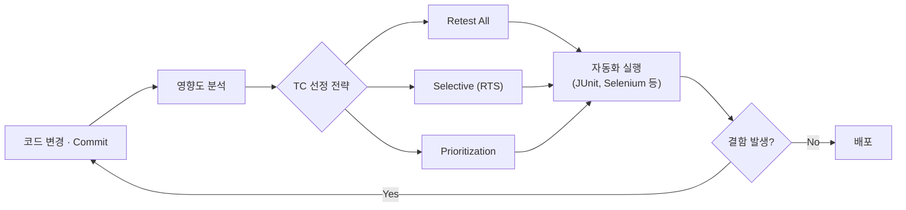

# 리그레션 테스트 (Regression Test, 회귀 테스트)

---

## I. 변경에 따른 부작용 방지, 회귀 테스트의 개요

### 가. 정의

- 코드 수정·기능 추가·패치 이후 **변경되지 않은 기존 기능에 의도치 않은 결함(Side Effect)이 생기지 않았는지** 기존 테스트 케이스를 재실행하여 검증하는 [[소프트웨어 테스트]]

### 나. 필요성 및 특징

| 구분 | 내용 |
| --- | --- |
| 파급 효과 차단 | 모듈 간 결합으로 한 곳의 수정이 다른 곳에 연쇄 결함(Ripple Effect)을 일으킴 |
| 잦은 배포 | [[Agile]]·[[DevOps]] 환경의 빈번한 변경으로 반복 검증 필수 |
| 목적 | 새 결함 탐색보다 기존 기능의 [[무결성]] 유지 |
| 자동화 의존 | 반복 실행되므로 테스트 자동화가 사실상 필수 |

---

## II. 수행 절차 및 핵심 기술

### 가. CI/CD 내 회귀 테스트

### 나. 핵심 기술 요소

| 구분 | 요소 | 설명 |
| --- | --- | --- |
| 영향 분석 | Impact Analysis | 변경이 미치는 모듈·기능 범위 식별 |
| TC 선정 | Retest All | 모든 TC 재실행, 가장 안전하지만 비용 최대 |
| | Regression Test Selection (RTS) | 변경과 의존 관계가 있는 TC만 선택 실행 |
| | Test Case Prioritization | 중요도·결함 이력·위험도 기반으로 우선 실행 |
| 추적성 | RTM (요구사항 추적 매트릭스) | 요구사항–코드–TC 간 양방향 추적 |
| 자동화 | 테스트 [[프레임워크]] | 단위(JUnit), API(REST Assured), UI(Selenium, Cypress) ([[테스트 실행 도구]]) |
| 파이프라인 | Continuous Testing | 커밋마다 자동 실행, 실패 시 배포 차단 |
| 품질 지표 | 결함 발견율, [[코드 커버리지]] | 회귀 스위트의 효과성 평가 |

---

## III. 비교 및 동향

### 가. 회귀 테스트 vs 확인 테스트 vs 단위 테스트

| 비교 항목 | 회귀 테스트 | 확인 테스트 (Re-testing) | [[단위 테스트]] |
| --- | --- | --- | --- |
| 목적 | 기존 기능이 깨지지 않았는지 확인 | 수정한 결함이 고쳐졌는지 확인 | 개별 모듈이 의도대로 동작하는지 확인 |
| 대상 | 변경되지 않은 기존 영역 | 수정된 결함 부위 | 함수·메서드·[[클래스]] |
| 시점 | 병합·빌드마다 반복 | 수정 직후 해당 건만 | 코드 작성 시 (또는 [[TDD]] 선행) |
| 자동화 | 필수 | 수동 병행 가능 | 매우 높음 |

### 나. 동향

- **테스트 스위트 비대화 대응**: AI가 변경 패턴·결함 이력·커버리지를 분석해 실패 가능성이 높은 최소 TC를 골라 실행 (AI 기반 RTS)
- **Shift-Left**: IDE·Pull Request 단계로 회귀 테스트를 앞당겨 결함 수정 비용 최소화
- **생성형 AI 활용**: [[초거대 언어 모델\|LLM]]이 변경 코드·요구사항을 바탕으로 회귀 테스트 스크립트를 생성·보완

---

### 🔗 연관 토픽

- **소속 도메인**: [[00_소프트웨어공학_MOC|🏗️ 소프트웨어공학]]
- **세부 분류**: `2. 애자일(Agile) & 지속적 통합/배포(CI/CD)`
- **핵심 연관 토픽**:
  - [[소프트웨어 테스트|소프트웨어 테스트 (Software Test)]]
  - [[단위 테스트]]
  - [[코드 커버리지]]
  - [[TDD|TDD (Test Driven Development)]]
  - [[DevOps|데브옵스 (DevOps)]]
