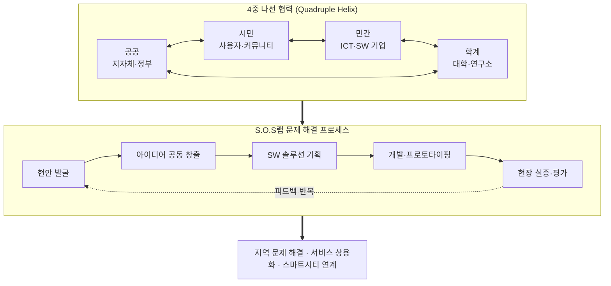

# 리빙랩 (Living Lab)과 S.O.S랩 (Solution in Our Society Lab)

---

## I. 시민 참여형 사회문제 해결 플랫폼, 리빙랩과 S.O.S랩의 개요

### 가. 정의

- **리빙랩 (Living Lab)**: 일상생활 공간을 실험실로 삼아 **사용자(시민)가 문제 정의부터 해결까지 직접 참여**하는 개방형 혁신(Open Innovation) 방식
- **S.O.S랩 (Solution in Our Society Lab)**: 리빙랩 방법론을 바탕으로 시민·지자체·기업·연구기관이 협력해 **지역 현안을 SW·ICT로 해결**하는 지역 현안 해결형 SW R&D 프로그램

### 나. 필요성

| 구분 | 내용 |
| --- | --- |
| 공급자 중심 R&D의 한계 | 기술 공급자 중심 Top-down 방식으로는 현장 체감도가 낮음 |
| 수요자 중심 해결 | 현장의 실제 문제를 시민과 함께 정의하는 Bottom-up 접근 필요 |
| 사회적 수용성 | AI·IoT 등 신기술을 실제 생활에 적용하기 위한 검증과 합의 |
| 다자 협력 | 공공·민간·시민(PPPP) 협력으로 지속 가능한 스마트시티 구현 |

---

## II. 운영 구조 및 핵심 요소

### 가. 개념도

- 시민·공공·민간·학계가 함께 현안을 정의하고, 실제 생활 공간에서 실증·평가를 반복하며 해결책을 다듬는 구조 (리빙랩 개념: MIT W. Mitchell, 2000년대 초 / 유럽 리빙랩 네트워크 ENoLL, 2006)

### 나. 핵심 구성요소

| 구분 | 요소 | 설명 |
| --- | --- | --- |
| 운영 주체 | 4중 나선 (Quadruple Helix) | 시민·공공·민간·학계의 수평적 협력 |
| 운영 환경 | Real-life Setting | 통제된 실험실이 아닌 실제 생활 공간이 테스트베드 |
| 방법론 | Co-creation | 기획·개발·실증·평가 전 과정에 사용자 참여 |
| | [[디자인 씽킹]] | 공감 기반으로 진짜 문제를 정의하고 아이디어 도출 |
| | [[Agile]] / [[MVP]] | 최소 기능 제품을 빠르게 실증하고 반복 개선 |
| 기술 | SW·ICT 융합 | IoT 센싱, 클라우드, AI 분석으로 환경·안전·교통 문제 해결 |
| 데이터 | [[공공데이터]] 개방 | 행정·교통·환경 데이터를 API로 제공해 데이터 기반 의사결정 |
| 지향 가치 | Social Impact | 기술 우수성보다 삶의 질 향상, 탄소 중립, 재난 안전 등 사회적 가치 |

---

## III. 비교 및 발전 방향

### 가. 전통적 R&D vs 리빙랩

| 비교 항목 | 전통적 R&D (Closed Innovation) | 리빙랩 / S.O.S랩 (Open Innovation) |
| --- | --- | --- |
| 혁신 주체 | 연구원·기술 공급자 | 시민·사용자 등 수요자 |
| 연구 공간 | 통제된 연구실 | 실제 생활 현장 |
| 목표 | 원천 기술, 논문·특허, 이윤 | 사회 현안 해결, 체감형 삶의 질 향상 |
| 추진 방식 | [[워터폴\|폭포수]]형 선형 절차 | 애자일 기반 반복 절차 |

### 나. 동향

- **지속가능성 확보**: 지원 종료 후 중단되는 한계를 넘기 위해 스핀오프 창업, [[ESG 경영]] 기업 투자 연계
- **스마트시티 연계**: 국가 시범 스마트시티의 데이터 허브·통합 플랫폼과 결합
- **디지털 포용**: 고령자·장애인 참여를 위한 유니버설 디자인, 생성형 AI 기반 자연어 소통 도입

---

### 🔗 연관 토픽

- **소속 도메인**: [[00_경영전략_MOC|📈 경영전략]]
- **세부 분류**: `3. 비즈니스 프로세스 혁신 & 디지털 전환 (DX)`
- **핵심 연관 토픽**:
  - [[디자인 씽킹]]
  - [[Agile]]
  - [[공공데이터]]
  - [[ESG 경영]]
  - [[시빅 해킹]]
