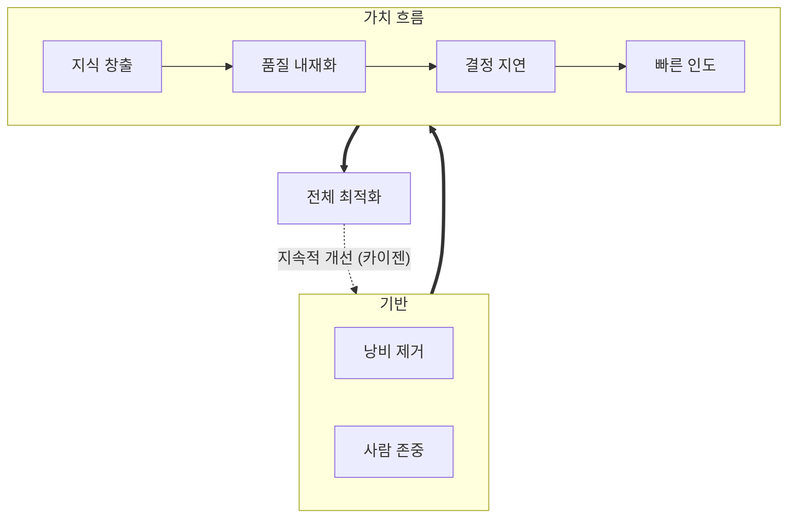

# 린 (Lean) 방법론

---

## I. 낭비를 없애고 흐름을 만드는, 린 방법론의 개요

### 가. 정의

- 도요타 생산 방식(TPS)의 **낭비 제거와 흐름 최적화** 철학을 SW 개발에 적용한 방법론으로, Poppendieck 부부가 7대 원칙으로 정리 (『Lean Software Development』 2003)

### 나. 등장 배경 및 특징

| 구분 | 내용 |
| --- | --- |
| 기원 | TPS의 JIT, 자働化(Jidoka), 카이젠, 풀(Pull) 시스템 |
| 관점 | 팀 단위보다 아이디어~배포 전체 가치 흐름(Value Stream) 최적화 |
| 낭비 정의 | 고객 가치를 만들지 않는 모든 활동 |
| 확장 | 린 스타트업, 칸반, SAFe의 린-애자일 사고로 확산 |

---

## II. 7대 원칙과 구성요소

### 가. 개념도

- 낭비를 식별·제거하고 가치 흐름을 따라 부분이 아닌 전체를 최적화하며, 이를 지속적으로 개선

### 나. 7대 원칙과 도구

| 구분 | 요소 | 설명 |
| --- | --- | --- |
| 원칙 | 낭비 제거 | SW 7대 낭비: 미완성 작업, 추가 기능, 재학습, 이관, 작업 전환, 지연, 결함 |
| | 품질 내재화 | [[TDD]], 지속적 통합, 페어 프로그래밍으로 결함을 사전에 방지 |
| | 지식 창출 | 짧은 반복·피드백·회고로 학습을 증폭 |
| | 결정 지연 | 되돌리기 어려운 결정은 마지막 책임 시점(Last Responsible Moment)까지 보류 |
| | 빠른 인도 | 작은 배치, 짧은 주기로 가치 전달·피드백 확보 |
| | 사람 존중 | 팀에 권한 위임, 자율과 몰입 환경 |
| | 전체 최적화 | 부분 최적화를 지양하고 전체 흐름 최적화 |
| 도구 | 가치 흐름 매핑 (VSM) | 가치 전달 과정을 시각화해 대기·병목 식별 |
| | 풀 시스템, WIP 제한 | 수요에 따라 작업을 당겨오고 진행 중 작업 제한 ([[Kanban (development) 프로세스\|칸반]]) |

---

## III. 비교 및 동향

### 가. 린 vs 애자일

| 비교 항목 | 린 | 애자일 |
| --- | --- | --- |
| 핵심 목표 | 낭비 제거, 흐름 최적화 | 변화 적응, 협업 |
| 관점 | 전체 가치 흐름 (조직) | 팀·프로젝트 |
| 진행 방식 | 연속 흐름 | 타임박스 반복 (스프린트) |
| 대표 기법 | 칸반, VSM, 린 스타트업 | [[SCRUM\|스크럼]], [[XP]] |
| 핵심 지표 | 리드 타임, 사이클 타임, WIP | Velocity, 번다운 |

### 나. 동향

- **린 스타트업**: 만들기-측정-학습 루프와 [[01_IT Tech/MVP|MVP]]로 신사업 가설 검증
- **SAFe 기반 철학**: 대규모 애자일의 린 포트폴리오 관리, 린 예산 수립
- **가치 흐름 관리 (VSM 플랫폼)**: [[DevOps]] 도구 데이터로 흐름 지표(리드 타임·배포 빈도)를 측정해 병목 개선

---

### 🔗 연관 토픽

- **소속 도메인**: [[00_프로젝트관리_MOC|📋 프로젝트관리]]
- **세부 분류**: `5. 애자일 프로젝트 관리 & 개발 운영 (Agile PM)`
- **핵심 연관 토픽**:
  - [[Kanban (development) 프로세스]]
  - [[01_IT Tech/MVP|MVP]]
  - [[Agile]]
  - [[DevOps|데브옵스 (DevOps)]]
  - [[SCRUM|스크럼 (SCRUM)]]
