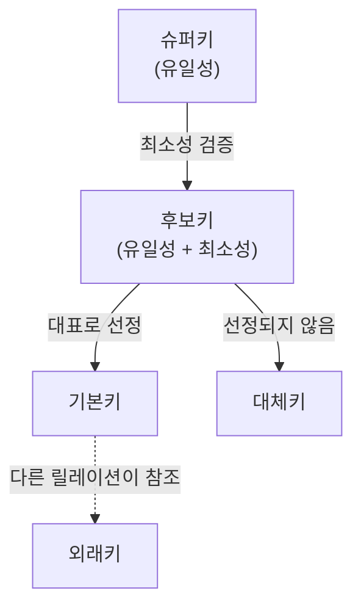

# 릴레이션 키 (Relation Key)

---

## I. 튜플 식별과 관계 연결, 릴레이션 키의 개요

### 가. 정의

- 릴레이션에서 **튜플을 유일하게 식별하거나 릴레이션 간 관계를 맺는 데 사용하는 속성 또는 속성 집합**

### 나. 특징

| 구분 | 내용 |
| --- | --- |
| 유일성 | 키 값으로 모든 튜플을 서로 구별 |
| 최소성 | 식별에 꼭 필요한 속성만으로 구성 |
| 무결성 수단 | 개체 무결성(PK), 참조 무결성(FK) 보장 ([[데이터베이스 무결성]]) |
| 성능 기반 | PK·FK가 인덱스와 [[조인]]의 기준 |

---

## II. 키의 도출 구조 및 종류

### 가. 키 도출 관계

- 슈퍼키 중 최소성을 만족하는 것이 후보키, 그중 하나를 기본키로 선정하고 나머지는 대체키

### 나. 키의 종류

| 구분 | 요소 | 설명 |
| --- | --- | --- |
| 기본 성질 | 유일성 | 같은 키 값을 가진 튜플이 둘 이상 없음 |
| | 최소성 | 속성 하나라도 빼면 유일성이 깨짐 |
| 키 종류 | 슈퍼키 (Super Key) | 유일성만 만족 (예: 학번+이름) |
| | 후보키 (Candidate Key) | 유일성과 최소성 만족 (예: 학번, 주민번호) |
| | 기본키 (Primary Key) | 후보키 중 선정한 대표 식별자, NULL·중복 불가 |
| | 대체키 (Alternate Key) | 기본키로 선정되지 않은 후보키 |
| | 외래키 (Foreign Key) | 다른 릴레이션의 기본키(또는 후보키)를 참조 |
| 설계 | 인조키 (Surrogate Key) | 업무 의미 없는 일련번호·UUID 식별자 |

---

## III. 비교 및 동향

### 가. 키 비교

| 비교 항목 | 슈퍼키 | 후보키 | 기본키 | 외래키 |
| --- | --- | --- | --- | --- |
| 조건 | 유일성 | 유일성 + 최소성 | 유일성 + 최소성 + NOT NULL | 참조 무결성 |
| NULL | 허용 가능 | 허용 가능 | 불가 | 허용 (식별 관계면 불가) |
| 중복 | 불가 | 불가 | 불가 | 허용 |
| 개수 | 여러 개 | 하나 이상 | 릴레이션당 1개 | 여러 개 |

### 나. 동향

- **인조키 활용**: 자연키 값 변경 시 연쇄 수정을 피하려고 일련번호·UUID 사용
- **분산 ID 생성**: 분산 DB·[[MSA (Micro Service Architecture)|MSA]]에서 Snowflake ID, UUIDv7처럼 시간 순 정렬 가능한 고유 키 사용
- **샤드 키 설계**: [[샤딩]] 환경에서 키 선택이 데이터 분산과 핫스팟을 좌우

---

### 🔗 연관 토픽

- **소속 도메인**: [[00_데이터베이스_MOC|🗄️ 데이터베이스]]
- **세부 분류**: `1. 데이터 모델링 & 관계형 DB 설계`
- **핵심 연관 토픽**:
  - [[엔티티|엔티티(Entity)]]
  - [[데이터베이스 무결성]]
  - [[함수적 종속성]]
  - [[조인|조인(Join)]]
  - [[스키마]]
