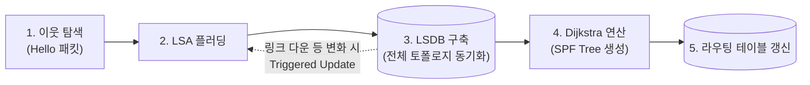

# 링크 상태 알고리즘 (Link State Algorithm)

---

## I. 전체 토폴로지 기반 최단 경로 라우팅, 링크 상태 알고리즘의 개요

### 가. 정의

- 모든 라우터가 링크 상태 정보(LSA)를 **전체 망에 플러딩**하여 동일한 토폴로지 지도(LSDB)를 만들고, **[[다익스트라 알고리즘]]** 으로 자신을 루트로 하는 최단 경로 트리(SPF Tree)를 계산하는 동적 [[라우팅 알고리즘]]

### 나. 등장 배경 및 특징

| 구분 | 내용 |
| --- | --- |
| 등장 배경 | [[거리 벡터 알고리즘]]의 느린 수렴과 라우팅 루프(Count-to-Infinity) 극복, 대규모 망 지원 |
| 전체 토폴로지 인지 | 모든 라우터가 같은 LSDB를 보유 |
| 이벤트 기반 갱신 | 변화 발생 시에만 LSA를 즉시 전파 → 빠른 수렴 |
| 계층 구조 | Area 분할로 LSDB 크기와 SPF 연산 부하 제한 |
| 자원 소모 | LSDB 저장과 SPF 계산으로 [[CPU]]·메모리 사용 많음 |

---

## II. 동작 절차 및 핵심 기술

### 가. 동작 절차

### 나. 핵심 기술 요소

| 분류 | 요소 | 설명 |
| --- | --- | --- |
| 이웃 관리 | Hello 패킷 | 이웃 발견 및 링크 활성 상태 확인 |
| 정보 단위 | LSA (Link State Advertisement) | 자신의 링크 연결 상태, 비용, 서브넷 정보 |
| 전파 | Flooding | 수신 포트를 제외한 모든 인터페이스로 LSA 전달 |
| 저장소 | LSDB | 수집한 LSA로 구성한 전체 네트워크 지도 |
| 경로 계산 | Dijkstra / SPF Tree | 자신을 루트로 루프 없는 최단 경로 트리 생성 |
| 메트릭 | Cost | 대역폭 기반 비용 (작을수록 우선) |
| 확장성 | Area | Backbone Area 중심의 계층적 분할 |
| 대표 [[프로토콜]] | OSPF, IS-IS | 기업망(OSPF), 통신사 코어망(IS-IS)의 IGP |

---

## III. 거리 벡터와의 비교 및 동향

### 가. 링크 상태 vs 거리 벡터

| 비교 항목 | 링크 상태 | 거리 벡터 |
| --- | --- | --- |
| 라우팅 시야 | 전체 토폴로지 | 이웃이 알려준 정보 |
| 교환 범위 | 모든 라우터 (Flooding) | 인접 라우터 |
| 교환 정보 | 자신의 링크 상태 | 전체 라우팅 테이블 |
| 갱신 방식 | 이벤트 기반 | 주기적 |
| 수렴·루프 | 빠름, 루프 거의 없음 | 느림, 루프 방지 기법 필요 |
| 자원 소모 | 많음 | 적음 |
| 메트릭 | 대역폭 기반 Cost | Hop Count |
| 기반 알고리즘 | Dijkstra | Bellman-Ford |
| 대표 프로토콜 | OSPF, IS-IS | RIP, IGRP |

### 나. 동향

- **Segment Routing (SR)**: OSPF·IS-IS를 확장해 출발지가 패킷 헤더에 경로(Segment)를 지정, 코어 라우터의 상태 유지 부담 감소
- **[[SDN(Software Defined Network)\|SDN]]**: 컨트롤러가 전체 망 뷰를 수집해 경로를 중앙에서 계산하는 방식으로 전환
- **데이터센터**: Spine-Leaf 구조에서 [[BGP]] 기반 언더레이와 결합

---

### 🔗 연관 토픽

- **소속 도메인**: [[00_네트워크_MOC|🌐 네트워크]]
- **세부 분류**: `2. 네트워크 계층 & 라우팅 프로토콜 (L3)`
- **핵심 연관 토픽**:
  - [[라우팅 알고리즘|라우팅 알고리즘(Routing Protocol, 거리벡터, 링크상태)]]
  - [[거리 벡터 알고리즘]]
  - [[다익스트라 알고리즘|다익스트라 (Dijkstra) 알고리즘]]
  - [[Routing Protocol]]
  - [[SDN(Software Defined Network)]]
