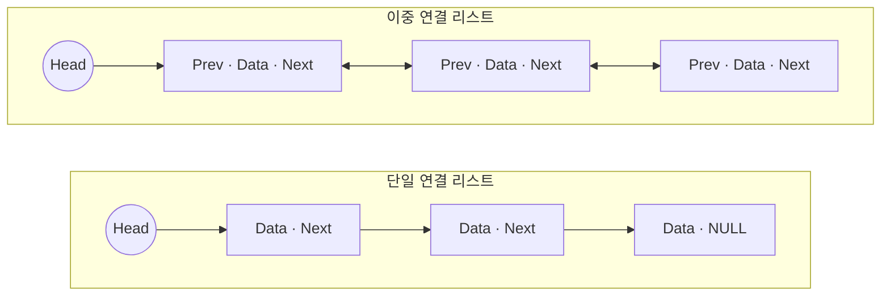

# 링크드 리스트 (Linked List)

---

## I. 포인터로 이어지는 선형 자료구조, 링크드 리스트의 개요

### 가. 정의

- **데이터와 다음 노드의 주소(포인터)를 가진 노드들을 연결**해 논리적 순서를 표현하는 동적 선형 자료구조

### 나. 특징

| 구분 | 내용 |
| --- | --- |
| 동적 크기 | 실행 중 노드를 할당·해제해 크기 변경이 자유로움 |
| 삽입·삭제 효율 | 위치를 알면 포인터만 바꿔 O(1), 원소 이동 없음 |
| 순차 접근 | k번째 원소 접근에 O(n) 탐색 필요 |
| 공간 오버헤드 | 노드마다 포인터 저장 공간 추가 |

---

## II. 구조 및 구성요소

### 가. 유형별 구조

- 노드는 메모리에 흩어져 있고 포인터로만 순서가 정해짐, 원형 리스트는 마지막 노드가 다시 Head를 가리킴

### 나. 구성요소

| 구분 | 요소 | 설명 |
| --- | --- | --- |
| 기본 요소 | 노드 (Node) | 데이터 필드 + 링크(포인터) 필드 |
| | Head / Tail | 첫 노드 / 마지막 노드를 가리키는 포인터 |
| 유형 | 단일 연결 | Next 포인터만, 한 방향 탐색 |
| | 이중 연결 | Prev·Next 포인터, 양방향 탐색, 주어진 노드 삭제 O(1) |
| | 원형 연결 | 마지막 노드가 첫 노드를 가리킴, 라운드 로빈 처리에 적합 |
| 연산 | 탐색 | O(n) 순차 탐색 |
| | 삽입·삭제 | 위치를 알면 O(1), 위치 탐색 포함 시 O(n) |
| [[메모리 관리]] | 동적 할당 | 힙 영역에서 노드 할당·해제 |

---

## III. 비교 및 동향

### 가. 링크드 리스트 vs [[배열]]

| 비교 항목 | 링크드 리스트 | 배열 |
| --- | --- | --- |
| 메모리 배치 | 비연속, 포인터로 연결 | 연속 |
| 크기 | 동적 | 고정 (동적 배열은 재할당) |
| 접근 | 순차 O(n) | 임의 접근 O(1) |
| 중간 삽입·삭제 | O(1) (위치를 알 때) | O(n) (원소 이동) |
| 추가 메모리 | 포인터 공간 | 없음 |
| 캐시 효율 | 낮음 (공간 지역성 부족) | 높음 |

### 나. 동향

- **Lock-free 리스트**: CAS 원자 연산으로 락 없이 노드를 삽입·삭제하는 병행 자료구조 (Harris 알고리즘 등)
- **시스템 활용**: 해시 맵 + 이중 연결 리스트로 [[LRU]] 캐시 구현, [[OS(운영체제)|운영체제]] 커널의 가용 블록 리스트(Free List)·Linux list_head
- **캐시 친화 변형**: 노드에 여러 원소를 담는 Unrolled Linked List, 탐색을 O(log n)으로 줄인 Skip List

---

### 🔗 연관 토픽

- **소속 도메인**: [[00_컴퓨터구조_MOC|💻 컴퓨터구조]]
- **세부 분류**: `2. 캐시 & 메모리 계층 구조 · 스토리지`
- **핵심 연관 토픽**:
  - [[배열]]
  - [[선형 자료구조와 비선형 자료구조]]
  - [[Stack]]
  - [[Queue]]
  - [[메모리 관리]]
