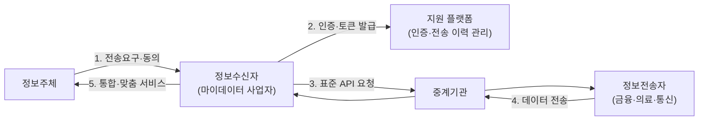

# 마이데이터 (MyData)

---

## I. 내 데이터는 내가 옮긴다, 마이데이터의 개요

### 가. 정의

- 정보주체가 **기관에 흩어진 본인 정보를 본인 또는 원하는 제3자에게 전송하도록 요구(전송요구권)하고, 이를 통합해 맞춤형 서비스에 활용하는 체계**

### 나. 등장 배경 및 특징

| 구분 | 내용 |
| --- | --- |
| 자기결정권 | 기업 중심 데이터 보유를 정보주체 중심으로 전환 |
| 법적 근거 | 금융: 신용정보법(본인신용정보관리업, 2022 본격 시행), 전 분야: 개인정보 보호법 제35조의2(2023 개정, 2025.3 시행) |
| 확산 방식 | 보건의료·통신 등 분야별로 단계적 확대 |
| 기술 특징 | 표준 API, 토큰 기반 인가, 전송 이력 관리 |

---

## II. 구조 및 구성요소

### 가. 데이터 전송 흐름

- 정보수신자는 정보주체 동의로 받은 접근 토큰으로 정보전송자의 표준 API를 호출하며, 소규모 기관은 중계기관을 경유

### 나. 구성요소

| 구분 | 요소 | 설명 |
| --- | --- | --- |
| 참여자 | 정보주체 | 전송요구권 행사·철회 |
| | 정보전송자 | 데이터를 보유하고 전송하는 기관 |
| | 정보수신자 | 데이터를 받아 서비스 제공 (마이데이터 사업자, 본인 저장소) |
| | 중계기관 | 소규모 전송자를 대신해 API 중계 |
| 인증·보안 | OAuth 2.0 | 비밀번호 대신 접근 토큰으로 권한 위임 |
| | mTLS | 기관 간 상호 인증서 검증·전송 암호화 |
| | JWS·전자서명 | 전송 데이터·요청의 위변조 방지 ([[무결성]]) |
| | FAPI | 금융 수준 OAuth 보안 프로파일 |
| 연계 | 표준 REST API | 분야별 표준 데이터 항목과 [[JSON]] 형식 |
| | 연계정보(CI) | 주민번호 대신 기관 간 동일인 식별 |
| 저장 | PDS | 정보주체가 직접 관리하는 개인 데이터 저장소 |

---

## III. 비교 및 동향

### 가. 금융 마이데이터 vs 전 분야 마이데이터

| 비교 항목 | 금융 마이데이터 | 전 분야 마이데이터 |
| --- | --- | --- |
| 근거 | 신용정보법 | 개인정보 보호법 제35조의2 |
| 대상 | 금융·신용정보 | 의료·통신·에너지 등 분야별 지정 |
| 운영 | 허가받은 본인신용정보관리회사 | 일반수신자·특수 전문기관 등 |
| 상태 | 2022년 전면 시행 | 2025년부터 분야별 단계 시행 |

### 나. 동향

- **분야 간 결합 서비스**: 금융·의료·통신 데이터를 결합한 건강·자산 관리 서비스 확대
- **프라이버시 강화 기술**: 결합 데이터의 재식별 위험에 대응해 [[가명처리 기법|가명처리]], [[영지식증명|ZKP]], 동형암호 검토
- **AI 개인 비서**: 전송받은 데이터를 LLM 에이전트가 해석해 맞춤 추천 ([[의도 경제]])

---

### 🔗 연관 토픽

- **소속 도메인**: [[00_데이터베이스_MOC|🗄️ 데이터베이스]]
- **세부 분류**: `4. 물리 저장 구조 & 인덱스 최적화`
- **핵심 연관 토픽**:
  - [[Open API 및 API|Open API API]]
  - [[데이터 가치 평가 제도]]
  - [[영지식증명|영지식증명(Zero Knowledge Proof)]]
  - [[의도 경제|의도 경제(Intention Economy)]]
  - [[공공데이터|공공데이터 (Open Data)]]
