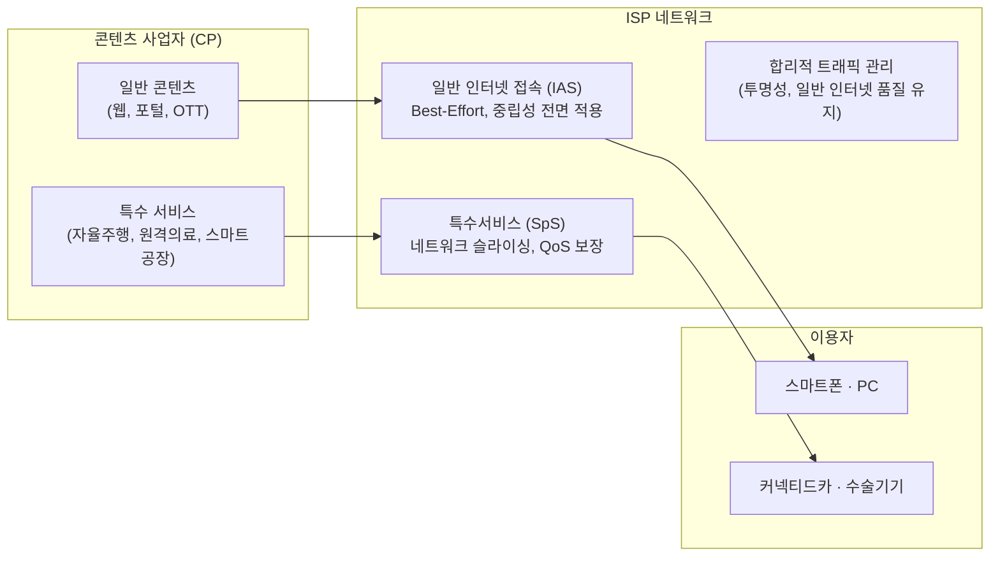

# 망 중립성 (Network Neutrality)

---

## I. 모든 트래픽의 동등 처리 원칙, 망 중립성의 개요

### 가. 망 중립성의 정의

- 인터넷접속서비스제공사업자(ISP)가 합법적인 트래픽을 **내용·서비스·단말·송수신자에 관계없이 차단·차별·감속·유료 우선처리 없이 동등하게 전송**해야 한다는 원칙

### 나. 등장 배경 및 기본 원칙

| 구분 | 내용 |
| --- | --- |
| 등장 배경 | OTT·클라우드 트래픽 급증에 따른 ISP의 차등 전송 시도 견제, 인터넷의 공공재 성격과 스타트업 혁신 생태계 보호 |
| 차단 금지 (No Blocking) | 합법적인 콘텐츠·앱·기기 접속 차단 금지 |
| 속도 저하 금지 (No Throttling) | 특정 트래픽의 고의적 지연·패킷 드롭·대역폭 축소 금지 |
| 유료 우선처리 금지 (No Paid Prioritization) | 대가를 낸 CP에게만 고속 차선(Fast Lane) 제공 금지 |
| 투명성 (Transparency) | 트래픽 관리 방식·[[TCP 혼잡제어\|혼잡 제어]] 기준 공개 |

---

## II. 이해관계 구조 및 핵심 요소

### 가. 일반 인터넷과 특수서비스 구조

### 나. 핵심 요소

| 구분 | 요소 | 설명 |
| --- | --- | --- |
| 망 관리 | 합리적 트래픽 관리 | 혼잡 완화, [[DDOS\|DDoS]]·악성코드 차단 등 최소한의 제어는 허용 |
| | [[Traffic Shaping (트래픽 쉐이핑)\|Traffic Shaping]] | 과부하 방지용 조절 기술이나 차별 수단으로 악용 가능 |
| 융합 기술 | 특수서비스 (SpS) | 특수 목적·초저지연 서비스에 조건부 예외 인정 |
| | [[네트워크 슬라이싱]] | 물리망을 [[SDN(Software Defined Network)\|SDN]]/[[NFV]]로 가상 분할해 서비스별 [[QoS]] 보장 |
| 비즈니스 | 제로 레이팅 (Zero Rating) | 특정 서비스 데이터 요금 면제, 공정경쟁 저해 시 사후 규제 |
| | 망 사용료 (Fair Share) | 대형 CP의 망 투자비 분담 논쟁, 망 중립성과는 별개 계약 쟁점으로 정리되는 추세 |
| 규제 | 각국 정책 변동 | 미국 FCC 규제의 폐지·복원 반복 등 글로벌 기준 불확실 |

---

## III. 일반 인터넷 vs 특수서비스 및 동향

### 가. IAS vs SpS

| 비교 항목 | 일반 인터넷 접속 (IAS) | 특수서비스 (SpS) |
| --- | --- | --- |
| 대상 | 모든 종단점 간 보편적 인터넷 | 제한된 단말·서버 간 특수 목적 접속 |
| 품질 | Best-Effort | 보장형 QoS (초저지연·고신뢰) |
| 망 중립성 | 전면 적용 | 요건 충족 시 예외 |
| 기반 기술 | 공용 IP 라우팅 | 5G SA·6G 슬라이싱, SDN/NFV, [[EDGE\|Edge]] |
| 제공 요건 | - | ① 특수 목적 한정 ② 일반 인터넷 품질 저하 금지 ③ 중립성 회피 목적 금지 |
| 사례 | 웹, SNS, OTT | V2X 자율주행, 원격 수술, 공장 실시간 제어 |

### 나. 엄격한 중립성 vs 유연한 규제

| 비교 항목 | 엄격한 중립성 | 유연한 규제 (최근 추세) |
| --- | --- | --- |
| 시각 | 모든 트래픽은 완전히 평등 | 서비스 특성에 따른 차등 허용 |
| 신기술 | 초저지연 서비스 제공 제약 | 특수서비스 분리 허용 |
| 규제 방식 | 사전 금지 | 사후 규제·공정경쟁 중심 |

### 다. 동향

- **망 사용료 분쟁**: 빅테크 CP와 ISP 간 비용 분담 논의(EU Fair Share 등)가 지속되며, 법원·정책은 망 중립성과 망 이용대가를 별개로 판단
- **5G/6G·AI 시대**: [[UAM]]·자율주행 등 슬라이싱 기반 서비스 확산에 맞춰 일반 인터넷 품질 모니터링과 혁신 서비스 촉진의 균형 필요

---

### 🔗 연관 토픽

- **소속 도메인**: [[00_네트워크_MOC|🌐 네트워크]]
- **세부 분류**: `3. 전송 계층 & 트래픽 / 혼잡 제어 (L4)`
- **핵심 연관 토픽**:
  - [[QoS|QoS (Quality of Service)]]
  - [[네트워크 슬라이싱]]
  - [[Traffic Shaping (트래픽 쉐이핑)]]
  - [[TCP 혼잡제어|혼잡 제어]]
  - [[SDN(Software Defined Network)]]
