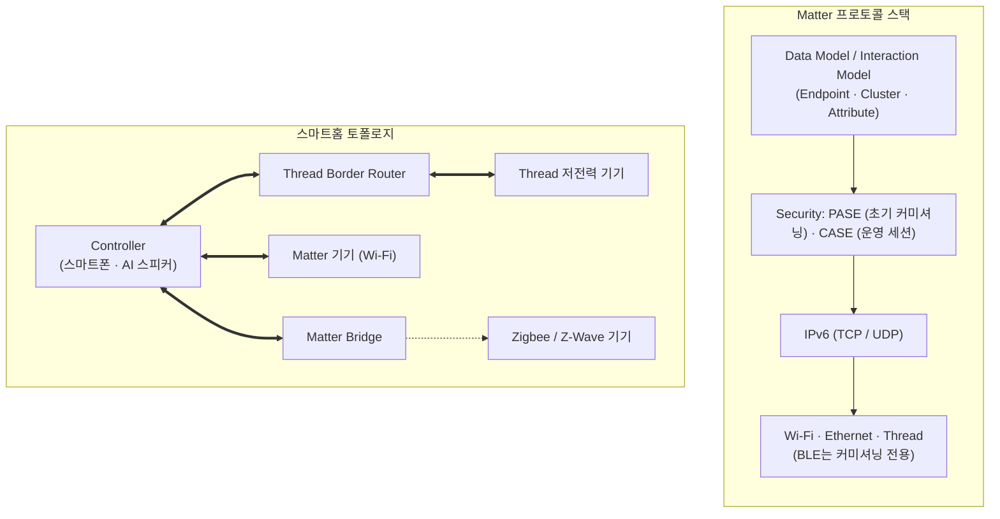

# 매터 (Matter, IoT 스마트홈 표준)

---

## I. 스마트홈 기기 간 상호운용성 표준, 매터의 개요

### 가. 매터의 정의

- CSA(Connectivity Standards Alliance) 주도로 제정된, 제조사·플랫폼에 관계없이 스마트홈 기기를 하나의 방식으로 연결·제어하기 위한 **[[IPv6]] 기반 오픈소스 응용 계층 상호운용성 표준 [[프로토콜]]**

### 나. 등장 배경 및 특징

| 구분 | 내용 |
| --- | --- |
| 플랫폼 파편화 | Apple Home, Google Home, SmartThings, Alexa 등 독자 규격으로 연동 불가 |
| 개발·인증 부담 | 제조사가 여러 생태계를 중복 지원해야 하는 비용 |
| Multi-Admin | 하나의 기기를 여러 플랫폼에 동시 등록·제어 (Multi-Fabric) |
| 로컬 우선 제어 | 클라우드를 거치지 않고 가정 내 망에서 직접 [[End-to-End]] 통신 → 저지연·프라이버시 |
| 보안 내재화 | 기기 인증서(DAC), 종단 간 [[암호화]], 분산 원장(DCL) 기반 위조 기기 차단 |

---

## II. 매터 프로토콜 구조 및 핵심 기술

### 가. 계층 구조 및 네트워크 구성

- **동작 흐름**: BLE로 기기 탐색·초기 인증(PASE) → Wi-Fi/Thread 자격 부여 → IPv6 기반 인증서 세션(CASE) 수립 → 여러 플랫폼(Fabric)에서 동시 제어

### 나. 핵심 기술 요소

| 구분 | 기술 | 설명 |
| --- | --- | --- |
| 네트워크 | Native IPv6 | 기기마다 IP를 부여해 [[게이트웨이]] 변환 없이 직접 통신 |
| | Thread | IEEE 802.15.4 기반 저전력 IPv6 메시, 자가 치유 |
| | Thread Border Router | Thread 메시와 Wi-Fi/Ethernet IP망 연결 |
| 연계 | Matter Bridge | Zigbee·Z-Wave 등 레거시 기기를 Matter 데이터 모델로 매핑 |
| 생태계 | Multi-Admin / Multi-Fabric | 플랫폼별 독립 암호 도메인으로 기기 초기화 없이 다중 바인딩 |
| 데이터 모델 | Cluster 구조 | Endpoint·Cluster·Attribute·Command·Event로 기능 표준화 |
| 보안 | PASE / CASE | 비밀번호 기반 초기 페어링 / 인증서 기반 종단 암호화 세션 |
| | DAC / DCL | 제조 시 발급되는 기기 인증서 / 분산 원장 기반 인증 정보 검증 |

---

## III. 기존 프로토콜과의 비교 및 동향

### 가. Matter vs Zigbee vs Z-Wave

| 비교 항목 | Matter | Zigbee | Z-Wave |
| --- | --- | --- | --- |
| 표준 범위 | 응용 계층 (IP 위에서 동작) | 물리 ~ 응용 전 계층 | 물리 ~ 응용 전 계층 |
| 물리 계층 | Wi-Fi, Thread, Ethernet | IEEE 802.15.4 (2.4GHz) | Sub-GHz |
| IP 연동 | Native IPv6 | Non-IP (전용 허브 필요) | Non-IP (전용 허브 필요) |
| 멀티 플랫폼 | 기본 지원 | 플랫폼별 허브 종속 | 플랫폼별 컨트롤러 종속 |
| 보안 | 기기별 DAC, CASE, DCL | 네트워크 공유 키 | AES-128 (S2) |

### 나. Matter vs OCF

| 비교 항목 | Matter | OCF |
| --- | --- | --- |
| 주도 | Apple, Google, Amazon, Samsung 등 | Intel, Samsung, Qualcomm 등 |
| 전송 계층 | IPv6 기반 Wi-Fi·Thread·Ethernet으로 한정 | 매체 독립적 |
| 확산 | 모바일 OS·스마트 스피커 기본 탑재로 빠른 확산 | 가전·B2B 위주 |

### 다. 동향

- **지원 기기 확대**: 조명·스위치·센서에서 로봇 청소기, 대형 가전, EV 충전기, 태양광 인버터, 에너지 관리 기기로 확장
- **HEMS 연계**: 실시간 전력 측정·피크 제어로 가상발전소(VPP) 생태계의 단말 표준으로 진화
- **과제**: 플랫폼별 커미셔닝 UX 차이, Thread Border Router 간 자격 공유 표준화
- **전망**: [[온디바이스 AI]]·[[앰비언트 컴퓨팅]]과 결합한 자율형 스마트홈의 연결 기반

---

### 🔗 연관 토픽

- **소속 도메인**: [[00_네트워크_MOC|🌐 네트워크]]
- **세부 분류**: `1. OSI 7계층 & 데이터링크 계층 (L1/L2)`
- **핵심 연관 토픽**:
  - [[IPv6]]
  - [[프로토콜]]
  - [[게이트웨이]]
  - [[앰비언트 컴퓨팅]]
  - [[End-to-End]]
